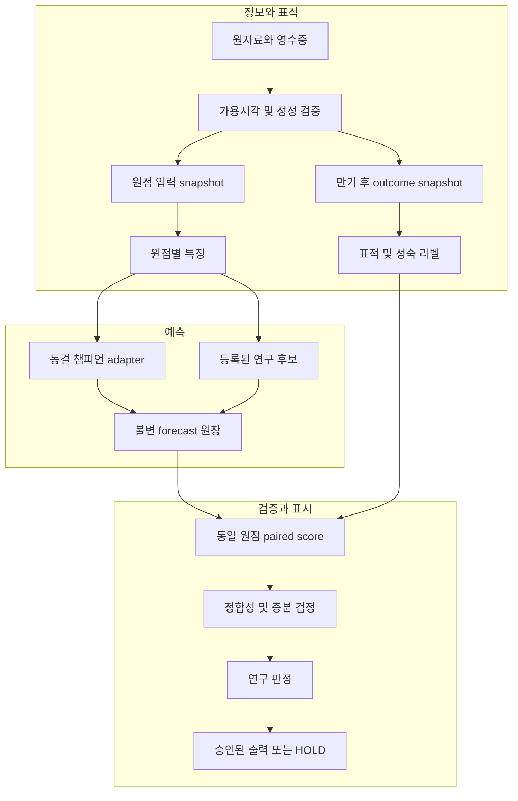
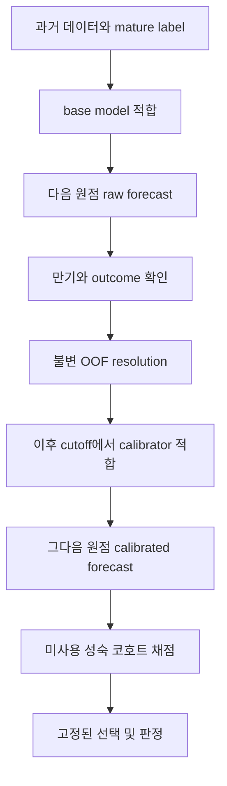

# NASDAQ 다변량 시계열 예측 고도화 설계서
## Claude Code 구현용 · 확률 정합성, 증분 예측력, 재현 가능한 검증

- 작성·자료 확인 기준: **2026-10-26**
- 문서 상태: **구현 설계안**. 새로운 모델의 성능을 검증하거나 운영 승격을 승인한 문서가 아니다.
- 내부 기준 자료: `multivariate_timeseries_explainer_20261026.md`. 원고가 명시한 저장소 기준은 `origin/main @ 91f1c12f`이다.
- 조사 범위: 공개 접근 가능한 논문 원문·저자 공개본·학회/저널 페이지, 공식 데이터베이스 문서, 공식 구현 문서. 유료 데이터 원본과 실제 예측 저장소 코드는 이번 작업에서 열람하지 않았다.
- 사용법: 이 파일을 실제 모델 저장소에 두고 **§21의 Claude Code 실행 지시문**과 함께 제공한다. 기존 HTML 리포트 저장소는 실제 모델 저장소를 대체하지 않는다.

> **핵심 판단**
>
> 우선순위는 **시간과 표적의 정합성 → 정직한 비교 실험 → 평온 상태에서의 새 위험 발생 예측 → 새로운 정보집합 검증 → 결합 경로 검증**이다.
> V8을 복잡하게 바꾸거나 변수를 더 넣는 것부터 시작하지 않는다. 현재 V13의 강한 성적에는 변동성 지속성이 포함되어 있으므로, 고도화의 성공은 **같은 조건·같은 원점의 당일 수준 기준선(PB)을 넘어서는 추가 정보**로 정의한다.

## 문서 안내

| 읽을 목적 | 해당 절 |
|---|---|
| 설계 결론과 현재 기준점 | [§1 결론](#section-1) · [§2 현행 상태](#section-2) · [§3 평가 목표](#section-3) |
| 데이터·표적·특징 | [§4 표적](#section-4) · [§5 구조](#section-5) · [§6 시간/DB](#section-6) · [§7 외부 자료](#section-7) · [§8 특징](#section-8) |
| 모델·보정·경로 | [§9 모델](#section-9) · [§10 보정](#section-10) · [§11 결합 경로](#section-11) |
| 검증과 운영 | [§12 시간 검증](#section-12) · [§13 통계](#section-13) · [§14 실험](#section-14) · [§15 판정](#section-15) · [§16 운영](#section-16) |
| 실제 구현 | [§17 코드/API](#section-17) · [§18 설정](#section-18) · [§19 테스트](#section-19) · [§20 작업 명세](#section-20) |
| Claude Code에 전달 | [§21 실행 지시문](#section-21) |
| 근거와 계산식 | [§22 연구/출처](#section-22) · [부록 A 채점 수식](#appendix-a) · [부록 B 검증 범위](#appendix-b) |

## 0. 문서를 읽는 규칙

### 0.1 사실·추론·설계를 구분한다

| 표기 | 뜻 | Claude Code의 처리 |
|---|---|---|
| **[원고 확인]** | 제공된 원고에 명시된 값·상태·경로 | 실제 저장소 계약·원장으로 다시 대조한다 |
| **[외부 근거]** | 공개 자료에서 확인한 방법·원천의 성질 | 참고문헌 ID로 원문과 조건을 확인한다 |
| **[감사 가설]** | 구조상 점검할 필요가 있으나 실제 코드에서 아직 확인하지 않은 위험 | 버그라고 단정하지 않고 재현 증거를 먼저 만든다 |
| **[설계 제안]** | 이 문서가 권하는 새 구조·인터페이스·실험 | 기존 계약을 바꾸지 않는 별도 연구 계층에 구현한다 |
| **[제안 기본값]** | 구현·연구를 구체화하기 위한 후보 설정 | 실험 전 계약에 고정한다. 기존 실측 성적과 혼동하지 않는다 |

**이 문서에 제시한 새 수식·지표·설정은 개선을 검증하기 위한 도구다. 예상 정확도, 예상 수익률, 예상 BSS/CRPS 개선 수치는 제시하지 않는다.**

### 0.2 우선 적용하는 제약

1. 실제 저장소의 `CLAUDE.md`, `AGENTS.md`, 동결 계약, 승인 원장, 보호 매니페스트를 먼저 읽는다.
2. 기존 V2/V8 커널과 V13 동결 계수·공개 판정을 덮어쓰지 않는다. 새 기능은 adapter와 별도 research namespace로 추가한다.
3. 이미 본 2007~2014, 2015~2018, 2019+ 결과를 새 모델의 청정 표본외 증거로 다시 이름 붙이지 않는다.
4. V9~V12, V13의 부정 결과를 새 버전명으로 반복하지 않는다. 재시험에는 **변경된 정보집합·표적·오류 수정 근거**가 필요하다.
5. 기존 금지사항인 딥러닝 가격 학습, 무단 학습형 결합, LLM 확률과의 산술 결합을 우회하지 않는다.
6. 신규 연구 코드 작성·합성 데이터 테스트와, 홀드아웃 소모·봉인 공개·실시간 공개·승격을 구분한다. 후자는 실제 저장소의 승인 절차를 그대로 적용한다.
7. 계약 검증에서 빈 필수 값이나 충돌이 발견되면 해당 실험을 `BLOCKED`로 기록하고, 독립적인 구현·테스트 작업은 계속한다.

### 0.3 용어를 먼저 고정한다

- **시점 정합성(Point-in-time integrity)**: 예측 시각에 실제로 이용 가능했던 데이터만 사용한다.
- **확률 보정(Calibration)**: 예측한 확률과 실현 빈도가 장기적으로 맞는지 확인한다.
- **논리적 정합성(Coherence)**: 같은 사건·같은 정보집합에서 지평·임계값·분위수 관계가 모순되지 않는다.
- **예측력(Predictive skill)**: 등록된 기준선보다 적절한 손실함수의 표본외 점수가 개선된다.
- **선명도(Sharpness)**: 보정이 유지되는 범위에서 분포가 불필요하게 넓지 않다.
- **PIT-transform**: `F_t(y_t)` 형태의 확률적분변환. 데이터의 Point-in-time과 코드 명칭을 분리한다.
- **확률의 불확실성 대역**과 **미래 실현값의 예측구간**은 다른 객체다.

---

## 1. 설계 결론: 무엇부터 바꿔야 하는가

### Thesis

**현재 시스템의 유력한 개선 방향은 대형 모델 교체보다, 검증 가능한 확률 객체와 올바른 사건 표적을 만드는 것이다.**

| 순서 | 설계 결정 | 해결할 문제 | 성공의 의미 |
|---|---|---|---|
| A | 원점·발행·수집·라벨 만기를 분리하는 데이터 계약 | 날짜만 맞고 정보 시각은 틀린 재현 | 모든 예측을 당시 정보집합으로 재생 |
| B | 하나의 분포 artifact에서 분위수·상승확률·구간을 파생 | 서로 다른 보정 결과가 한 화면에서 섞이는 위험 | CDF와 표시값의 수학적 일치 |
| C | 성숙한 OOF 예측 전용 calibration/평가 계층 | 자기 적합·라벨 지연·중첩 원점 편향 | 재학습해도 과거 예측은 불변 |
| D | V14 조건부 전이용 저차원 hazard 후보 | 지속성과 새 위험 발생을 혼동 | 같은 조건부 PB보다 나은 사건 예측 |
| E | 옵션·일중 데이터의 제한된 신규 정보 실험 | 이미 소진된 일간 변수 탐색 반복 | 정보 블록의 독립적인 증분 |
| F | 결합 경로를 별도 표적으로 검증 | 주변분포 점수를 경로 예측력으로 오인 | 경로 사건·의존구조 점수까지 통과 |
| G | 승격과 운영 중단을 분리 | 매일 점수 관찰 후 유리할 때만 승격 | 사전 고정한 성숙 코호트로 판정 |

### Insight

여기서 A~C는 **예측력 개선을 주장할 수 있게 하는 기반**이다. 이 작업만으로 시장 예측력이 생긴다고 주장하지 않는다. D~F가 실제 예측력 후보이며, 표본외 증거가 없으면 기존 챔피언을 유지하는 것이 정상적인 결과다. 확률 예측을 적절한 점수로 평가해야 한다는 근거는 [R01](#r01), 다변량 의존성을 별도로 평가해야 한다는 근거는 [R02](#r02)에 있다.

---

## 2. 현재 기준점과 반복하면 안 되는 실험

### 2.1 원고에서 확인한 현재 상태

| 트랙 | 원고의 상태·수치 | 고도화 설계의 해석 |
|---|---|---|
| V8 | `shadow.mf_dfm_varx_calibrated_v8`. 전체창 1,011원점, 장기 평균 CRPS 개선 **+4.08%**, 계약 판정 PASS | 변경하지 않는 가격 주변분포 챔피언 |
| V8 2019+ | 385원점, 장기 평균 **+4.17%**, 자체 판정 HOLD: 2008 위기 원점 없음 | 이미 공개된 준청정 비교 자료. 신규 청정 시험 아님 |
| V8 지평별 유의성 | 2019+ DM 5% 유의는 21일 **1개** | 모든 지평의 개선이 확정됐다고 표현하지 않음 |
| V8 라이브 | **49/126 세션**, 해소 **19행** | 같은 원점·중첩 지평 때문에 19개 독립 증거가 아님 |
| V9~V12 | 외생·분포층·평시 상태·first-touch 재보정의 부정 결과 | 기본 재실행 대상에서 제외 |
| V13 | 챔피언 **`persistence_pb`**, 홀드아웃 **3/9 셀** 통과 | EWMA/HAR가 현재 운영 챔피언이라고 오기하지 않음 |
| V13 개발 | rung 2~8 증분 검정 **128개**, 비퇴화 채택 **0**, 개발 예산 **8/8** 소진 | 새로운 탐색 공간을 자동으로 열지 않음 |
| V13 라이브 | 사건 <20 또는 국면 <5이면 제한; 판정은 셀당 성숙 원점 60 이후 | 최저 조건이지 검정력 확보 보장이 아님 |
| V14 | 평온→돌파 조건부 표적, 개발 **1/4**, 외부 블록 채택 **0**, 표시 없음 | 조기경보와 가장 직접적으로 연결되는 연구 표적 |
| daily6m | `predictive_validation: not_established`; 일별 상승 Brier **0.271**, 동전 기준 **0.25** | 경로 참고층. V8 통과를 승계하지 않음 |

내부 근거: 원고 §5.6, §7, §8.4, §8.6~8.10, §11.

### 2.2 현행 게이트는 상속하되 신규 실험과 섞지 않는다

| 현행 V8 조건 | 원문 값 |
|---|---|
| PIT 누수 / 영수증 연결률 | 0건 / 1.0 |
| 기존 평가의 표본·국면 | 최소 250원점, 필수 위기 3개: 2008 금융위기·2020 팬데믹·2022 긴축 |
| 단기 1·5일 CRPS | 최강 기준선보다 2% 넘게 나쁘면 안 됨 |
| 장기 21·63일 평균 개선 | ≥ +2% |
| 장기 손실차 CI90 상단 | < 0 |
| 80% 구간 적중 | 76~84% |
| 50% 구간 적중 | 45~55% |
| 위기 국면별 80% 적중 | ≥ 70% |
| 필수 시장 입력 / 달러 입력 나이 | ≤48시간 / ≤216시간 |
| 원점 나이 | 1거래일 경과 경고, 10거래일 경과 숫자 숨김 |
| 최근 26원점 운영 손실 | 기준선보다 CRPS 5% 초과 악화 시 숨김 |

**새 모델의 V8 대비 증분 검정은 위 표와 별도다.** 단순 기준선 대비 +2%를 넘었다고 이미 더 강한 V8보다 개선됐다는 뜻은 아니다. 현행 값을 변경하는 것은 이 설계서의 기본 구현 범위가 아니다.

### 2.3 재시험 차단 목록

| 이미 확인된 경로 | 다시 열 수 있는 근거 | 근거 없이 하면 안 되는 일 |
|---|---|---|
| M2·신용·MMF·VXN 등 기존 일간 외생 | 당시 정보집합에 없던 검증 가능한 새 데이터 또는 재현된 오류 수정 | 열 이름·기간·모델명만 바꿔 반복 |
| 국면 혼합·폭·재보정 조합 | 독립 데이터/별도 표적/오류 수정 | 2008 이득에 맞춘 새 가중치 탐색 |
| HAR의 V13 증분 | 실제 일중 RV 등 정보 측정 방식이 달라짐 | 같은 일간 RV로 HAR를 재실행해 새 발견으로 주장 |
| V12 first-touch 재보정 | 검증된 joint forecast 또는 새 사건 정의 | 기존 V8 주변분포에서 임의 경로 확률 산출 |
| 학습형 앙상블 | 원고의 해소 200+ 조건 및 실제 계약 충족 | 새 namespace에서 사실상 동일 결합 학습 |
| Foundation model | 허용된 독립 추론 참조층 | 과거 성과를 금융 확률 스킬로 전용하거나 V8에 자동 혼합 |

### 2.4 실제 코드에서 확인할 감사 항목

다음은 **확정된 결함이 아니다**. 구현 전에 확인해 결과를 `repository_inventory.md`에 남긴다.

| 감사 가설 | 확인할 증거 |
|---|---|
| 1일 MSE로 선택한 VARX가 장기 CRPS 목적과 불일치할 가능성 | 실제 inner objective, 후보 선택 원장, 지평별 손실 |
| DFM의 과거 smoothed state 또는 전체창 scaling이 과거 OOF에 유입될 가능성 | 원점별 입력·모수·scaler·filter/smoother cutoff |
| 입력 공통 마지막 날짜 때문에 예측 원점이 불필요하게 뒤로 밀릴 가능성 | 달러 발표 스케줄과 원점 계산 코드 |
| 보정 분위수와 상승확률이 서로 다른 분포에서 나올 가능성 | 최종 표시 계산의 artifact ID와 CDF 경로 |
| 개별 셀 확률이 지평/임계 단조성을 어길 가능성 | 같은 발행·조건의 전체 셀 벡터 |
| 조기 양성만 먼저 학습에 들어갈 가능성 | 라벨 성숙·학습 포함 조건 |
| `2019-blind` 명칭과 `2019-04-30` 절단의 역할이 혼동될 가능성 | 날짜별 read scope, feature/label cutoff, 계약의 실제 의미 |
| DTWEXB→DTWEXBGS 전환에 지수 기준 차이의 인공 변화가 생길 가능성 | 2019-01-02 전후 splice 규칙과 원자료 |
| 홀드아웃 +4.04%와 +7.34%의 집계 범위 혼동 | 원고 §8.3처럼 전체 626원점과 홀드아웃 209원점을 분리 재계산 |

---

## 3. 목표 함수: ‘예측률’ 하나로 합치지 않는다

### 3.1 표적별 평가 계약

| 출력 | 1차 점수 | 필수 보조 진단 | 기준선 |
|---|---|---|---|
| V8형 수익률 분포 | 지평별 CRPS, 등록된 장기 집계 | 50%·80% coverage와 폭, PIT-transform, 꼬리 손실 | V8 + 기존 6개 기준선 |
| 분위수만 제공하는 후보 | 동일 분위수 격자의 WIS / pinball loss | 분위수 교차, tail extrapolation 정책 | 같은 격자로 변환한 V8 |
| V13형 사건 확률 | Brier 차이 대 PB | log loss, reliability, 사건/비사건 분해, 사건 수·국면 수 | 동결 PB + 등록된 causal-refit PB + 기후 |
| V14 조건부 전이 | 동일 eligibility의 Brier 차이 | 기한별 calibration, false alarm·lead time 진단 | 조건부 PB |
| 결합 경로 | 등록된 joint score + 사건 Brier | Energy score, Variogram score, drawdown/touch/simultaneous band | 검증 대상과 동일 지평의 기존 joint kernel |
| 일중 RV 측정 기반 분산 | QLIKE 등 등록된 분산 손실 | 측정 오차·단위·overnight 분리 | 같은 정보집합의 단순 분산 예측 |

근거: CRPS·Brier·Energy score [R01](#r01), WIS [R03](#r03), Variogram score [R02](#r02), 잡음 있는 변동성 대리변수의 평가 [R10](#r10).

### 3.2 점수 계산을 고정한다

낮을수록 좋은 손실 `L`에 대해, 후보 `C`와 기준 `B`의 동일 원점 손실차:

$$
d_{t,h}=L(F^{C}_{t,h},y_{t,h})-L(F^{B}_{t,h},y_{t,h}).
$$

`d<0`가 개선이다. 원점별 비율을 평균하지 않고, 집계 skill은 다음처럼 계산한다.

$$
\operatorname{Skill}_h
=1-\frac{\sum_{t\in\mathcal I_h}L^{C}_{t,h}}
{\sum_{t\in\mathcal I_h}L^{B}_{t,h}}.
$$

- 후보와 기준은 **동일 원점·동일 target spec·동일 label revision policy**를 사용한다.
- 분모가 0 또는 수치적으로 불안정하면 skill을 만들지 않고 원 손실과 `NOT_IDENTIFIABLE`을 표시한다.
- 여러 지평을 합칠 때 가중치와 정규화 상수는 학습 구간에서 미리 고정한다. 평가창의 실현값으로 지평 가중치를 바꾸지 않는다.
- 기존 V8 게이트의 집계는 기존 구현 그대로 재현한다. 새 score를 기존 수치인 것처럼 비교하지 않는다.
- coverage를 올리려고 구간을 넓히는 변경은 폭과 proper score가 동시에 검증되어야 한다.
- threshold accuracy, AUC, 일별 상승 적중률은 보조 진단으로만 쓴다. 불균형 사건에서 정확도 하나를 최적화하지 않는다.
- 분류 가중치·oversampling을 썼다면 사전확률 변경 효과를 교정하고 실제 base rate에서 다시 보정해야 한다. 기본 설계는 확률을 왜곡하는 class weighting을 사용하지 않는다.

### 3.3 실험 결과를 세 축으로 분리한다

`calibration_pass`, `coherence_pass`, `incremental_skill_pass`를 따로 기록한다.

- 단조성 위반을 없앴다 → **정합성 개선**.
- 80% 구간의 실현 적중이 개선됐다 → **보정 개선 후보**.
- 등록된 표본외 점수가 PB/V8보다 개선됐다 → **예측력 개선 증거**.
- 시스템이 더 빨라졌다 → **운영 개선**.

이 네 결과를 하나의 ‘예측 정확도 상승’으로 합쳐 쓰지 않는다.

---

## 4. 표적 계약과 라벨 설계

### 4.1 공통 시간 축

| 필드 | 의미 |
|---|---|
| `origin_session` | 기준 지수 종가가 속한 실제 거래 세션 |
| `information_cutoff_at` | 특징으로 사용할 수 있는 정보의 마지막 UTC 시각 |
| `issued_at` | 예측이 실제로 불변 원장에 발행된 시각 |
| `target_start_session` | 사건을 판정하기 시작할 첫 미래 세션 |
| `target_end_session` | h번째 미래 세션 |
| `outcome_observed_at` | 대상 결과를 원천에서 관측할 수 있게 된 시각 |
| `label_available_at` | 승인된 확정/정정 정책까지 충족한 라벨 이용 가능 시각 |
| `label_revision_id` | 채점에 사용한 라벨의 판본 |

**원점 날짜와 발행 시각을 같은 것으로 취급하지 않는다.** 이미 지나간 첫 대상 세션의 종가를 본 뒤 과거 원점으로 예측을 발행하면 회고 자료이며 라이브 예측이 아니다. 거래일은 저장소가 선택한 실제 거래소 달력으로 계산한다. 달력 일수·평일 수로 5·21·63·126을 대체하지 않는다.

신규 prospective artifact는 변경 불가능한 `issued_at`가 **첫 대상 관측의 이용 가능 시각보다 앞서는지** 검사한다. cutoff 이후 발행 지연도 별도 기록한다. cutoff만 과거로 기입해 backdated forecast를 라이브로 등록할 수 없게 한다. 거래소 휴장·조기폐장 규칙은 공식 달력과 대조한다. [D15](#d15)

### 4.2 가격 분포 계약

$$
R_{t,h}=\log\left(\frac{P_{t+h}}{P_t}\right),\qquad h\in\{1,5,21,63\}.
$$

- 표적은 **NASDAQ Composite / NASDAQCOM**이다. NDX, QQQ, NQ를 자동 대체하지 않는다.
- price index와 total return, raw close와 adjusted close를 구분한다.
- 지수 범위는 동일한 `P_t`와 동일한 분포의 분위수로 `P_t exp(Q_{t,h}(q))`를 계산한다.
- 수익률의 percent, percentage point, decimal을 serializer에서 구분한다.
- 현재 V8의 원점·정정 규칙은 먼저 재현한다. 새로운 발행 시각 정책은 별도 계약으로 평가한다.

### 4.3 사건 확률 계약

원고의 VIX 사건은 **일중 고가 터치가 아니라 종가 기준**이다.

$$
Y^{VIX,K}_{t,h}
=\mathbf 1\left\{\max_{k=1,\ldots,h}VIX_{\operatorname{close},t+k}\ge K\right\},
\quad K\in\{25,30\}.
$$

RV 사건도 코드/계약의 `within_horizon` 여부를 먼저 확인하고, 원고와 불일치하면 자동 수정하지 말고 기록한다. within-horizon 계약일 때:

$$
Y^{RV}_{t,h}
=\mathbf 1\left\{\max_{k=1,\ldots,h}RV21_{t+k}>0.1694\right\}.
$$

| 계약 좌표 | 필수 결정 |
|---|---|
| boundary | VIX는 `>=`, RV는 `>`를 보존 |
| include_origin | 현재 종가를 미래 터치로 포함하는지 명시. 신규 제안은 미래 세션 1부터 |
| observation_field | 공식 종가 / 일중 고가를 분리 |
| horizon | 거래 세션 수와 달력 만기를 구분 |
| missing_label | 누락은 0이 아니라 `UNRESOLVED` |
| equality | 임계와 정확히 같은 값의 테스트 포함 |
| revision | 최초 이용 가능값/확정값/정정값 정책 고정 |

### 4.4 V14 eligibility는 원점에서 한 번 정한다

$$
E^{VIX}_t=\mathbf 1\{VIX_t<20\},\qquad
E^{RV}_t=\mathbf 1\{RV21_t\le0.1694\}.
$$

평가 대상은 `E_t=1`인 원점에서의 `P(Y_{t,h}=1 \mid \mathcal F_t,E_t=1)`다.

- 학습·평가·PB·기후가 같은 eligibility mask를 공유한다.
- 미래에 다시 평온한 날만 남기는 필터를 넣지 않는다.
- eligibility 밖 원점은 `NOT_ELIGIBLE`이며 확률 0을 발행하지 않는다.
- 같은 평온 국면에서 여러 원점이 발생하더라도 독립 사건 수를 늘린 것으로 세지 않는다.
- ‘평온에서 돌파’와 ‘이미 높은 변동성이 유지’는 별도 target ID로 보관한다.

### 4.5 RV21의 지속성과 새로운 위험을 분해한다

**감사 가설:** h<21에서 미래 RV21에는 원점에 이미 알려진 수익률이 남아 있다. V13의 큰 BSS를 전부 미래 충격 예측으로 해석하면 안 된다.

예를 들어, 평균을 제거하지 않는 제곱수익 합 정의라면:

$$
RV21_{t+k}^{2}
=\frac{A}{21}
\left[
\underbrace{\sum_{j=t+k-20}^{t}r_j^2}_{\text{원점에서 알려진 부분}}
+\underbrace{\sum_{j=t+1}^{t+k}r_j^2}_{\text{미래 부분}}
\right],\quad 1\le k<21.
$$

`A`는 실제 계약의 연율화 계수다. **이 식을 현재 RV 구현의 정의라고 가정하지 않는다.** sample variance, 평균 제거, ddof를 사용한다면 sum·sum of squares·표본 수를 이용한 정확한 분해로 바꾼다.

구현할 진단:

1. 각 원점·미래 세션의 `known_variance_contribution`과 기존 창에서 빠지는 관측치의 영향을 계산한다.
2. 등록된 단순 조건부 수익분포에서 미래 경로를 생성하고 동일 rolling estimator와 기간 내 최대값 연산을 적용한 **window-mechanics probability baseline**을 만든다. 미래 제곱수익의 기대값만 대입한 진단은 별도 표시하며, 기대값에 임계 indicator를 적용한 값을 사건확률이라고 부르지 않는다.
3. PB와 이 기준선에 대한 증분을 따로 보고한다.
4. 이미 알려진 구성 요소를 뺀 `forward_realized_variance`는 **별도 연구 표적**으로만 등록한다. 현행 RV21 사건을 몰래 바꾸지 않는다.
5. 과거 정보를 많이 포함하는 표적이 유용할 수 있다는 사실과, 새로운 위험을 미리 알아맞혔다는 주장을 구분한다.

### 4.6 조기 양성 편향을 막는다

**기본 라벨 정책: 완전 성숙 코호트.**

h일 사건이 일찍 발생해 양성임을 알더라도, 해당 원점의 h일 만기와 라벨 이용 가능 시각이 지날 때까지 binary 모델의 학습·보정·비교 집계에서 제외한다. 양성만 빨리 들어오고 음성은 기다리는 비대칭을 막기 위한 정책이다.

`early_event_observed_at`는 운영 메타데이터로 저장할 수 있다. 중도절단 자료를 학습에 활용하려면 별도 survival risk-set 계약을 사용해야 하며, binary 모델의 maturity 규칙을 임의로 완화하지 않는다.

---

## 5. 전체 아키텍처: 챔피언을 보호하는 연구 계층

### 프로세스 핵심

**동일한 시점 스냅숏에서 기준선과 후보를 함께 예측하고, 만기 후 같은 채점기가 비교한다.**

### 5.1 계층별 책임

| 계층 | 소유하는 사실 | 소유하면 안 되는 결정 |
|---|---|---|
| source adapter | 원본 바이트·원천 시각·수집 영수증 | 모델 채택 |
| availability policy | 해당 판이 특정 시각에 사용 가능한지 | 성과를 본 뒤 지연시간 변경 |
| snapshot builder | 선택한 observation revision 집합 | 미래 라벨을 특징에 결합 |
| target engine | eligibility·만기·라벨·검열 | 예측확률 보정 |
| model adapter | snapshot→raw forecast | 평가창 성적에 따른 무등록 변경 |
| calibration engine | 성숙 OOF→보정 상태 | 원점 당시 예측 덮어쓰기 |
| scoring engine | 같은 라벨에 대한 proper score | 가장 좋아 보이는 평가 범위 선택 |
| gate engine | 계약에 따른 PASS/HOLD/FAIL | 승인 없는 계약 완화 |
| publisher | 승인된 artifact 참조 | 숫자 재계산·이전 숫자로 fallback |

### Insight

정합성 오류를 모델 개선으로 덮지 않는다. 모델을 바꿔도 target·snapshot·scoring 계층을 공유하면 비교가 가능하고, 실패 원인을 데이터·표적·모형·보정·검정 중 어디에서 발생했는지 구분할 수 있다. 원점의 `forecast_input_snapshot`과 만기·가용 시각 이후의 `outcome_snapshot`은 다른 객체이며, Resolution은 두 ID를 모두 참조한다. 미래 outcome snapshot을 과거 특징 생성에 전달하지 않는다.

---

## 6. 데이터·DB: 시점과 정정의 증거를 보관한다

### 6.1 단일 available_at를 증거 있는 시간 계약으로 확장한다

**[외부 근거]** ALFRED의 real-time 구간은 날짜 단위이며, FRED는 원천 발표일이 자사 서비스의 실제 가용일과 일치하지 않을 수 있다고 명시한다. 따라서 `native_pit`를 장중 timestamp까지 정확하다는 의미로 확대하지 않는다. [D01](#d01) [D02](#d02)

| 제안 필드 | 타입/값 | 불변조건 |
|---|---|---|
| `observation_period_start/end` | date 또는 UTC timestamp | 경제적 관측 기간을 공개 시각으로 사용하지 않음 |
| `source_published_at` | UTC timestamp / null | 근거가 없으면 null |
| `provider_available_at` | UTC timestamp / null | 원천과 재배포 경로의 지연을 구분 |
| `first_seen_at` | UTC timestamp | 이 수집기가 바이트를 실제 받은 최초 시각 |
| `recorded_at` | UTC timestamp | canonical commit 시각 |
| `availability_lower/upper_bound` | UTC timestamp / null | 불확실한 시각은 범위로 보관 |
| `availability_precision` | exact / date / inferred / captured_only | 빈티지 등급과 별도 축 |
| `availability_policy_id` | immutable ID | 계약 hash에 포함 |
| `revision_id / supersedes_id` | immutable ID / null | 정정도 새 이벤트 |
| `provider_methodology_id` | version ID | 원천 산출 방식의 변경 추적 |
| `instrument_id / return_convention` | registry ID | COMP/NDX/price/total-return 구분 |
| `source_license_id` | registry ID | 파생·보관·표시 권한 연결 |
| `ingestion_batch_id / commit_id` | immutable ID | 완료된 배치만 snapshot에 포함 |

기존 `native_pit`, `reconstructed_market_archive`, `captured_forward` 이름과 과거 행은 보존한다. 추가 메타데이터가 없는 과거 자료를 근거 없이 exact timestamp로 승격하지 않는다.

### 6.2 두 재생 모드

| 모드 | 사용 조건 | 금지 |
|---|---|---|
| `operational_replay` | 실제 영수증과 당시 발행 snapshot의 commit checkpoint, `first_seen_at <= information_cutoff_at`, 당시 확정된 source policy | 나중에 받은 backfill·정정·새 정책을 당시 기록에 소급 |
| `historical_information_set_reconstruction` | 과거 판의 존재와 공개 범위를 증명하는 빈티지·보수적 availability policy | 재구성을 청정 라이브 증거로 표현 |

역사 재구성에서는 현재 수집한 과거 빈티지도 사용할 수 있다. 다만 `first_seen_at`는 현재 시각 그대로 기록하고, 역사적 공개 증거를 별도 필드에 둔다. 날짜만 있는 판은 정책에 따른 이용 가능 상계를 통과해야 하며, 상계 이전 장중 사용은 막는다. timezone도 입증되지 않았다면 임의의 자정 timestamp를 만들지 않는다.

### 6.3 Nasdaq 종가의 정정

Nasdaq Composite 방법론은 종가가 기초종목 Last Sale 정정 때문에 **17:15 ET까지 바뀔 수 있음**을 명시한다. 이는 17:15에 모든 공급자가 동시에 값을 제공한다는 뜻이 아니다. 역사 재현에는 해당 시기의 방법론 적용 기간과 증거를 사용하며 현재 규칙을 과거 전 기간에 자동 소급하지 않는다. [D03](#d03)

구현 규칙:

1. `anchor_price_revision`과 `terminal_price_revision`을 모두 저장한다.
2. 원천 확정 정책과 공급자 수신 시각이 충족된 뒤 라벨을 성숙시킨다.
3. 최초 채점 이후의 정정은 `restated_resolution`으로 append한다.
4. 과거 점수는 조용히 대체하지 않고 원판·정정판·영향을 함께 남긴다.
5. 정정으로 기존 결론이 바뀌면 `superseded_evidence` 또는 `invalidated_evidence`를 명시한다.
6. 최근 값만 있는 아카이브는 당시 최초판을 복원했다고 주장하지 않는다.

### 6.4 달러지수: 관측일·발표일·방법론 전환을 분리한다

H.10은 직전 영업주의 일별 자료를 주간으로 발표한다. ‘일별 관측값’이라는 표기가 매일 실시간으로 알 수 있었다는 뜻은 아니다. [D05](#d05)

**우선 감사할 구체적 불일치:**

- [원고 확인] `2019-01-02`에 DTWEXB→DTWEXBGS 전환.
- [외부 근거] 연준은 새 달러지수 방법론의 `2019-02-04` 적용과 과거 구간 소급 계산을 설명한다. [D16](#d16)

두 날짜의 차이가 실제 누수를 뜻하는지는 코드·빈티지 조회 후 판단한다. 검사 항목은 다음과 같다.

| 검사 | 실패 사례 | 수정 후보 |
|---|---|---|
| 방법론 공개 전 이용 | 새 방법론 backcast를 공개 전 원점에 사용 | 원점 당시 존재한 series version만 선택 |
| 지수 척도 | 다른 base의 level을 이어 log difference 계산 | 같은 정의 안의 return을 계산한 뒤 연결 |
| overlap scaling | 미래 전체 overlap으로 과거 level 보정 | 해당 cutoff 이전 overlap만 사용 |
| 공개 지연 | 주간 발표 이전 일별값을 미리 채움 | 발표 batch 전체에 availability 부여 |
| stale 처리 | 오래된 level 반복을 실제 0% 변화로 오인 | update flag·age·missingness 분리 |

동결 V8의 재현과 정정 후보의 연구 결과를 별도 보관한다. 잘못된 자료 사용이 확인되면 먼저 증거의 유효성을 정리하고 그 위에서 새 실험을 한다.

### 6.5 비동기 as-of snapshot

원점은 표적 시장의 완료된 세션과 실제 발행 정책에서 정한다. 각 입력은 독립적으로 `effective_available_at <= cutoff`를 만족하는 최신 판을 선택한다.

~~~python
# 설계 의사코드. 특정 DB/라이브러리의 기존 API가 아니다.
def build_snapshot(cutoff, replay_mode, source_specs, ledger_checkpoint):
    events = committed_events(ledger_checkpoint)
    visible = apply_availability_policy(
        events, cutoff=cutoff, replay_mode=replay_mode
    )
    history = resolve_latest_visible_revision_per_observation_period(visible)
    heads = select_latest_visible_period_per_series(history)
    heads = attach_age_missing_update_flags(heads, cutoff)
    validate_sources_units_calendar_and_receipts(history, source_specs)
    return freeze_snapshot(history, heads, source_specs, ledger_checkpoint)
~~~

- 가용 시각을 필터링한 뒤 `(series_id, observation_period)`별 판본을 선택해 전체 과거 history를 보존한다. 계열당 최신 한 행만 남기면 DFM·lag·RV 계산에 필요한 이력이 사라진다. 최신 head와 age는 그 history 위에서 별도로 계산한다. 단순 `observation_date <= origin_date` 조인은 부족하다.
- 늦은 달러 때문에 최신 주가 원점을 뒤로 묶는 현상을 측정한다.
- `age_since_observation`과 `age_since_publication`을 구분한다.
- 기존 정렬 / as-of+age / 같은 원점에서 달러 제외를 하나의 제한된 ablation으로 비교할 수 있다.
- 발행 시각이 달라지는 후보는 **공통 발행 정책·공통 eligible 원점 비교**와 **서비스 최신성 비교**를 분리한다.
- 기존 48시간·216시간 gate는 그대로 재현한다. 새 원점 정책을 검증 없이 운영에 넣지 않는다.

### 6.6 데이터베이스 선택

**권고: canonical JSONL + 원본 보존을 유지하고, Parquet/DuckDB를 읽기 중심의 파생 분석층으로 사용한다.**

| 계층 | 권장 형태 | 재생성 가능성 |
|---|---|---|
| raw evidence | 원본 gzip + SHA-256 + 영수증 | 원본 자체는 불변 |
| canonical event | 기존 append-only JSONL | 정본 |
| snapshot manifest | 정렬된 ID/hash/정책 JSON | 정본 증거로부터 생성 |
| observations/features/labels/losses | partitioned Parquet | 항상 재구축 가능 |
| ad hoc 분석 | read-only DuckDB views | 캐시 |
| serving | forecast artifact + verdict + latest pointer | 원장·계약으로 재생 |

DuckDB의 일반 in-process 동시성 모델을 확인하고 단일 writer를 설계한다. 여러 workflow가 같은 DB나 JSONL에 독립적으로 쓰도록 만들지 않는다. [I07](#i07)

DB 교체는 예측력 증거가 아니다. profile 결과 병목이 확인된 부분만 projection·cache로 개선한다.

### 6.7 snapshot과 cache key

~~~yaml
# 신규 스키마 제안: 실제 값은 실행 환경에서 산출한다.
snapshot:
  snapshot_id: null
  schema_version: null
  replay_mode: null
  information_cutoff_at: null
  ledger_checkpoint_id: null
  transaction_cutoff_at: null
  observation_revision_ids_hash: null
  raw_receipts_hash: null
  source_specs_hash: null
  availability_policy_hash: null
  target_contract_hash: null
  calendar_hash: null
  transform_code_hash: null
  environment_lock_hash: null
~~~

필수 null을 가진 객체는 draft만 허용하며 모델 실행 입력으로는 거부한다.

DFM cache에는 원고의 계약·cutoff·입력 hash 외에도 실제로 결과에 영향을 주는 **모델 코드, 변환 정책, 라이브러리 lock, scaler, 모수 fit cutoff**를 포함한다. 변경된 policy로 과거 cache를 재사용하지 않는다.

- canonical JSON의 키 순서·배열 순서·Unicode·숫자 직렬화 정책을 고정한다.
- 원본 바이트 hash와 정규화된 의미 payload hash를 구분한다.
- API key·쿠키·서명 URL을 로그와 hash 입력에 넣지 않는다.
- 같은 실행 환경에서는 기존 bit identity 요구를 지킨다. 다른 CPU/BLAS까지 seed 하나로 bit identity가 보장된다고 주장하지 않는다.
- 외부 의존성을 무조건 최신으로 올리지 않는다. 기존 lock을 먼저 재현하고 필요한 변경만 별도 검증한다.

---

## 7. 외부 데이터·논문 DB 검토와 도입 판단

### Thesis

**새 정보집합은 ‘당일 변동성 수준’에 아직 반영되지 않은 정보를 제공해야 한다. 원천의 수가 늘어나는 것 자체는 개선이 아니다.**

### 7.1 원천별 판단

| 원천·DB | 제공 정보와 현재 확인 범위 | 권장 사용 | 필수 제약 |
|---|---|---|---|
| FRED/ALFRED | 거시·금리·지수와 빈티지 날짜 [D01](#d01) [D02](#d02) | 기존 시간 정합성 강화 | 현재판 default 조회 차단, 발표 timestamp 별도 |
| Nasdaq COMP | 지수 정의·종가·정정 방법론 [D03](#d03) | 표적 고정 | NDX·QQQ와 동일시 금지 |
| Cboe VIX 역사 | 공식 일별 변동성 지수 이력 [D04](#d04) | 기존 VIX 입력·라벨 | 현재 아카이브와 당시 수집 판 구분 |
| Cboe 상수만기 지표 | VIX9D·VIX3M 등 기간구조 [D14](#d14) | 기존 VXN과 다른 가설일 때 제한 연구 | VIX futures curve와 구별 |
| Federal Reserve H.10 | 주간 공개되는 일별 달러 자료 [D05](#d05) [D16](#d16) | latency와 splice 감사 | backcast 공개일·관측일 분리 |
| Federal Reserve EBP | 개정 가능 연구 계열 [D06](#d06) | captured-forward 후보 | 현재 전체 이력을 과거에 소급하지 않음 |
| Treasury XML | 공식 국채 수익률 곡선 [D11](#d11) | 금리 정의·시각 정합성 | par yield/실거래/zero rate 혼동 금지 |
| FRED-MD/QD | 거시 연구용 패널·historical vintages [D10](#d10) | DFM 연구 대조 자료 | `current.csv` 전체기간 주입 금지 |
| Cboe DataShop | 옵션 NBBO·거래·일중 자료의 공식 상품 [D07](#d07) [D17](#d17) | 옵션 새 정보 블록 | 심볼·역사 범위·배달 시각·별도 지수 권한 확인 |
| OptionMetrics | IvyDB EOD·Intraday 옵션 표면·원호가 관련 자료 [D08](#d08) | 장기 옵션 가설 검토 | 파생 IV 계산법·정정·당일 가용성 확인 |
| Databento OPRA | 옵션 호가/체결, feed별 event/receive timestamp [D09](#d09) | 시간 증거가 있는 시장 자료 | vendor 수신 시각과 우리 수신 시각 분리 |
| SEC EDGAR | 공시 제출·XBRL 공개 API [D12](#d12) | 후순위 기업/지수 breadth 연구 | 당시 구성종목·공개시각·정정·생존편향 처리 |

위 표의 유료 DB는 **공식 공개 문서만 확인**했다. 계정 접근, 구매, 실제 전 기간 자료 확보, 프로젝트의 재배포 권한 확인을 완료한 것이 아니다. 구독료나 수집 비용 숫자는 추정하지 않는다.

### 7.2 우선 검토할 새로운 정보 블록

| 블록 | 가설 | 원점 특징 예 | 구별할 기준선 | 중단 조건 |
|---|---|---|---|---|
| 옵션 기간구조 | 같은 현재 변동성에서도 미래 위험의 가격 구조가 다름 | 동일 기초자산·만기별 implied variance, slope | 동일 eligibility PB + 기존 수준/age | 현재 수준을 넘는 forward 증분 없음 |
| 옵션 skew | 하방 tail 가격이 새 위험 정보를 포함 | 고정 delta/maturity skew·호가 품질 | 수준/기간구조까지만 쓴 모델 | 희소·불안정 호가가 효과를 지배 |
| 일중 realized measure | 일별 종가가 버린 intraday path 정보가 다음 위험에 도움 | RV·semivariance·jump proxy·overnight 분리 | 기존 일간 RV 기반 PB/단순 모형 | proxy 기초자산 차이 또는 발표 지연 설명으로 효과 소멸 |
| breadth/집중도 | 일부 종목 약세가 지수 위험 전이에 앞섬 | 당시 구성종목 기준 참여도·집중도 | VIX/RV 수준만 쓴 동일 대상 모델 | PIT membership·상장폐지 자료 미확보 |
| 발표 surprise | 이미 아는 일정과 실제 새 정보의 차이 | 당시 consensus와 실제 발표의 차이 | 일정만 알고 있는 모델 | consensus vintage가 없거나 발표 전 누수 |

**한 번에 한 블록**만 추가한다. feature 조합·변환·만기를 다 바꾸는 광범위 grid는 새 정보의 기여를 분리하지 못한다.

### 7.3 옵션과 일중 자료의 함정

- VIX는 SPX 옵션에서 산출하는 지표다. VXN, NDX, QQQ, COMP는 같은 기초자산이 아니다. proxy라면 이름·basis risk·평가 표적을 명시한다. [D03](#d03) [D04](#d04) [D14](#d14)
- 옵션의 위험중립 정보(risk-neutral information)를 물리적 발생확률(physical probability)로 그대로 표시하지 않는다. 실제 발생 라벨에 대한 별도 확률 모형과 검증이 필요하다.
- bid/ask 중간값이 있다고 유효한 거래 가능 가격이라고 가정하지 않는다. crossed/locked/zero quote, 비유동 옵션, 만기·행사가, corporate action을 QC한다.
- intraday realized variance와 기존 일간 수익률 21일 rolling volatility는 다른 측정량이다. 명칭을 분리한다.
- sampling interval, microstructure noise 처리, overnight 처리, jump 판별법도 모델 선택 자유도다. 점수 본 뒤 바꾸지 않는다.
- 기존 HAR 실패는 일중 측정자료의 새 가설을 논리적으로 금지하지는 않지만, 새 자료가 없으면 같은 실험의 반복이다. HAR의 구조적 근거는 [R09](#r09), realized measure 평가의 한계는 [R10](#r10)에 있다.
- 원천 방법론 변경도 기록한다. Cboe는 2025-02-10 적용 옵션 strike 선택 규칙 변경을 공지했고 VIX·VXN 등 영향 지수를 명시했다. 이를 곧바로 예측 결함으로 해석하지 않고 source methodology registry의 실제 변화점으로 관리한다. [D13](#d13)
- EBP 공식 설명은 전체 이력이 월별로 수정될 수 있음을 밝힌다. 현재 페이지에는 2026-09 발표부터 일부 채권 특성의 공급자가 바뀌었으며 이전 이력을 재수정하지 않았다는 안내도 있다. 공급자 변경·모형 변경·데이터 정정을 같은 이벤트로 뭉개지 않는다. [D06](#d06)

### 7.4 원천 사용 허용 계약

~~~yaml
# 신규 source_spec의 필수 좌표
source:
  source_id: null
  instrument_ids: []
  entitlement_status: unverified
  permitted_uses: []
  redistribution_policy: unverified
  actual_coverage_verified: false
  delivery_latency_policy_id: null
  correction_policy_id: null
  methodology_version: null
  availability_evidence_grade: null
  enabled: false
~~~

데이터 계약·권한·기초자산·가용 시각·QC가 모두 확인된 원천만 연구 입력으로 활성화한다. 구매가 필요한 경우에는 구체적인 제품·범위·비용을 확인한 뒤 별도 승인 대상으로 남긴다. 접근권한이 없어도 기존 데이터 기반 감사와 연구 scaffold는 완료할 수 있다.

---

## 8. 특징과 DFM: 과거 정보를 현재 모수로 다시 써도 되는지 명시한다

### 8.1 특징 레지스트리

각 특징은 다음 좌표를 가진다.

| 좌표 | 내용 |
|---|---|
| `feature_id` | 의미·변환·단위가 고정된 ID |
| `source_dependency_ids` | raw→관측→변환 의존 관계 |
| `lookback_sessions` | 실제 사용한 과거 구간 |
| `availability_lag_policy` | 공개 지연·재배포 지연 |
| `transform_fit_cutoff` | scaler·winsorization 등 모수의 학습 시각 |
| `missing_policy` | 결측·stale 처리 규칙 |
| `previous_experiment_ids` | 이미 실패한 가족과 연결 |
| `target_hypothesis` | 어느 사건/지평에 왜 도움이 되는가 |
| `enabled_by_contract` | 등록된 캠페인에서만 사용 |

원고가 금지한 clipping을 슬쩍 추가하지 않는다. 새 robust transformation이 필요하면 기존과 다른 연구 후보로 식별한다.

### 8.2 DFM 감사

statsmodels의 `DynamicFactorMQ`는 혼합 월간/분기·EM·표준화 기능을 제공한다. 라이브러리가 time-aware snapshot을 대신 보장하지는 않는다. [I01](#i01)

필수 확인:

1. 원점별 입력판과 parameter fit cutoff가 같은 정보 경계를 따른다.
2. 당시 발표되지 않은 월·분기의 값을 채워 넣지 않는다.
3. scaler가 학습 구간 밖 값으로 계산되지 않는다.
4. 과거 origin j의 OOF 특징을 만들 때 j 이후 관측을 본 smoothed state를 넣지 않는다.
5. 필터 상태와 smoother 상태를 명확히 구분한다.
6. 현재 cutoff에서 과거 전체를 재추정하는 정책과, 과거 발행 특징을 동결하는 정책을 분리한다. 어느 쪽도 과거 OOF 발행을 사후 대체할 수 없다.
7. factor sign·scale 변화가 VARX 입력과 cache를 일관되게 유지하는지 검사한다.
8. 미수렴·로그우도 저하·비유한 값은 조용한 마지막 정상값 fallback 대신 계약상 HOLD로 처리한다.

### 8.3 후보 선택 목적의 정렬

원고의 VARX hyperparameter는 1일 MSE, 일부 경로 파라미터는 21일 CRPS, 공개 평가는 장기 CRPS를 사용한다. **이것만으로 버그라고 할 수는 없다.**

먼저 **active dependency audit**를 한다. 원고에서 V8의 h21/h63은 VARX 반복외삽을 FHS로 대체하므로, 바꾸려는 VARX 파라미터가 최종 장기 분포에 실제로 영향을 주는지 코드 의존 관계와 통제 perturbation으로 확인한다. 완전히 우회되는 파라미터의 선택 목적을 장기 CRPS로 바꾸는 실험은 실행하지 않는다. FHS 잔차·변동성·보정 등 어느 경로로 영향을 주는지 밝혀진 파라미터만 대상으로 삼는다.

다만 연구 후보에서는 내부 선택 목적만 최종 확률 점수와 맞추는 단일 ablation을 할 수 있다. 이때:

- 다른 데이터·후처리·후보 수는 고정한다.
- 21·63일 성숙 라벨이 없는 최근 원점을 내부 점수에 넣지 않는다.
- 높은 장기 변동성 때문에 raw CRPS 규모가 지평 가중치를 사실상 정하지 않도록, 집계 규칙을 사전 고정한다.
- 선택 목적 변경이 기존 V8 챔피언을 이기지 못하면 중단한다.
- 이 실험을 V9~V12의 상태 신호·가중 재설계와 같은 후보로 중복 집계하지 않는다.

---

## 9. 모델 설계: 작은 후보부터 강한 기준선과 비교한다

### 9.1 단일 확률 객체

모든 모델 출력은 `ForecastArtifact`를 통해서만 표시한다.

| 객체 | 지원 연산 | 지원하지 않을 수 있는 연산 |
|---|---|---|
| `MarginalDistribution` | CDF, quantile, interval, 기대 손실 | first-touch·drawdown |
| `EventProbabilitySurface` | 고정 사건의 기한·임계별 확률 | 가격 분포·임의 다른 사건 |
| `JointPathDistribution` | 경로별 누적수익·max/min·touch·drawdown | 별도 보정 모델의 주변분포를 자동 승계 |
| `ParameterUncertaintyBand` | 계수 추정 불확실성 대역 | 미래 사건/가격의 보정된 예측구간 |

동일 주변분포에서:

$$
Q_h(q)=\inf\{x:F_h(x)\ge q\},\qquad
P(R_{t,h}>0)=1-F_h(0).
$$

`>=` 사건에는 좌극한 CDF가 필요할 수 있다. 경험분포의 원자 질량과 boundary를 테스트한다.

- 분위수·상승확률·지수 구간은 같은 `distribution_id`를 참조한다.
- 분위수 격자만 가진 후보에 tail 가정을 숨겨 full CDF를 만들어 주지 않는다. 필요한 경우 별도 tail policy를 계약에 넣고, 그 전에는 지원하지 않는 연산을 거부한다.
- CDF 혼합과 분위수 평균은 다르다. `w F1+(1-w)F2`를 구현하면서 `w Q1+(1-w)Q2`로 바꾸지 않는다.
- V8의 지평별 FHS 분포는 해당 지평의 주변분포다. 독립적으로 뽑은 h별 종점을 이어 붙여 joint path라고 부르지 않는다.

### 9.2 V8 주변분포 트랙

**기준:** 동결 V8, 기존 6개 baseline, 동일 snapshot·원점·label policy.

| 후보 ID 제안 | 변경점 하나 | 실행 전 필요한 근거 | 기각 기준 |
|---|---|---|---|
| `dist_objective_aligned` | inner selection을 등록된 분포 점수에 맞춤 | 목적 불일치 감사 결과 | V8 대비 증분 없거나 보정 악화 |
| `dist_direct_linear` | h일 누적수익 직접 위치/분위수 모델 | 반복 외삽 또는 잔여 조건부 오류의 구체적 진단 | FHS/V8보다 열등 |
| `dist_quantile_nonlinear` | 저복잡도 quantile forest 또는 boosting **하나** | 선형 잔차의 재현 가능한 비선형 진단 | 학습창/극단 소수 원점에만 이득 |
| `dist_parametric_score` | 분포회귀를 proper score로 적합 | 분포 모수 구조에 대한 근거와 충분한 표본 | tail 오지정·calibration 악화 |
| `dist_new_realized_measure` | 새 일중 측정자료만 추가 | source 검증 완료, 기존 일간 RV와 다른 정보 | 자료/시간 조건을 맞추면 이득 소멸 |

이는 후보 카탈로그다. **모두 실행하라는 지시가 아니다.** 최초 캠페인은 진단과 직접 연결되는 후보만 등록한다.

- Quantile Regression Forests [R16](#r16)와 NGBoost [R12](#r12)는 방법론 후보로 검토했다.
- quantile crossing은 monotone rearrangement 등으로 다룰 수 있다. 순서를 맞췄다고 calibration이 보장되지는 않는다. [R15](#r15)
- GARCH-t/GJR-GARCH는 데이터·표적·진단이 달라졌을 때의 대조군이다. V13의 기존 복잡도 사다리를 근거 없이 다시 열지 않는다. 다단계 분산 예측과 사건의 최대값 확률은 같은 계산이 아니다. [I05](#i05)
- 원고에서 실패한 drift tilt·regime blend를 기본 설정에 다시 넣지 않는다.
- 대규모 deep network와 가격 수준 직접 학습은 기본 범위에서 제외한다.

### 9.3 FHS 구현 감사

| 좌표 | 검사 |
|---|---|
| 역사 창 | 각 h일 블록의 끝과 해당 라벨 가용 시각이 cutoff 이전인가 |
| 과거 변동성 | 블록 시작 시점 추정에 이후 데이터가 들어가지 않는가 |
| 현재 변동성 | snapshot과 같은 정보 경계인가 |
| drift | 학습 cutoff·단위·h배율이 일관적인가 |
| 다변량 표집 | 잔차를 변수별로 따로 뽑지 않는가 |
| 꼬리 표본 | 짧은 창이 위기 표본을 제거하여 보수성이 사라지지 않는가 |
| concentration | 소수 원점·특정 위기 제거 시 이득이 무너지는가 |
| 지원 객체 | marginal FHS와 실제 path-FHS가 다른 경우 capability가 구분되는가 |

FHS의 변동성 조정은 알려진 방법이지만, 시간변화 상관과 역사 표본의 꼬리 충분성 문제는 남는다. 해당 방법이 이 프로젝트에서 더 높은 성적을 보장하는 것은 아니다. [R11](#r11) [R17](#r17)

### 9.4 V14 전이 확률의 우선 후보: 이산시간 hazard

원점에서 eligible한 경우 첫 미래 종가 돌파 시각:

$$
T_{t,K}=\min\{k\ge1:VIX_{t+k}\ge K\}.
$$

이산 위험률과 누적 사건 확률:

$$
\lambda_{t,k}
=P(T_t=k\mid T_t\ge k,X_t,E_t=1),
\qquad
p_t(h)=1-\prod_{k=1}^{h}(1-\lambda_{t,k}).
$$

**[설계 제안]** 신경망 없이 정규화 로짓으로 시작한다.

$$
\operatorname{logit}(\lambda_{t,k})
=a_{b(k)}+\beta z_t.
$$

- `z_t`: 원점에 알려진 현재 VIX 또는 RV21 수준 하나.
- `b(k)`: 시간 basis. 제안 초기 구간은 기존 지평을 경계로 한 `1~5 / 6~21 / 22~63`이다.
- scaler는 학습 자료에서만 적합한다.
- regularization 강도·basis 변경 후보 수는 캠페인 전 고정한다.
- 기준은 같은 eligibility의 **지평별 직접 PB**, 조건부 기후다.
- 일반적인 discrete hazard와 right-censoring likelihood의 근거는 [R08](#r08)이다. 그 논문의 신경망을 가져오라는 제안은 아니다.

이 구조는 **같은 사건의 `p(5) <= p(21) <= p(63)`**를 보장한다. 그것이 PB 대비 예측력 우위를 보장하지는 않는다.

### 9.5 hazard 학습 자료와 likelihood

원점 i의 사건 발생/검열까지 person-period 행을 만든다. `C_i`는 **현재 모델을 적합하는 fit cutoff**까지 원점 i 이후 데이터가 연속으로 완전히 관측된 마지막 미래 세션이다. 과거 원점 i 자체의 information cutoff가 아니다. `d_ik=1`은 k에서 첫 사건이 실제 관측된 경우에만 부여한다. 사건을 보지 못한 원점의 잠재 `T_i`를 알고 있다고 가정하지 않고, 구현은 관측 종료 세션과 event indicator를 입력으로 받는다.

$$
\mathcal L
=-\sum_i\sum_{k\le \min(T_i,C_i,H)}
\left[d_{ik}\log\lambda_{ik}
 +(1-d_{ik})\log(1-\lambda_{ik})\right]
+\Omega(\theta).
$$

| 구현 규칙 | 이유 |
|---|---|
| 사건 이후 행을 제거 | risk set에서 이미 이탈 |
| 원점 특징 `X_i`만 각 미래 k에 사용 | 미래 실제 VIX/RV로 teacher forcing하지 않음 |
| 달력은 원점에 확정된 것만 사용 | 미래 정책 결정·경제 발표 결과는 unknown |
| 시장 휴장과 데이터 수집 실패 구분 | 데이터 누락을 무사건 생존으로 해석하지 않음 |
| origin·episode cluster 유지 | person-period 행 수를 독립 표본 수로 오인하지 않음 |
| 초기 버전은 완전 성숙 코호트 사용 | label 정책 단순화와 비교 가능성 |
| 부분 관찰 활용은 별도 censoring 계약 | 비정보성 검열 가정과 가용 시각 검증 필요 |

수치 구현은 `log1p`·`expm1` 등 안정적인 누적 연산을 사용한다. 극단 확률의 clipping이 필요하면 학습·log score 계산·표시의 정책을 분리하고 계약에 기록한다.

서로 중첩되는 원점의 person-period 합은 전체 행이 독립이라는 likelihood가 아니라 **marginal/composite 적합 목적**으로 해석한다. naive iid Hessian으로 계수 신뢰구간을 만들지 않는다. 계수 대역과 모델 비교의 불확실성은 원래 origin 시간축을 보존하는 등록된 block 절차로 평가한다.

### 9.6 임계값 간 정합성

독립 hazard 두 개를 적합하는 것만으로 `P(VIX>=30) <= P(VIX>=25)`가 자동 보장되지는 않는다.

**기본 선택:** V14의 VIX25 전이부터 연구한다. VIX30을 표본 부족 상태에서 억지로 결합하지 않는다.

후속 선택지는 다음 중 하나만 별도 검증한다.

1. 동일 joint path에서 두 사건을 계산.
2. 지평×임계 확률 격자를 제약집합에 투영.
3. threshold crossing을 표현하는 저차원 다상태 모형.

제약 투영을 사용한다면:

$$
\min_{\tilde p}\sum_{h,K}w_{h,K}(\tilde p_{h,K}-p_{h,K})^2
$$

subject to

$$
0\le\tilde p_{h,K}\le1,\quad
\tilde p_{h_1,K}\le\tilde p_{h_2,K}\ (h_1<h_2),\quad
\tilde p_{h,30}\le\tilde p_{h,25}.
$$

투영은 origin·cutoff·eligibility·미래 판정 구간·종가 기준이 동일한 surface에만 적용한다. 예를 들어 V13의 무조건부 확률과 V14의 평온 조건부 확률 사이에 이 순서 제약을 걸지 않는다. 가중치 `w`는 결과 전에 고정한다. 투영 후 점수와 보정을 다시 평가한다. 이전 FAIL 셀을 ‘정합화했다’는 이유로 공개하지 않는다.

### 9.7 가격 분포와 사건 확률의 관계

VIX 사건, NASDAQ 수익 분포, RV 사건이 다른 모형·확률공간에서 나온다는 사실을 payload에 남긴다. 단순 평균으로 하나의 위험확률을 만들지 않는다.

하나의 joint model을 연구한다면 경로상 NASDAQ 수익으로부터 계산한 RV와 별도 RV 상태가 기계적으로 충돌하지 않도록 해야 한다. 주가 수익률과 VIX의 상관이 있다는 이유만으로 위험중립 옵션 지표와 실제 수익의 생성식이 동일하다고 가정하지 않는다.

---

## 10. 보정 계층: 미래 라벨 없이 보정하고 다시 평가한다

### 10.1 성숙 OOF만 사용한다

`OOF`는 단순히 ‘훈련에 넣지 않은 행’이라는 뜻으로 끝나지 않는다. 원점 당시 데이터와 상태로 생성되어 불변 기록된 예측이어야 한다.

보정기의 입력 조건:

- raw forecast가 자신의 outcome을 보기 전에 생성됐음.
- base model의 fit·feature transform·선택에 해당 outcome이 쓰이지 않았음.
- 보정 학습 시각보다 `label_available_at`가 늦지 않음.
- target·horizon·eligibility·replay policy가 일치함.
- 보정 방법을 고르는 평가는 그 보정기 fit에 사용한 OOF 표본 다음의 검증 구간에서 수행함.

공식 calibration 문서도 모델 적합 자료와 calibration 자료의 분리를 요구한다. 시계열에서는 여기에 만기·가용 시각 제약이 추가된다. [I03](#i03)

### 10.2 사건 확률의 가장 작은 보정 후보

**[설계 제안]**

$$
\operatorname{logit}(p^{cal})
=a+b\,\operatorname{logit}(p^{raw}),\qquad
\Omega=\lambda_a a^2+\lambda_b(b-1)^2.
$$

`a=0,b=1`이 항등이다. slope를 학습하는 후보에는 `b>=0`을 강제해 단조성을 보존한다. 첫 후보는 `b=1`인 intercept-only로 제한할 수 있다.

| 조건 | 동작 |
|---|---|
| 보정 필요성의 반복 증거 없음 | raw 유지 |
| 사건·국면·성숙 표본 guard 미달 | 보정 후보 미적합 / 연구 HOLD |
| 보정이 다음 시간 구간에서 악화 | 항등 후보 유지, 실패 기록 |
| 지평별 보정이 단조성 훼손 | hazard 단계의 보정 또는 등록된 제약 처리 후 재평가 |
| 다른 target 또는 다른 probability space | 같은 보정기로 합치지 않음 |

Beta calibration [R04](#r04), isotonic [I03](#i03)도 검토했지만 초기 기본값으로 추가하지 않는다. 표본 의존성이 큰 사건 자료에서 행 수만 많다고 자유도가 높은 보정이 정당화되지는 않는다.

### 10.3 V8 PIT-transform 재보정의 객체화

원고의 식을 그대로 해석하면:

$$
T(q)=(1-s)G^{-1}(q)+s q,\qquad
Q_{\mathrm{cal}}(q)=Q_{\mathrm{raw}}(T(q)).
$$

기존 `s=0.5`와 성숙 104원점 규칙은 동결 재현 대상이다.

- `G`는 예측 발행 후 충분히 성숙한 과거 PIT-transform만 포함한다.
- `T`가 항등일 때 출력이 항등인지 검사한다.
- `Q_cal`의 일반화 역함수로 CDF를 정의하거나 그에 일치하는 표본 표현을 만든다.
- shrinkage를 넣은 뒤에도 단순히 `F_cal=G(F_raw)`라고 구현할 수 있다고 가정하지 않는다. 선택한 수학적 표현의 동치성을 테스트한다.
- 가격 상승확률도 최종 `F_cal`에서 산출한다. raw path의 상승 비율과 혼용하지 않는다.
- 새로운 G window·가중·state conditioning은 새 후보이며 기존 동결 s를 바꾸지 않는다.

원자 질량과 경계가 있는 경우까지 포함해 복원 CDF를 다음처럼 정의한다.

$$
F_{\mathrm{cal}}(x)
=\int_0^1\mathbf 1\{Q_{\mathrm{cal}}(u)\le x\}\,du.
$$

이는 단조 quantile 표현에서 `sup{q: Q_cal(q)<=x}`와 일치하며 빈 집합은 0으로 처리한다. 단순한 일대일 역함수가 있다고 가정하지 않는다. 유한 분위수 격자만 있으면 격자 사이와 양쪽 꼬리의 규칙을 명시하지 않는 한 완전한 CDF capability를 부여하지 않는다.

### 10.4 불확실성의 종류를 표시한다

| 대역 | 의미 | 포함하지 않는 것 |
|---|---|---|
| V13 현행 델타법 80% 대역 | 동결 모델의 계수 추정 불확실성 | 전체 모델 선택·데이터 개정·miscalibration |
| block-bootstrap coefficient band | 등록한 재표집 가정 아래 추정 변동 | 자동적인 실현 빈도 보장 |
| 80% 가격 예측구간 | 미래 가격/수익의 분포 구간 | 경로 전체 동시 coverage |
| calibration 진단 CI | 특정 평가 코호트의 보정 불확실성 | 매 원점의 정확한 참 확률 구간 |

계수 band를 넓히는 것과 실제 확률을 더 잘 예측하는 것은 다르다.

### 10.5 Conformal 후보의 위치

CQR의 고전적 유한표본 결과는 교환가능성 아래의 **marginal coverage**다. 임의 분포에서 매일 모든 조건에 대한 정확한 conditional coverage를 보장하지 않는다. [R05](#r05) [R18](#r18)

ACI류 방법은 분포 변화에 대응하는 연구 근거가 있지만, 여기의 겹친 다지평·지연 라벨에 논문의 결과를 자동 이전할 수 없다. [R06](#r06)

따라서 기본값은 `conformal.enabled: false`다. 활성화 연구에는 다음이 필요하다.

1. h별 성숙 queue와 deterministic update 순서.
2. delayed feedback와 누락 해소 처리.
3. 지나치게 넓거나 무한한 구간이 나오는 경우의 처리.
4. alpha/score clipping을 넣었다면 원 보장의 적용 여부 재검토.
5. coverage뿐 아니라 WIS/CRPS·폭·위기 slice의 비열등성.
6. 원고의 PIT 재보정과 동일 원점에서의 단일 대조 실험.

---

## 11. daily6m와 결합 경로: 별도의 검증 대상

### Thesis

**개별 날짜의 구간이 맞는 것과, 6개월 경로·터치·최대 낙폭이 맞는 것은 다른 문제다.**

### 11.1 경로 표현

~~~text
# shape와 capability를 명시하는 설계 예시
JointPathArtifact:
    origin_session
    information_cutoff_at
    joint_distribution_id
    target_spec_id
    path_sample_count
    session_ids                 # 미래 거래 세션의 순서
    log_return_increments       # [sample, step, variable]
    cumulative_log_returns      # increments의 누적합
    sample_weights
    random_stream_manifest
    input_snapshot_id
    calibration_state_id
    predictive_validation_status
~~~

- 누적수익과 일별 증분은 동일 경로에서 합산 관계가 맞아야 한다.
- 예시 경로는 실제 표본 경로 또는 명시한 summary다. 매일 p50을 이은 선을 ‘대표 실제 경로’라고 부르지 않는다.
- 서로 다른 날짜의 quantile 순위가 같은 표본을 가리키는 것은 아니다.
- target이 일중 touch라면 종가 경로만으로 충분하지 않다. 현재 종가 touch와 구분한다.

### 11.2 경로 평가 집합

| 평가 | 질문 |
|---|---|
| 주변 CRPS/WIS | 각 지평의 분포는 맞는가 |
| Energy score | 누적수익 벡터의 공동 분포는 적절한가 |
| Variogram score | 시간·변수 사이 차이와 의존성이 적절한가 |
| first-touch Brier | 등록한 장벽을 기한 내 넘는가 |
| maximum drawdown 분포 점수 | 경로상 손실 깊이를 표현하는가 |
| pointwise coverage | 각 날짜의 구간이 맞는가 |
| simultaneous coverage | 경로 전체가 동시에 띠 안에 있는가 |
| increment 진단 | 비현실적 jump·자기상관·변동성 군집 문제가 있는가 |

Energy score는 의존성 오류에 둔감할 수 있고, Variogram score는 공통 위치 오차를 놓칠 수 있으므로 함께 사용한다. [R01](#r01) [R02](#r02)

각 축의 scale과 weight는 훈련 구간에서 고정한다. 테스트 구간의 실현 변동성으로 정규화하지 않는다. path-functional 임계도 사전등록한다.

### 11.3 Monte Carlo 경로 수와 표본 수

- 원고의 운영 경로 수 **20,000**은 독립적인 실제 시장 표본 20,000개가 아니다.
- 후보 비교는 같은 경로 수와 등록한 공통 난수 stream 정책을 사용한다.
- 개발 2,000과 운영 20,000의 점수 차이가 모델 이득으로 오인되지 않도록 확인한다.
- weighted empirical CDF 자체의 CRPS와 잠재 생성분포의 CRPS 추정치를 구분한다.
- fair-CRPS 보정은 iid ensemble 등의 조건을 확인한 경우만 적용한다. deterministic FHS support나 의존 표본에 U-statistic 공식을 무조건 적용하지 않는다. [R19](#r19) [I06](#i06)
- 일부 seed에서만 이기는지 개발 단계의 고정 seed bank로 검사하되, 좋은 seed만 최종 선택하지 않는다.

### 11.4 경로 보정 후보는 진단 이후에만

ECC는 보정된 주변표본을 원 ensemble의 순위 구조에 맞추는 방법이다. [R07](#r07) 다만:

- 원래 copula가 틀리면 그 오류를 보존할 수 있다.
- 누적수익을 날짜별로 재배열한 뒤 차분하면 합산 관계는 맞더라도 일별 움직임이 비현실적일 수 있다.
- V8 주변분포에 맞췄다고 daily6m의 joint score가 좋아진 것은 아니다.
- 원고 V10의 재가중·혼합 실패와 구별되는 가설이 필요하다.

**초기 구현 범위는 평가기와 provenance 분리까지다.** joint 후보는 그 진단 결과가 특정 결함을 보여줄 때만 연다.

### Insight

daily6m의 가장 먼저 필요한 고도화는 그래프를 더 정교하게 만드는 일이 아니라, 그 그래프가 주장하는 경로 확률을 실제로 채점하는 일이다.

---

## 12. 검증 설계: 이중 시간 순서와 성숙 OOF

### 12.1 자료를 세 종류로 분리한다

| 증거 층 | 목적 | 허용되는 주장 |
|---|---|---|
| legacy reproduction | 기존 계약·원장·점수의 정확한 재현 | 과거 시스템을 재현했다 |
| exposed historical research | 이미 본 기간에서 감사·개발·회귀 진단 | 특정 가설의 개발 증거 |
| prospective confirmation | 새 계약 동결 이후 실제로 먼저 발행한 예측 | 등록된 범위의 전진 성능 증거 |

원고의 2019+는 이미 V2/V8에서 공개됐다. 파일을 다른 디렉터리에 복사하거나 새 모델 ID를 부여해도 다시 청정해지지 않는다.

기존 위기 구간은 regression/stress audit에 유용하다. 그 결과를 신규 미래 예측의 확증과 합치지 않는다. 2008을 포함하지 않는 미래 코호트가 모든 위기에서 검증됐다고 주장하지도 않는다.

### 12.2 Nested temporal procedure

~~~python
# 제안 의사코드. 실제 저장소의 권한/계약 검증을 모든 데이터 read보다 먼저 둔다.
def research_pipeline(contract, store, registry):
    enforce_read_scope_and_experiment_budget(contract)
    verify_contract_is_frozen_for_requested_action(contract)
    outer_plan = load_registered_outer_plan(contract)

    for outer in outer_plan:
        development = store.history_visible_at(outer.freeze_at)
        inner_records = generate_prequential_raw_forecasts(
            development,
            candidate_registry=registry,
            split_plan=outer.inner_plan,
            refit_everything_within_each_cutoff=True,
        )

        # calibrator도 자신의 fit 표본 다음 구간에서 검증한다.
        evaluated_pipelines = evaluate_calibration_prequentially(
            inner_records,
            mature_only=True,
            identity_candidate_required=True,
        )
        selected = select_once(evaluated_pipelines, contract.selection_rule)
        frozen_state = freeze_selection_and_update_rule(selected, contract)

        for origin in outer.origins:
            input_snapshot = store.input_snapshot(
                origin.information_cutoff_at,
                replay_mode=outer.replay_mode,
            )
            past_resolutions = store.resolutions_available_before(
                origin.information_cutoff_at
            )
            state = permitted_causal_update(
                frozen_state, input_snapshot, past_resolutions
            )
            append_immutable_forecast(state.predict(origin, input_snapshot))

        if cohort_is_complete_and_labels_final(outer):
            append_fixed_look_evaluation(outer, contract)
        else:
            append_evidence_status(outer, "WAITING_FOR_MATURITY")
~~~

**핵심:** 선택 규칙·refit 주기·online update도 처음에 고정한다. outer 기간의 지난 성숙 라벨을 자동 갱신에 쓸 수 있는지는 계약이 정한다. 과거 label을 이용하는 합법적인 causal update와, 사람이 outer 결과를 보고 가설·격자를 바꾸는 행위를 구분한다.

### 12.3 실제 label interval로 purge한다

훈련 row i가 검증 시작 s보다 앞선다고 충분하지 않다.

~~~text
train_origin_i < validation_origin_s
AND label_end_session_i < validation_target_start_session_s
AND label_available_at_i <= validation_information_cutoff_s
AND registered_gap_rules_hold
~~~

- 위 조건은 표적별 실제 세션과 availability로 계산한다.
- 원고의 purge 63·embargo 5는 기존 재현에서 그대로 사용한다.
- 신규 daily6m 검증에 최대 지평 63을 자동 재사용하지 않는다.
- 63거래일을 주간 원점 63행으로 구현하지 않는다.
- 과거 lag 특징끼리 같은 관측을 공유한다는 이유만으로 모든 정상 학습 row를 삭제하지 않는다.
- chronological training에는 검증 뒤 미래 자료 자체를 넣지 않는다. ‘뒤에 embargo를 뒀으니 미래 학습이 괜찮다’는 해석을 금지한다.

일반 `TimeSeriesSplit`은 시간 순서를 지원하지만 label 가용 시각·revision·사건 window를 자동 이해하지 않는다. 전용 splitter와 invariant가 필요하다. [I02](#i02)

### 12.4 calibration도 시간 순서대로 검증한다

과거 전체로 다시 적합한 모델의 fitted probability는 위 C를 대체할 수 없다. base fit에서 제외한 자료라도 calibrator 선택에 사용했다면 최종 성능 평가는 다시 그 이후 구간을 사용한다.

### 12.5 유일 키와 중복

- 논리 예측 키: `model_version + target_spec + origin_session + information_cutoff + issuance_policy + artifact_kind`. 같은 발행을 중복 표본으로 세지 않는 키다.
- 저장 artifact ID는 별도로 `evidence_track + replay_mode + experiment namespace + run + payload hash`를 구별한다. 오늘 재구성한 V8과 당시 live 원장이 같은 논리 키를 가지더라도 저장 충돌이 나지 않게 한다. 재구성은 원본 forecast ID를 참조하고 독립 live 표본 수를 늘리지 않는다.
- resolution 유일 키: `forecast_id + horizon + outcome_revision_policy + label_revision_id`.
- 같은 예측을 다시 수집·채점해도 독립 표본 수가 늘지 않는다.
- 원고의 `supersedes` 발행을 최신 것만 선택하는 정책과 최초 발행 정책을 섞지 않는다.
- live evaluation은 사전등록한 발행 선택 규칙으로 고정한다. 잘 맞은 발행만 남기는 선택을 차단한다.

---

## 13. 통계 검증: 중첩·다중 탐색·희소 사건을 함께 다룬다

### 13.1 원점별 손실 벡터

`losses.parquet`의 한 원점은 모든 후보·기준선·지평·셀의 손실 벡터와 결측 사유를 포함한다.

$$
D_t=(d_{t,h,c})_{h,c}.
$$

Block bootstrap은 **동일한 시간 블록 인덱스**로 벡터 전체를 재표집한다. 모델·지평마다 다른 인덱스를 쓰면 실제 비교의 공분산을 잃는다.

- 후보 실패 원점을 삭제하고 성공 원점만 비교하지 않는다.
- 미발행·HOLD 비중과 상태별 분포를 별도 보고한다.
- selective forecast를 허용한다면 그 조건을 원점에 알고 있었는지, 발행률·선택 코호트가 무엇인지 사전등록한다.
- 같은 target의 공통 eligible 원점 paired 결과와 전체 서비스 availability를 모두 남긴다.

여기서 **원천·표적 계약으로 사전에 정한 eligibility**와 **후보 수치 실패**를 구분한다. 후보가 성공한 날짜의 교집합을 primary 코호트로 삼지 않는다. 실패 원점은 사전등록된 fallback 정책 전체를 하나의 후보로 채점하거나, fallback이 없으면 확증 verdict를 `HOLD`로 처리한다. 성공 원점만의 분석은 선택된 보조 결과로 명시한다.

V14처럼 eligible 날짜가 드문 경우에도 날짜를 압축한 뒤 인접 row를 시간 블록처럼 재표집하지 않는다. **원래 origin-calendar grid, eligibility mask, 모든 모델의 손실 벡터**를 함께 재표집하고 각 replicate에서 eligible paired score를 집계한다. 유효 paired 관측이 없는 replicate는 사전 고정한 유효성 규칙에 따라 처리하며, 유리한 replicate만 다시 뽑지 않는다.

### 13.2 블록 길이

정상 bootstrap은 약한 의존·정상성 등의 조건에 기대는 방법이며 금융 자료에서 무조건적인 유한표본 보장이 아니다. [V01](#v01)

신규 캠페인은 다음을 개발 구간에서 결정해 고정한다.

1. 실제 거래 세션 기반 label-overlap graph.
2. 원점 cadence와 손실차 자기상관.
3. primary block-length 규칙.
4. 사전등록된 짧은/긴 블록 sensitivity.
5. bootstrap 반복 수·seed·CI 구성법.

원고 V13의 블록 13·2,000회·seed 20260907은 **legacy 재현 좌표**다. 새 daily/weekly/126일 문제에 무조건 복사하지 않는다.

bootstrap replicate마다 평균·ratio·지평 집계를 다시 계산한다. 원점별 skill 비율을 평균한 후 CI를 붙이지 않는다.

### 13.3 표본 수를 분리한다

| 수 | 의미 |
|---|---|
| `n_origin` | 서로 다른 발행 원점 |
| `n_resolved_rows` | 채점 가능한 지평/셀 행 |
| `n_positive / n_negative` | 사건·비사건 원점 수 |
| `n_episode` | 계약으로 정의한 사건 국면 수 |
| `n_nonoverlap_blocks` | 겹치지 않는 비교 블록 수 |
| `n_effective_diagnostic` | 선택한 가정 아래의 유효 표본 수 추정치 |

유효 표본 수 추정값을 실제 독립 관측 수나 게이트 대체값으로 쓰지 않는다. 사건 20·국면 5·성숙 원점 60을 넘겨도 불확실성이 크면 `EVIDENCE_INSUFFICIENT`이다.

### 13.4 기준선 선택

현행 ‘지평별 가장 잘한 6개 기준선 중 최강’ 비교는 유지한다. 다만 추론의 질문을 분명하게 한다.

| 비교 | 1차 목적 |
|---|---|
| 후보 vs 동결 V8 | 실제 교체 이득 |
| 후보 vs 기존 6개 baseline | 현행 기준선 경쟁력·호환 |
| 사건 후보 vs 동일 조건 PB | 지속성을 넘는 정보 |
| 사건 후보 vs 기후 | unconditional/conditional prevalence 대비 |
| hazard vs same-data direct PB | 구조적 지평 공유의 효과 |
| refit PB vs frozen PB | 모형 복잡도와 단순 갱신 효과를 분리 |

테스트에서 가장 강했던 baseline을 보여주는 것은 보수적인 서술일 수 있다. 그 선택이 없었던 것처럼 단일 고정 pair의 p-value를 해석하면 안 된다. 모든 baseline loss matrix를 보관한다.

### 13.5 다중검정 설계

**최초 구현 권고:** 작은 후보 집합에서는 고정된 paired test와 사전등록한 family correction으로 시작한다. 후보가 많아지는 경우에만 SPA/StepM 등을 선택한다.

| 방법 | 답하는 질문 | 사용 위치 |
|---|---|---|
| paired loss test + family correction | 등록된 개별 후보가 기준선보다 나은가 | 기본 |
| Reality Check / SPA | 탐색한 후보 집합에 우수한 후보가 있는가 | 후보 수가 늘어난 경우 |
| StepM | 어떤 후보별 우월성 주장을 허용하는가 | 선택적 확장 |
| Model Confidence Set | 자료가 구별하지 못하는 모델 집합은 무엇인가 | 진단 |

근거: data snooping [V02](#v02), SPA [V03](#v03), MCS [V04](#v04), 공식 구현 [I04](#i04).

`family_id`에는 feature·horizon·threshold·calibrator·regime·blend 선택을 모두 연결한다. 실패 후보를 family에서 지우지 않는다. 검정을 여러 개 돌린 뒤 가장 유리한 하나를 채택하지 않는다.

낮을수록 좋은 손실의 귀무는 다음 방향과 일치해야 한다.

$$
H_0:\ E[L_c-L_B]\ge0\quad\text{for all registered candidates }c.
$$

p-value가 작아도 새 특징의 인과적 효과나 경제적 수익을 증명한 것은 아니다.

#### 13.5.1 최초 구현의 구체적인 검정 계약

**[설계 제안]** 고정된 성숙 코호트와 등록된 소수 후보에는 centered paired stationary bootstrap + Holm family correction을 기본 후보로 둔다. 정상성·약한 의존성 근사가 불합리하거나 유효 블록이 부족하면 PASS 대신 `EVIDENCE_INSUFFICIENT`를 반환한다. 원고의 기존 검정 구현을 이 절차로 교체하라는 지시가 아니다.

1. 후보별 primary aggregate를 동일한 사전 가중치·단위로 계산한다. `d_t=L_candidate,t-L_baseline,t`이며, 사전에 정한 최소 실질 개선을 `δ>=0`이라 둔다.
2. 검정은 `H0: E[d_t] >= -δ`, 대립은 `E[d_t] < -δ`다. δ는 **해당 손실의 단위**다. `+2%` 같은 상대 skill 임계값을 raw CRPS의 δ에 그대로 대입하지 않는다.
3. 관측 통계는 `mean(d)+δ`. 귀무 경계에서의 centered bootstrap 통계는 `mean(d[index_b])-mean(d)`로 계산한다. 조건부 eligibility가 있으면 각 평균은 같은 원래 시간 grid와 mask에 대한 eligible 평균이다.
4. 작은 값이 개선이므로 `p_raw=(1 + count(null_stat_b <= observed_stat))/(B+1)`의 왼쪽 꼬리를 사용한다. 이는 **bootstrap 근사에 대한 Monte Carlo 추정**이며 +1이 exact permutation validity나 유한표본 보장을 주지는 않는다.
5. 등록된 family의 모든 primary 비교를 Holm 방법으로 보정한다. 미실행·실패 비교를 성적에 따라 family에서 삭제하지 않는다. 검정 불능 비교는 원 p를 null과 사유로 보관하고 보정 입력만 `p_for_adjustment=1`로 두거나, 등록 정책에 따라 family를 HOLD한다. NaN 자동 제거로 family 크기를 줄이지 않는다. Holm의 보호는 입력 p의 유효성에 의존하며 bootstrap 근사를 exact test로 바꾸지 않는다. [V09](#v09)
6. 후보·지평·셀 전체에 같은 resample index를 사용한다. 학생화(studentization)를 선택한다면 관측 통계와 replicate에 같은 long-run variance 추정 규칙을 적용하고 선택을 사전등록한다.
7. loss difference, skill, legacy CI90, 신규 검정 p, 보정 p, family 크기, B, block rule, Monte Carlo 해상도를 모두 남긴다. CI의 수준과 pointwise/simultaneous 여부도 명시한다.

최초 버전은 위 비학생화 절차와 합성 null 검증을 구현한다. SPA·StepM으로 바꿀 때에는 평가 결과를 보기 전 inference contract를 변경한다. 검정력이 낮다는 이유로 결과를 본 뒤 δ·family·블록 길이를 바꾸지 않는다. [V01](#v01) [V02](#v02) [V03](#v03) [I04](#i04)

### 13.6 DM은 보조 진단

- CRPS/Brier의 **손실차**에 HAC long-run variance를 적용한다.
- squared-error용 API에 CRPS를 넣고 다시 제곱하는 구현을 금지한다.
- 예를 들어 `forecast::dm.test`는 error와 `power`를 받는 API다. 이름만 보고 proper-score loss vector에 그대로 연결하지 않는다. 참고 문서의 수정 DM·장기분산 정의를 읽고 손실차 전용 구현을 검증한다. [I08](#i08)
- 거래일 horizon의 `h-1`을 주간 origin lag로 그대로 옮기지 않는다.
- 장기분산이 비양수·비유한이거나 표본이 부족하면 이유 있는 HOLD를 반환한다.
- 후보 탐색의 다중성은 DM 하나로 교정되지 않는다.
- 위기 slice에서 중첩 coverage hit를 iid Bernoulli로 간주하지 않는다. 구간 예측의 조건부 평가 개념과 실제 의존성 처리는 구분한다. [V08](#v08)

### 13.7 G4 귀무 통과율과 permutation p-value

~~~text
legacy_null_pass_rate = passing_surrogate_runs / B

monte_carlo_permutation_p =
    (1 + surrogate_statistics_at_least_as_extreme_as_observed) / (B + 1)
~~~

두 값은 다른 통계다.

- 원고의 `0.000` 귀무 통과율을 `p=0`으로 바꾸지 않는다.
- G4는 `passes/B`, B, Monte Carlo 불확실성을 함께 보관한다.
- Monte Carlo permutation p의 0 방지 원칙은 [V05](#v05)에 근거한다.
- +1 보정만으로 잘못된 시계열 순열이 유효해지지는 않는다.
- 라벨의 nonstationarity·persistence를 보존하는 surrogate 설계를 명시한다.
- 새로운 특징의 증분 귀무를 시험할 때 PB의 현재 수준 구조까지 파괴하는 무차별 shuffle만 사용하지 않는다.
- 필요하면 null DGP에서 PB 수준·변동성 군집·중첩 라벨을 보존하고 새 블록만 무정보로 생성한다. 그 합성 결과는 실측 성과와 분리한다.

### 13.8 국면 집중과 음성 대조

필수 진단:

1. 특정 위기 한 개를 제외한 영향 분석.
2. 이득이 큰 소수 원점을 제거한 sensitivity.
3. calm/stress·고정 subperiod·발표 여부별 점수.
4. 무사건 구간, 거의 항상 사건 구간, 한 번의 긴 위기, regime shift의 합성 null.
5. 일부러 미래 정보를 넣은 fixture를 pipeline이 거부하는지 검사.
6. 무정보 특징을 더했을 때 ‘발견’이 과도하게 나오는지 검사.

국면 삭제 분석은 영향 진단이다. 미래까지 학습한 후 과거 위기를 예측한 결과를 전진 표본외로 부르지 않는다. 원고 V10의 ‘소수 위기 원점이 이득을 지배’했던 실패를 반복하지 않는지 확인한다.

### 13.9 검정력

`min_practical_effect`는 성능 약속이 아니라, 구현 복잡도와 오차 비용을 감수할 최소 개선의 **사전 선택 기준**이다.

- 개발 자료의 중첩·episode 구조를 보존한 simulation으로 검정력을 추정한다.
- 원하는 효과를 검출하기 어려우면 후보 수를 줄이거나 미래 표본을 더 기다린다.
- 미래 성적을 보고 효과 기준·사건 최소 수·위기 조건을 낮추지 않는다.
- 원고의 126세션, 사건 20, 국면 5 등 서로 다른 목적의 gate를 합쳐 하나의 ‘충분한 표본’으로 만들지 않는다.

---

## 14. 제한된 실험 명세

다음 ID는 **새 작업용 제안 이름**이며 실제 V15/V16 등의 모델 버전을 미리 배정하지 않는다.

| 실험 | 질문 | 변경 변수 | 비교 대상 | 실행 조건 | 산출물 |
|---|---|---|---|---|---|
| `AUDIT_TIME` | 시간·판본·splice가 정합적인가 | 없음: 감사 | 기존 snapshot | read scope 허용 | 시각 증거 표, 재현 fixture |
| `REPLAY_IDENTITY` | adapter가 현재 모델을 정확히 재현하는가 | serialization/adapter만 | 기존 golden output | 보호 hash 확인 | identity report |
| `ASOF_AGE` | 느린 계열 때문에 손해 보는가 | 정렬·age 정책 | legacy / dollar-off | 새 계약·공통 발행 비교 | freshness와 paired score |
| `OBJECTIVE_ALIGN` | 최종 분포 목적에 맞춘 선택이 낫나 | inner objective만 | 동결 V8 | 감사에서 근거 확인 | 지평별 score·ablation |
| `RV_MECHANICS` | RV 스킬 중 이미 아는 창의 기여는 얼마인가 | 진단 baseline | PB·기후 | target estimator 확인 | known/future 분해 |
| `CAL_MINIMAL` | 작은 보정이 실제 다음 구간에서 유리한가 | intercept 또는 slope 중 등록 범위 | identity | mature OOF·사건 guard | calibration/skill 분리 |
| `TRANSITION_HAZARD` | 평온→돌파의 지평 공유가 도움이 되나 | direct PB→hazard | 조건부 PB | V14 계약·예산 범위 확인 | horizon coherence·Brier |
| `NEW_INFO_ONE_BLOCK` | 옵션/일중 블록이 PB보다 새 정보를 주나 | source block 하나 | 같은 모형의 block-off | 원천 검증·사용권 | 비용·가용성·증분 |
| `JOINT_EVAL` | daily6m가 주장하는 경로가 맞나 | 평가기만 | 기존 joint kernel | labels/target registry | ES/VS/path-functional score |
| `JOINT_SINGLE_FIX` | 진단한 경로 결함 하나를 고칠 수 있나 | 등록된 수정 하나 | 같은 joint baseline | JOINT_EVAL에서 결함 재현 | full joint 판정 |

### 14.1 모든 실험이 남길 레코드

~~~yaml
experiment_record:
  experiment_id: null
  family_id: null
  hypothesis: null
  prior_exposure_ids: []
  negative_result_ids: []
  preregistration_commit: null
  contract_hash: null
  code_hash: null
  target_spec_hash: null
  input_snapshot_manifest_hash: null
  outcome_snapshot_manifest_hash: null
  baseline_ids: []
  primary_metric_id: null
  candidate_grid_hash: null
  total_attempt_count: null
  read_scope_receipt_id: null
  inference_plan_hash: null
  compute_manifest_hash: null
  status: draft
  verdict: null
~~~

재시도·실패·수치오류도 삭제하지 않는다. 동일 seed와 snapshot의 infrastructure 재시도와, 하이퍼파라미터를 바꾼 새 실험을 구분한다.

### 14.2 중단 규칙

- 입력/라벨 정합성 실패 → 성능 비교 전에 중단.
- 동결 챔피언 재현 실패 → 후보 성능 주장을 중단하고 adapter/환경부터 수정.
- 원천 access·availability 불명 → 해당 source disabled.
- 사건·국면 부족 → 추정이 실행돼도 검증 PASS를 만들지 않음.
- 개발 증분 없음 → 새 특징을 더 넣어 구조를 자동 확장하지 않고 부정 결과 기록.
- 홀드아웃 실패 → 실제 계약의 재조정 금지를 지킴.
- 후보가 불필요하게 복잡하고 차이가 구별되지 않음 → 단순 기준 유지.

---

## 15. 판정과 승격: 운영 성공·통계 성공·공개를 분리한다

### 15.1 신규 evidence gate 제안

아래는 새 연구 계층의 판정 구조다. 기존 V8/V13 계약을 대체하는 임계표가 아니다.

| Gate | 필수 조건 | 실패 상태 |
|---|---|---|
| E0 · identity | baseline 재현·보호 파일 불변 | `BASELINE_MISMATCH` |
| E1 · data | 이용 시각·판본·영수증·label maturity 정합 | `DATA_INVALID` |
| E2 · coherence | 범위·분위수·동일 사건의 지평/임계 관계 | `COHERENCE_FAILED` |
| E3 · sample | 현행 최소 guard + 사전 검정력 계획 | `EVIDENCE_INSUFFICIENT` |
| E4 · primary skill | 등록된 PB/V8 대비 paired test·family rule 통과 | `NO_INCREMENTAL_EVIDENCE` |
| E5 · calibration | 등록 coverage/score·신뢰도·tail 비열등성 | `CALIBRATION_FAILED` |
| E6 · robustness | 위기·episode·실패 원점 선택 효과 검사 | `FRAGILE_RESULT` |
| E7 · operational | runtime·원장·재생·모니터링 검증 | `OPERATIONAL_HOLD` |
| E8 · authorization | 동결·공개·승격에 필요한 실제 승인 영수증 | `AWAITING_AUTHORIZATION` |

**[제안 기본값]** 새 확증 family의 1종 오류 수준은 `0.05`, 판정은 고정된 성숙 코호트 1회로 시작한다. 이 값은 기존 CI90을 몰래 CI95로 바꾸라는 지시가 아니다. legacy 재현과 신규 추론 계약을 별도로 보관한다.

`min_practical_effect`, 비열등성 margin, block rule, prospective cohort는 실제 데이터·비용·검정력 검토 후 **결과를 보기 전에** 채운다. 미정인 채로 자동 PASS를 만들지 않는다.

### 15.2 현행 gate와 미래 확증의 관계

- 최소 250원점·필수 위기 3개 등 기존 gate는 재현·회귀 검증에서 보존한다.
- 신규 prospective 결과가 2008을 포함한다고 가장하지 않는다.
- 신규 모델의 승격에 어떤 역사 stress audit와 미래 증거가 필요한지는 새로운 명시적 계약으로 정한다.
- 이 설계서는 기존 필수 위기 조건을 완화한 것으로 간주하지 않는다.
- V13의 3개 통과 셀만 공개한다는 현재 allowlist는 새 후보가 생겨도 자동 확장되지 않는다.
- LLM 프로젝트 P3의 **50문항+·Brier<0.18**, 학습형 결합의 **해소 200+**, 시계열/V13의 성숙 조건은 각각 별개다.

### 15.3 모니터링과 반복 관찰

운영상 stale·무결성·수치 오류는 즉시 HOLD할 수 있다. 반대로 rolling score가 좋아졌다는 이유로 매일 유의성을 선언하거나 승격하지 않는다.

Henzi–Ziegel의 multi-step sequential inference에는 정정이 있고, h>1의 지연·겹침에서 단순 `running min(1/E)`를 anytime-valid p-value로 사용할 수 없다. [V06](#v06) [V07](#v07)

**기본:** `sequential_evidence.enabled: false`. 추후 사용하려면 정확한 filtration·delayed stopping rule·거래일 누락·비동기 해소를 구현하고 null simulation을 재현해야 한다.

~~~mermaid
stateDiagram-v2
  [*] --> Draft
  Draft --> Audited: 계약과 정합성 검사
  Audited --> Research: 허용된 개발
  Research --> Frozen: 후보와 판정 계획 고정
  Frozen --> Shadow: 승인된 전진 발행
  Shadow --> Reviewable: 코호트 성숙과 검증
  Reviewable --> Approved: 기존 승인 절차
  Reviewable --> Rejected: 증분 또는 보정 실패
  Shadow --> Hold: 입력이나 운영 실패
  Approved --> Hold: 운영 게이트 실패
  Hold --> Shadow: 원인 해소와 허용된 재개
~~~

상태도는 연구 계층의 제안이다. 통계 실패를 운영 재시작으로 지워 재도전하는 전이는 없다.

---

## 16. 운영·재현성 설계

### 16.1 원자적 발행

~~~text
raw 수집
→ raw 검증 및 영수증 생성
→ 관측 batch 검증
→ 단일 canonical writer commit
→ input snapshot 고정
→ model/calibration 실행
→ forecast artifact 불변 저장
→ gate verdict 저장
→ 허용된 latest pointer의 원자적 교체
~~~

- 완료 marker가 없는 batch는 snapshot에서 제외한다.
- source 수집은 병렬로 하되 canonical ledger의 writer는 하나로 직렬화한다.
- 같은 작업을 재실행해도 semantic event ID로 중복을 막는다.
- Git 충돌에서 JSONL hash chain을 일반 줄 병합으로 해결하지 않는다.
- 중간 append crash는 원본을 보존하고 마지막 검증 checkpoint에서 recovery event를 만든다.
- 오래 걸린 이전 job이 나중에 끝나 latest pointer를 과거로 되돌리지 못하게 compare-and-swap 조건을 둔다.
- gate 실패에는 현재 HOLD artifact를 발행한다. 낡은 숫자를 조용히 보여주지 않는다.

### 16.2 작업 시간과 실제 정보 수신

예약 job이 실행됐다는 사실은 데이터가 제시간에 왔다는 증거가 아니다. 실행 완료·실제 receipt·source schedule을 구분한다.

- 모든 저장 timestamp는 UTC; 거래 세션 해석은 `America/New_York`; 사용자 표시 시간은 KST.
- DST와 조기폐장을 달력 계약으로 처리한다.
- 재시도 backoff는 deadline과 단위 작업 idempotency를 갖는다.
- 예정된 비공개 기간과 수집 실패를 구분해 기록하지만 기존 freshness gate를 임의로 완화하지 않는다.
- 새 source가 기존 source와 값·정의가 다르면 대체 feed를 자동 연결하지 않는다.

### 16.3 필수 운영 관측값

| 항목 | 목적 |
|---|---|
| input별 age·publication age·수신 지연 | 정체와 누수 진단 |
| 누락·정정·격리 관측 수 | 데이터 품질 |
| model fit/convergence status | 수치 실패 |
| forecast capability·coherence status | 잘못된 확률 산출 차단 |
| pending/mature/unresolved label 수 | 조기 채점 방지 |
| origin/episode/positive/negative 수 | 증거 충분성 |
| 후보·기준 paired loss의 결측 | 선택적 성과 표시 방지 |
| snapshot/cache hit과 code hash | 재현 |
| run wall time·CPU·메모리·외부 요청량 | 구현 비용 |
| 현재 gate reason code | fail-closed 설명 |

운영 지표는 곧 예측력 지표가 아니다. DB나 cache 개선으로 실행이 빨라진 것을 모델 스킬 개선으로 보고하지 않는다.

### 16.4 재생성과 영향 추적

데이터 정정·달력 수정·소스 방법론 변경·패키지 변경이 생기면 dependency graph로 영향받는 artifact를 찾는다.

- 기존 발행값은 보존.
- 새로운 결과는 별도 revision과 변경 사유.
- 해시가 바뀌지 않은 원점·입력은 재사용.
- cache key가 다른 결과를 재활용하지 않음.
- replay 모드는 네트워크 없이 저장된 raw·계약·lock만으로 실행.
- 운영 pointer 변경은 코드 테스트 성공과 별개 권한으로 유지.

---

## 17. Claude Code가 구현할 코드 구조와 인터페이스

### 17.1 실제 저장소를 먼저 식별한다

이 절의 신규 경로·클래스·CLI는 **구현 제안**이다. 현재 저장소에 존재한다고 가정하지 않는다. 먼저 아래 파일의 존재 여부, 실제 역할, 보호 상태를 조사한다. 원고의 파일명을 바꿔 적지 말고, 변경된 경로가 있으면 대응표를 만든다.

| 원고에 제시된 경로 | 확인 목적 |
|---|---|
| `docs/design/mts_program_blueprint_v1_260909.md` | 상위 프로그램 원칙·제한 |
| `docs/MODEL_REGISTRY.md` | 기존 모델 ID·공개 상태 |
| `data/contracts/multivariate_timeseries_v2.yaml` | V2 계약 |
| `data/contracts/multivariate_timeseries_v8.yaml` | V8 동결·검증·운영 게이트 |
| `data/contracts/multivariate_timeseries_v13_vol.yaml` | V13 표적·예산·동결·공개 allowlist |
| `data/contracts/multivariate_timeseries_v14_conditional.yaml` | V14 eligibility·개발 범위 |
| `data/contracts/timeseries_daily6m_v1.yaml` | daily6m의 표적·경로·표시 제한 |
| `src/ai_fc/timeseries_v2/model.py` | 기존 가격 커널 |
| `src/ai_fc/timeseries_v2/dfm_cache.py` | DFM 적합 경계·cache key |
| `src/ai_fc/timeseries_v2/features.py` | 특징 정의·원점 정렬 |
| `src/ai_fc/timeseries_v2/market_archive.py` | 영수증·정정·시장 자료 |
| `src/ai_fc/timeseries_v8/model.py` | FHS·PIT 보정·최종 분포 |
| `src/ai_fc/timeseries_v8/backtest.py` | 분할·기준선·검정 |
| `src/ai_fc/timeseries_v8/pipeline.py` | 예측·해소·운영 흐름 |
| `src/ai_fc/timeseries_v8_display.py` | 표시값과 artifact의 연결 |
| `data/timeseries_v13/vol/champion_coefficients.json` | 동결 PB 계수 |
| `data/timeseries_v13/ledgers/vol_live.jsonl` | 실제 사건 예측 원장 |
| `data/timeseries_v13/ledgers/vol_live_resolutions.jsonl` | 해소 원장 |
| `data/timeseries_v2/ledgers/market_observations.jsonl` | canonical 시장 관측 |
| `data/timeseries/facts/observations.parquet` | 거시 빈티지 자료 |
| `data/timeseries_v2/parquet/features_C1.parquet` | 기존 특징 파생물 |

조사 결과는 제안 경로 `docs/research/mts_upgrade/repository_inventory.md`에 남긴다.

필수 항목:

- 실제 repository root·commit·dirty 상태·Python 및 의존성 lock.
- 원고 기준 `91f1c12f`와 실제 checkout의 차이. 과거 commit으로 무조건 reset하지 않는다.
- 적용되는 `CLAUDE.md`·`AGENTS.md`와 현재 세션에서 이미 부여된 권한.
- 보호 파일·금지 실험·개발 예산·홀드아웃 접근 범위·승인 영수증의 실제 위치.
- 원고의 수치/ID/경로와 실제 상태의 차이.
- 모델별 최종 출력까지의 active dependency graph.
- 새 코드를 기존 CLI·test runner·config loader에 연결할 최소 지점.

**계약·메타데이터를 읽는 조사와 보호 데이터 payload를 읽는 행위를 구분한다.** read scope 확인 전 전체 데이터 디렉터리를 로딩하거나 봉인 payload를 열어보지 않는다. 허용된 연구 scope가 이미 명확하면 같은 권한을 다시 요구하지 않는다.

### 17.2 제안 모듈

기존 기능이 같은 역할을 충족하면 중복 구현 대신 adapter를 만든다. 연구 구현을 기존 커널에 직접 섞지 않는다.

| 신규 제안 경로: `src/ai_fc/mts_research/` 아래 | 책임 | 주요 출력 |
|---|---|---|
| `contracts.py` | schema·상속·read scope·예산 검증 | validated contract / blocker |
| `availability.py` | 공개·수신·판본의 가용성 결정 | eligible revision set |
| `snapshots.py` | 입력/outcome snapshot 생성·검증 | immutable manifest |
| `sessions.py` | 거래 세션·DST·만기 계산 | session calendar reference |
| `targets.py` | return·touch·RV·eligibility 정의 | target rows |
| `maturity.py` | 완전 성숙·검열·정정 상태 | matured resolution view |
| `features.py` | origin별 causal transformation | feature batch + lineage |
| `adapters/v8.py` | V8의 무변경 호출·출력 변환 | champion artifact |
| `adapters/pb.py` | frozen/refit PB를 별도 식별 | event artifact |
| `distributions.py` | CDF·quantile·sample capability | 일관된 확률 객체 |
| `hazard.py` | risk set·저차원 hazard·생존 곱 | conditional probability surface |
| `calibration.py` | 성숙 OOF 보정·identity fallback | calibration state |
| `prequential.py` | nested temporal 실행·OOF 원장 | frozen OOF artifacts |
| `scores.py` | 표적별 CRPS/WIS/Brier/ES/VS | origin loss vectors |
| `resampling.py` | 원래 시간 grid의 공동 block 재표집 | paired inference results |
| `gates.py` | legacy gate와 신규 evidence gate | verdict + reason codes |
| `artifacts.py` | hash·append·idempotency·commit | immutable objects |
| `cli.py` | 허용된 명령의 얇은 조정 계층 | audit/run manifests |

데이터·보고서 제안 경로:

~~~text
data/mts_research/contracts/
data/mts_research/source_specs/
data/mts_research/snapshots/
data/mts_research/ledgers/
data/mts_research/derived/
data/mts_research/experiments/
docs/research/mts_upgrade/
tests/mts_research/
~~~

각 실행은 `experiment_id/run_id` 아래 독립 출력으로 저장한다. 기존 `data/timeseries_v8/` 또는 V13 동결 파일에 새 후보 산출물을 덮어쓰지 않는다. 대용량 자료를 Git에 넣을지는 실제 저장소의 기존 정책을 따른다.

### 17.3 최소 타입 계약

다음은 표준 라이브러리로 표현한 **인터페이스 뼈대**다. 직렬화·검증·실제 숫자 계산을 완료한 구현이 아니다. 저장소가 이미 Pydantic/다른 schema 체계를 쓰면 의미를 보존해 옮긴다.

~~~python
from __future__ import annotations

from dataclasses import dataclass
from datetime import date, datetime
from typing import Literal, Protocol

ReplayMode = Literal[
    "operational_replay",
    "historical_information_set_reconstruction",
]
ForecastKind = Literal[
    "marginal_distribution", "quantile_grid",
    "event_probability", "joint_path",
]
ForecastStatus = Literal["ISSUED", "HOLD", "NOT_ELIGIBLE"]
ResolutionStatus = Literal[
    "PENDING", "MATURE", "UNRESOLVED", "RESTATED", "INVALIDATED",
]

@dataclass(frozen=True)
class EventEnvelope:
    event_id: str
    recorded_at: datetime
    experiment_id: str
    evidence_track: str
    commit_id: str
    payload_hash: str
    previous_event_hash: str | None

@dataclass(frozen=True)
class ForecastSpec:
    target_spec_hash: str
    instrument_id: str
    horizon_sessions: int
    origin_session: date
    information_cutoff_at: datetime
    input_snapshot_id: str
    calendar_hash: str
    eligibility_rule_hash: str
    forecast_kind: ForecastKind

@dataclass(frozen=True)
class TrainingBatchRef:
    manifest_id: str
    manifest_hash: str
    fit_cutoff_at: datetime
    read_scope_receipt_id: str
    target_spec_hash: str
    feature_spec_hash: str
    matured_label_policy_hash: str

@dataclass(frozen=True)
class FittedStateRef:
    state_id: str
    state_hash: str
    model_id: str
    code_hash: str
    training_manifest_id: str
    fit_cutoff_at: datetime
    environment_lock_hash: str

@dataclass(frozen=True)
class CalibrationStateRef:
    calibration_state_id: str
    fit_information_cutoff_at: datetime
    oof_cohort_manifest_hash: str
    max_used_label_available_at: datetime | None
    target_spec_hash: str
    label_revision_policy_hash: str
    method: str

@dataclass(frozen=True)
class ForecastAttemptEvent:
    attempt_id: str
    attempted_at: datetime
    intended_origin_session: date
    contract_hash: str
    stage: str
    status: Literal["STARTED", "FAILED", "COMMITTED"]
    input_snapshot_id: str | None
    forecast_id: str | None
    reason_codes: tuple[str, ...]

@dataclass(frozen=True)
class ForecastDraft:
    model_id: str
    spec: ForecastSpec
    state_id: str | None
    calibration_state_id: str | None
    prediction_status: Literal["READY", "HOLD", "NOT_ELIGIBLE"]
    payload_ref: str | None
    payload_hash: str | None
    capabilities: tuple[str, ...]
    reason_codes: tuple[str, ...]

@dataclass(frozen=True)
class ForecastArtifact:
    forecast_id: str
    logical_forecast_key: str
    reconstruction_of_forecast_id: str | None
    model_id: str
    spec: ForecastSpec
    issued_at: datetime
    replay_mode: ReplayMode
    evidence_track: Literal[
        "legacy_reproduction", "historical_research", "prospective",
    ]
    status: ForecastStatus
    state_id: str | None
    calibration_state_id: str | None
    payload_ref: str | None
    payload_hash: str | None
    capabilities: tuple[str, ...]
    reason_codes: tuple[str, ...]
    contract_hash: str

@dataclass(frozen=True)
class ResolutionEvent:
    resolution_id: str
    forecast_id: str
    target_spec_hash: str
    input_snapshot_id: str
    outcome_snapshot_id: str | None
    status: ResolutionStatus
    observed_value: float | None
    label_available_at: datetime | None
    label_revision_id: str | None
    scoring_policy_hash: str
    supersedes_resolution_id: str | None

class DistributionForecast(Protocol):
    # CDF capability가 확인된 객체에만 부여한다.
    def cdf(self, x: float) -> float: ...
    def quantile(self, q: float) -> float: ...

class ModelAdapter(Protocol):
    def fit(self, batch: TrainingBatchRef) -> FittedStateRef: ...

    def predict(
        self, state: FittedStateRef, spec: ForecastSpec
    ) -> ForecastDraft: ...
~~~

추가 구현 요구:

1. datetime은 timezone-aware UTC만 허용한다. 날짜 문자열에 timezone을 추정해서 붙이지 않는다.
2. `ForecastSpec`의 target hash가 threshold·boundary·관측 필드·단위·RV estimator·만기·eligibility·label revision policy를 모두 결정해야 한다.
3. `ISSUED`에는 검증된 payload·hash·state_id가 필요하다. `HOLD/NOT_ELIGIBLE`은 수치 0이나 가짜 state ID를 만들지 않는다. snapshot 자체가 실패한 경우는 `ForecastAttemptEvent`에 기록하고 불완전한 ForecastSpec을 정상 발행으로 저장하지 않는다.
4. `fit_cutoff_at <= information_cutoff_at <= issued_at`와 입력/학습 snapshot의 as-of 조건을 검사한다. 역사 재구성의 `issued_at`는 실제 재구성 시각이며 과거 날짜로 위조하지 않는다.
5. `RESTATED`는 이전 resolution을 참조하는 새 이벤트다. 채점 가능성은 상태 이름만으로 결정하지 않고 label policy와 모든 maturity 필드를 확인한다.
6. `observed_value`는 scalar 표적용이다. joint path의 outcome은 별도 불변 배열 payload와 shape/unit metadata로 확장한다. 큰 배열을 JSONL 행에 반복 저장하지 않는다.
7. `state_id`와 `calibration_state_id`는 당시 상태를 가리킨다. 모델 registry의 “현재 최신 state”를 조회해 과거 artifact를 해석하지 않는다.
8. `Protocol`이 존재한다고 capability가 자동 보장되지는 않는다. sparse quantile 객체에는 `cdf`를 가장하지 않고 `quantile_grid`와 가능한 지표만 노출한다.
9. calibration state도 base state와 별도로 cutoff를 검사한다. fit cutoff와 사용한 모든 라벨의 available_at이 예측 cutoff 이하여야 하고, OOF·target·revision 정책 hash가 일치해야 한다. 학습 라벨이 없는 identity state만 `max_used_label_available_at: null`을 허용한다.
10. 모든 event는 공통 `EventEnvelope`와 함께 canonical writer가 append한다. `label_available_at`은 라벨 원천/확정 정책의 가용 시각이고 `recorded_at`은 우리 시스템의 실제 기록 시각이다. 운영 재생의 학습·보정에는 당시 checkpoint에서 보였던 resolution만 포함한다. PENDING→MATURE 등 상태 변화도 기존 행 수정이 아니라 새 이벤트다.
11. `ModelAdapter.predict`는 발행 전 `ForecastDraft`만 반환한다. 보정·정합성·gate 검사를 통과한 후 canonical writer의 실제 commit이 `issued_at`과 envelope를 부여한다. 모델 계산 함수의 현재 시각을 불변 원장 발행 시각으로 가장하지 않는다. staged·failed 결과는 ISSUED가 아니다.
12. 논리 예측 키와 실제 artifact ID를 분리한다. 재구성·재시도·정정으로 파일 수가 늘어도 primary cohort의 origin 수와 발행 선택 규칙은 바뀌지 않는다.

### 17.4 OOF·loss·evidence 스키마

| 객체 | 최소 키/값 | 금지할 누락 |
|---|---|---|
| OOF forecast | forecast ID, origin, fit cutoff, outer/inner split ID, target hash, input snapshot, model state, actual issue/reconstruction time | 나중에 적합한 상태로 과거 OOF를 교체 |
| calibration training view | OOF ID, outcome snapshot, maturity cutoff, inclusion reason, weights | in-sample 예측과 미성숙 라벨 |
| loss row | forecast ID, resolution ID, origin, model, horizon, metric ID/version, value, unit, eligibility, failure reason | target 또는 라벨 판본 불일치 |
| paired loss row | 동일 target/원점/정책의 candidate·baseline ID와 각 손실 | candidate 성공 원점만의 선택 |
| inference result | family, comparison, cohort hash, block indices hash, score unit, δ, raw/adjusted p, CI method | 미등록 방향·표본·다중성 |
| gate result | contract hash, gate ID, inputs hash, PASS/HOLD/FAIL, reason, evidence refs | 단일 boolean만 기록 |
| exposure event | 누가/어느 실행이/언제/어떤 범위를 읽었는지 | 한 번 본 구간의 청정성 복원 |
| promotion receipt | 승인 범위, 대상 모델/artifact, 적용 계약 | 코드 merge를 공개 승인으로 간주 |

이 키들을 표준 join 경로로 고정한다. `date+model_name`만으로 합치면 지평·조건부 표적·정정판이 섞인다.

---

## 18. 실행 설정: 그대로 복사해도 성능 실험은 시작되지 않는 draft

아래는 **신규 계약 초안**이다. `null`은 누락을 숨기는 기본값이 아니라 구현 시 반드시 채울 항목이다. 코드 scaffold·합성 테스트는 가능하지만, 실제 자료 실험을 시작하려면 실제 저장소의 read scope·예산·표적·판정 계획이 결정되어야 한다.

~~~yaml
schema_version: mts_research_contract_proposal_v1
state: draft
purpose: probability_integrity_and_incremental_skill
source_document: multivariate_timeseries_explainer_20261026.md
actual_repository_revision: null
environment_lock_hash: null

inherit:
  v8_contract: data/contracts/multivariate_timeseries_v8.yaml
  v13_contract: data/contracts/multivariate_timeseries_v13_vol.yaml
  v14_contract: data/contracts/multivariate_timeseries_v14_conditional.yaml
  daily6m_contract: data/contracts/timeseries_daily6m_v1.yaml
  frozen_price_champion: shadow.mf_dfm_varx_calibrated_v8
  frozen_event_champion: persistence_pb
  protected_manifest_hash: null

execution:
  namespace: mts_research
  mode: audit_only
  enabled_experiments: []
  enabled_candidates: []
  read_scope_receipt_id: null
  allowed_input_manifest_hash: null
  allowed_outcome_manifest_hash: null
  experiment_budget_receipt_id: null
  network_fetch_enabled: false
  protected_holdout_read_enabled: false
  auto_promote: false
  production_publish_enabled: false

time_and_targets:
  replay_mode: null
  availability_policy_hash: null
  source_registry_hash: null
  calendar_hash: null
  target_spec_hash: null
  eligibility_rule_hash: null
  label_revision_policy_hash: null
  maturity_policy: complete_horizon
  partial_censoring_training_enabled: false
  original_origin_grid_required: true

models:
  hazard:
    enabled: false
    family: penalized_discrete_time_logit
    origin_features_only: true
    proposed_time_bins_sessions:
      - [1, 5]
      - [6, 21]
      - [22, 63]
    penalty_grid_manifest_hash: null
  calibration:
    default: identity
    candidate: intercept_only
    oof_only: true
    mature_labels_only: true
    parameter_grid_manifest_hash: null
  conformal_enabled: false
  foundation_model_integration_enabled: false
  learned_ensemble_enabled: false
  new_source_blocks_enabled: []

evaluation:
  evidence_track: null
  prospective_cohort_manifest_hash: null
  candidate_failure_policy: hold_confirmatory_verdict
  registered_fallback_policy_hash: null
  primary_metric_spec_hash: null
  primary_comparison_manifest_hash: null
  minimum_practical_effect_in_score_units: null
  noninferiority_margin_manifest_hash: null
  family_manifest_hash: null
  familywise_alpha: 0.05
  inference_method: centered_paired_stationary_bootstrap
  multiplicity_method: holm
  studentized: false
  original_grid_and_eligibility_mask_resampled_together: true
  bootstrap_replicates: null
  mean_block_length_in_origin_grid_rows: null
  block_sensitivity_manifest_hash: null
  random_seed_manifest_hash: null
  degenerate_replicate_policy_hash: null
  fixed_mature_cohort_look: true
  sequential_evidence_enabled: false
  legacy_gates_unchanged: true

outputs:
  root: data/mts_research/experiments
  append_only: true
  require_atomic_commit: true
  require_baseline_identity_report: true
  require_negative_result_record: true
~~~

### 18.1 설정 검증 규칙

- 기존 계약을 읽어 상속한 값과 새 설정이 충돌하면 실패한다. 마지막에 읽은 YAML이 조용히 덮어쓰는 방식은 금지한다.
- `state: draft`와 필수 null이 남은 계약은 `run`을 거부한다. `validate/audit/dry-run`은 부족한 항목을 구체적으로 보고한다.
- `protected_holdout_read_enabled: true` 하나만으로 접근을 허용하지 않는다. 실제 권한·범위·예산 영수증과 읽을 manifest를 함께 검증한다.
- `minimum_practical_effect_in_score_units`와 비열등성 margin은 실측 개선 숫자가 아니다. 결과를 보기 전에 정하는 연구 기준이다.
- bootstrap 반복 수는 family 크기·필요 p-value 해상도·Monte Carlo 오차를 고려해 정한다. 반복 수가 작아 Holm 임계 수준을 구분할 수 없으면 통과 판정을 만들지 않는다.
- seed는 contract·experiment·component에서 안정적으로 파생하거나 명시적으로 등록한다. Python의 실행별 무작위 `hash()`를 seed 생성기로 쓰지 않는다.
- origin grid row 수와 거래 세션 수를 구분한다. 주간 원점에 daily horizon 숫자를 그대로 block length로 넣지 않는다.
- hazard의 세 time bin은 **제안 초기 구조**다. 실제 표적이 해당 지평을 지원하는지 확인하고, 여러 bin 구조를 성적에 따라 훑는 것을 추가 탐색으로 센다.
- `auto_promote`와 `production_publish_enabled`는 최초 구현에서 false를 유지한다. 연구 점수가 좋아도 별도 운영 승인 없이는 바뀌지 않는다.
- 기존 승인 영수증이 충족되면 허용된 범위의 작업은 계속한다. config null을 임의로 채우거나 불필요하게 같은 승인을 반복 요청하지 않는다.

---

## 19. 반드시 통과해야 할 테스트와 검증 증거

### 19.1 테스트의 범위

아래는 **향후 Claude Code가 실제 코드에서 구현·실행할 acceptance tests**다. 이 설계서 작성 과정에서 모델 저장소의 테스트를 실행했다는 뜻이 아니다. 합성 fixture의 숫자는 테스트 입력이며 실제 시장 성적과 분리한다.

| ID | 입력·상황 | 기대 결과 |
|---|---|---|
| T01 | cutoff보다 늦게 공개된 관측 | feature snapshot에서 제외 |
| T02 | 같은 observation의 과거판·미래 정정판 | cutoff 당시 보이는 판만 사용 |
| T03 | 날짜만 있는 ALFRED vintage | 보수적 availability 상계 이전 장중 사용 거부 |
| T04 | 지금 받은 오래된 backfill | 역사 재구성 가능 여부와 operational replay 불가를 구분 |
| T05 | source 시각과 provider/first_seen 시각 불일치 | operational replay는 실제 수신 경계를 지킴 |
| T06 | 같은 계열의 여러 관측 기간·여러 정정판 | 기간별 최신 가용판 전체 이력 보존 |
| T07 | incomplete batch / commit checkpoint 이후 event | snapshot 제외 |
| T08 | 원점 이후 자료로 적합한 scaler/DFM state | fit cutoff mismatch로 차단 |
| T09 | code·policy·lock만 바꾼 동일 데이터 | cache key가 달라짐 |
| T10 | DST·휴일·조기폐장 주변 원점 | 공식 세션 기준 horizon·UTC 변환 일치 |
| T11 | 최초 종가와 장마감 후 정정 종가 | 발행 anchor와 label 판본을 각각 보존 |
| T12 | 달러 방법론 공개 전 backcast | evidence 없는 과거 가용성 승격 차단 |
| T13 | 다른 기준 척도의 지수 splice | 인공 return 재현·탐지, 원천 경계 기록 |
| T14 | outcome snapshot을 feature builder에 전달 | 타입·scope 검사에서 거부 |
| T15 | 실제 발행 시각이 첫 대상 관측보다 늦음 | prospective 등록 거부 |
| T16 | 사건 양성만 일찍 확인되고 horizon 미성숙 | 기본 binary calibration·score에서 제외 |
| T17 | 일부 미래 세션 라벨 누락 | 0이 아니라 UNRESOLVED |
| T18 | V14 origin eligibility 밖 | NOT_ELIGIBLE, 확률 0 발행 금지 |
| T19 | VIX 임계와 같은 종가·RV 임계와 같은 값 | 각각 `>=`와 `>`의 계약대로 판정 |
| T20 | rolling RV 미래창에 남은 과거 수익률 | known/future 분해와 원 estimator 재결합 일치 |
| T21 | 분산의 기대값만 threshold와 비교한 코드 | 이를 확률 baseline으로 등록하지 못함 |
| T22 | hazard 첫 사건 뒤의 person-period | risk set에서 제거 |
| T23 | fit cutoff 뒤 사건 / 관측 중간 누락 | 관측되지 않은 사건 사용 금지, 검열 경계 일치 |
| T24 | 미래 실제 VIX/RV를 hazard covariate로 전달 | origin-only feature 계약 위반 차단 |
| T25 | 일정한 합성 hazard λ | `p(h)=1-(1-λ)^h`와 수치 일치 |
| T26 | 동일 표면의 지평·threshold 확률 | 필요한 단조성·범위 검사 |
| T27 | conditional/unconditional·다른 cutoff 표면 | 같은 projection constraint로 묶지 못함 |
| T28 | final CDF·quantile·상승확률 | 동일 artifact에서 경계 포함 정의까지 일치 |
| T29 | 점질량이 있는 분포와 보정 quantile | CDF 일반화 역관계·0 경계·tail 처리 정확 |
| T30 | identity PIT transform·identity calibration | 원래 분포와 일치 |
| T31 | quantile-grid만 있는 출력 | 미정 꼬리를 가진 full CDF/CRPS capability 주장 차단 |
| T32 | 두 분포의 CDF mixture와 quantile 평균 | 별개 연산이며 혼용하지 않음 |
| T33 | 단일점 분포·평행이동한 합성 분포 | CRPS의 절대오차 환원·변환 일관성 |
| T34 | 서로 다른 분위수 격자의 WIS | 비교 전 공통 격자·weight 정책 요구 |
| T35 | 비독립·가중·재정렬 sample | iid fair-CRPS 보정을 자동 적용하지 않음 |
| T36 | 동일 주변분포·다른 의존구조의 합성 경로 | 사전 고정한 반복 실험의 평균/점수 분포로 joint 평가의 구분 능력 확인; 단일 실현값의 항상 우위를 요구하지 않음 |
| T37 | pointwise coverage만 있는 경로 | simultaneous coverage로 표시하지 않음 |
| T38 | inner fold와 외부 validation label span 중첩 | 실제 세션·label available 기준 purge |
| T39 | 과거 OOF 예측을 최신 fit으로 다시 생성 | 기존 예측 덮어쓰기 거부, 별도 reconstruction ID |
| T40 | 후보가 특정 stress 원점에서 실패 | 사전 fallback 포함 또는 confirmatory HOLD |
| T41 | 희소 V14 eligibility와 긴 날짜 gap | 원래 시간 grid·mask를 함께 block 재표집 |
| T42 | 후보·지평별 loss vectors | 동일 block indices 적용 |
| T43 | 상수 손실차·0 기준선 손실·퇴화 replicate | 가짜 p/skill 생성 없이 명확한 상태 |
| T44 | 작은 synthetic loss 개선과 δ | one-sided 검정 방향·단위·Holm 순서 일치 |
| T45 | surrogate 통과 0회 | 귀무 통과율 0과 Monte Carlo p를 구별 |
| T46 | positive/episode 부족 | 추정 성공과 evidence HOLD를 구분 |
| T47 | 같은 origin/horizon/forecast 중복·재시도 | semantic key로 중복 채점 차단 |
| T48 | 라벨 정정으로 점수가 변경 | restated evidence와 원판 모두 유지 |
| T49 | 동결 V8/PB adapter | 동일 환경 golden output·보호 hash 보존 |
| T50 | 승인 없는 holdout payload 접근 | 데이터 read 이전 거부와 exposure 감사 |
| T51 | snapshot 이후·forecast 이후·pointer 이전 crash | 불완전 commit 노출 없음, idempotent 복구 |
| T52 | 더 오래된 job이 늦게 완료 | latest pointer rollback 차단 |
| T53 | 네트워크를 끈 replay | 저장된 raw·계약·lock만으로 결과 재생 |
| T54 | calibration·skill·runtime 중 하나만 개선 | 결과 유형을 올바르게 구분 |
| T55 | draft의 필수 null / 상속 충돌 | 실험 시작 차단, 독립 합성 테스트는 실행 가능 |
| T56 | 예측 cutoff 뒤 라벨로 적합한 calibrator state | 미래 보정 상태 주입 차단 |
| T57 | snapshot 생성·fit 단계에서 state 없이 실패 | attempt 이벤트와 HOLD 사유 기록, 가짜 정상 artifact 생성 금지 |
| T58 | live 원본과 현재 historical reconstruction의 같은 논리 키 | 별도 artifact ID와 원본 참조 유지, live 표본 중복 없음 |
| T59 | 원천상 과거 가용이지만 나중에 기록한 resolution | operational calibration replay에서 당시 checkpoint 밖 자료 제외 |
| T60 | draft 계산 후 commit 전에 실패 | ISSUED로 기록되지 않음; issued_at은 실제 commit에서 확정 |

### 19.2 수치·통계 테스트의 합격 정의

- **동결 재현:** 실제 계약의 bit identity·허용 오차를 우선한다. 다른 BLAS·CPU에서 임의로 허용 오차를 넓혀 통과시키지 않는다.
- **신규 수치 함수:** 절대·상대 오차는 함수의 단위와 알고리즘에 맞춰 test config에 명시한다. 모든 함수에 같은 임의 tolerance를 강제하지 않는다.
- **확률 객체:** CDF 단조·범위·우연속성, quantile 단조, 질량 합, 음수 weight, 무한/NaN을 property test로 검사한다.
- **통계 절차:** iid null만으로 끝내지 않는다. persistent volatility·overlap·rare episode·regime shift null을 포함한다. 관측 기각률의 Monte Carlo 불확실성도 보고한다.
- **검정 유효성:** 합성 null 통과는 모든 금융 시계열에 대한 보장이 아니다. 불안정한 null에서 nominal 수준을 유지하지 못하면 해당 데이터 조건에서의 confirmatory 사용을 보류한다.
- **모델 유용성:** 코드 테스트 PASS와 성능 evidence PASS는 다른 판정이다.

### 19.3 최종 검증 묶음

Claude Code는 아래 산출물을 남겨야 한다.

| 산출물 | 핵심 내용 |
|---|---|
| `repository_inventory.md` | 실제 상태·원고와의 차이·실행 권한 |
| `data_time_audit.md` | 발표/수신/정정/달러 splice·종가 확정 |
| `baseline_identity.json` | 비교 대상·환경·hash·동일성 결과 |
| `test_results.json` | 실행한 테스트·통과/실패/미실행 이유 |
| `experiment_registry.jsonl` | 모든 후보·시도·노출·부정 결과 |
| `cohort_manifest.json` | 실제 평가 원점·eligibility·성숙·정정 정책 |
| `origin_losses.parquet` | 재집계 가능한 후보/기준선 손실 |
| `inference_report.json` | score 차이·불확실성·family·검정 가정 |
| `research_verdict.md` | thesis → 결과 표 → 핵심 해석 → 제한 |
| `implementation_handoff.md` | 변경 파일·재현 명령·미완료 항목·승인 필요 작업 |

실제 자료를 읽을 수 없으면 수치 칸을 가상의 값으로 채우지 않는다. `NOT_RUN`과 필요한 입력/권한만 구체적으로 기록한다.

---

## 20. 구현 작업 명세

기간 추정이나 홍보성 이정표를 넣지 않는다. 아래는 Claude Code가 의존 순서대로 처리할 **구체적인 작업 묶음**이다.

| 작업 | 선행 조건 | 구현 범위 | 완료 조건 |
|---|---|---|---|
| W0 · 실제 코드 조사 | 실제 모델 저장소 접근 | §17.1 inventory·보호·read scope·dependency graph | 미확인 사실을 구분한 inventory |
| W1 · 계약과 snapshot | W0 | schema·availability·revision·calendar·hash | T01~T15 중 해당 테스트 통과 |
| W2 · baseline adapter | W0, W1 | V8/PB 무변경 adapter·target/label replay | 동결 출력 재현, 보호 파일 불변 |
| W3 · 평가 기반 | W1, W2 | mature OOF·nested split·proper score·paired inference | 누수·중첩·failure selection 테스트 통과 |
| W4 · 정합성 감사 | W2, W3 | final distribution·RV mechanics·objective dependency | 확인된 결함/정상/미확인 각각 증거 |
| W5 · hazard 후보 | W3, V14 허용 scope | penalized hazard·공통 조건 PB·최소 보정 | 합성·개발 검증과 부정 결과 기록 |
| W6 · 새 정보 adapter | source 접근·권한·가용성 확인 | 선택한 옵션/일중 블록 하나 | raw→feature 재생, block-off 비교 준비 |
| W7 · 등록 실험 | 후보·예산·inference contract 고정 | 허용된 개발/확증 실행·family 통계 | 원점 손실·cohort·판정 완전 보존 |
| W8 · 운영 연결 | 새 운영 계약·필요 승인 충족 | shadow 발행·해소·HOLD·모니터링 | 원자성·재생·표시 제한 검증 |

**권한이 부족한 단계만 막는다.** 예를 들어 유료 옵션 DB가 없어도 W0~W4와 합성 hazard 구현은 진행할 수 있다. 실제 V14 개발 예산이 소진되었다면 scaffold·합성 테스트를 계속하되 새로운 실측 후보 실행은 보류한다. 코드가 완성되어도 성능 개선이 입증되지 않으면 W8로 자동 이동하지 않는다.

### 20.1 신규 CLI 제안

아래 명령은 **이 문서가 요구하는 미래 CLI**이며 현재 실행 가능한 명령이라고 주장하지 않는다. 먼저 기존 CLI 관례에 맞춰 구현하고 `--help`에서 동작·권한·side effect를 확인한다.

~~~bash
python -m ai_fc.mts_research.cli inventory
python -m ai_fc.mts_research.cli validate-contract --contract <draft.yaml>
python -m ai_fc.mts_research.cli audit-time --contract <approved-scope.yaml>
python -m ai_fc.mts_research.cli replay-baseline --contract <approved-scope.yaml>
python -m ai_fc.mts_research.cli plan-experiment --contract <registered.yaml>
python -m ai_fc.mts_research.cli run-experiment --contract <registered.yaml> --dry-run
python -m ai_fc.mts_research.cli evaluate --experiment-id <registered-id>
~~~

`run-experiment --dry-run`은 코호트 manifest와 필요 권한·계산 계획을 검증하되 보호 payload를 열거나 예산을 소모하는 fit을 수행하지 않는다. 실제 실행 command는 계약 상태와 scope가 검증된 경우에만 노출한다. `evaluate`도 결과·라벨 read scope가 필요하다.

`inventory`는 repository의 실제 지침·버전·계약 metadata 조사부터 수행한다. test runner는 기존 저장소가 사용하는 도구를 따른다. 이 문서를 근거로 pytest·uv·poetry 중 하나가 이미 있다고 가정하지 않는다.

### 20.2 결과 보고 형식

~~~text
Thesis: <실제로 확인한 결론 한 문장>

구현:
- <변경 파일과 역할>

검증 표:
- baseline identity
- data/label integrity
- coherence
- calibration
- incremental skill
- operational status

증거:
- contract/snapshot/cohort/experiment ID
- 실행한 명령과 test result
- 사용한 실제 표본·episode·failure 수
- 손실차·CI·family 보정·검정 가정

제한:
- NOT_RUN/BLOCKED의 정확한 사유
- 아직 없는 데이터·성숙 코호트·필요 승인

금지:
- 구현 완료를 예측력 향상으로 표현
- 미실행 결과를 추정 숫자로 채움
- 연구 PASS를 공개/승격 승인으로 표현
~~~

---

## 21. Claude Code에 그대로 전달할 실행 지시문

다음 블록과 이 MD 파일을 **실제 예측 모델 저장소**에 함께 제공한다.

~~~text
이 저장소의 NASDAQ 다변량 시계열 예측 시스템을 고도화한다.
함께 제공한 NASDAQ_forecasting_upgrade_design_20261026.md를 구현 설계로 사용하라.

[목표]
현재 동결 V8/PB를 보존하면서,
1) 시점·표적·라벨·확률 객체의 정합성,
2) 성숙 OOF와 시간 의존성을 반영한 비교 평가,
3) 허용된 V14 평온→위험 전이 hazard 후보,
4) 승인된 새 정보 블록의 증분 검증
을 구현 가능한 연구 계층으로 만든다.
성능 향상을 약속하거나 가상의 결과를 작성하지 않는다.

[먼저 할 일]
- repository root와 실제 commit을 확인한다.
- 적용되는 CLAUDE.md, AGENTS.md, 상위 blueprint, model registry,
  V2/V8/V13/V14/daily6m 계약, 보호 manifest, 승인·예산 원장을 읽는다.
- 설계서의 원고 사실과 실제 코드 상태를 대조해 repository_inventory.md를 쓴다.
- HTML 리포트 저장소를 모델 저장소로 간주하지 않는다.
- 실제 파일이 없으면 경로를 임의로 만들었다고 주장하지 않는다.
- 보호 데이터 payload를 읽기 전에 read scope를 검사한다.
- 현재 세션·원장에 이미 승인된 범위는 반복 확인 없이 진행한다.

[구현]
- 설계서 W0~W4를 우선 수행한다.
- 기존 기능은 재사용하고 필요한 adapter와 독립 research namespace를 추가한다.
- 원천의 observation/publication/provider/first_seen/recorded 시각과 revision을 구분한다.
- operational replay와 historical reconstruction을 섞지 않는다.
- input snapshot과 outcome snapshot을 분리한다.
- 거래 세션, label maturity, conditional eligibility를 단일 target 계약으로 계산한다.
- 과거 OOF 예측을 최신 모델 상태로 덮어쓰지 않는다.
- final CDF/quantile/up-probability는 동일 artifact에서 파생한다.
- 실제 dependency audit에서 최종 분포에 영향을 주지 않는 파라미터는 튜닝하지 않는다.
- RV21 window의 known/future 기여를 정확한 현재 estimator로 진단한다.
- loss vector는 원래 origin grid를 유지하고 eligibility mask와 함께 공동 재표집한다.
- 후보가 실패한 날짜를 primary 평가에서 삭제하지 않는다.
- legacy gate와 신규 증분 검정을 별도로 구현한다.
- W5의 hazard scaffold와 합성 테스트는 구현할 수 있다.
  실제 개발 실행은 V14 read scope·예산·실험 등록 조건이 충족된 경우에만 한다.
- 새 데이터 블록은 가용성·정의·사용권·역사 coverage가 확인된 하나만 활성화한다.
- 필수 계약 값이 미정이면 그 실험을 BLOCKED로 기록하되 독립 작업은 계속한다.

[보호]
- 동결 커널·계수·기존 예측·원장·공개 allowlist를 덮어쓰지 않는다.
- 실험 예산과 봉인을 우회하는 새 버전명을 만들지 않는다.
- 원고에서 실패한 후보를 이름만 바꿔 재탐색하지 않는다.
- 딥러닝 가격 학습, 무단 learned ensemble, LLM 확률 결합을 추가하지 않는다.
- 새 모델을 자동 공개·자동 승격하지 않는다.
- 미래 공개값·현재 수정판·미성숙 라벨을 과거 특징/보정에 넣지 않는다.
- Conformal·sequential·foundation model은 문서의 조건을 충족하기 전 기본 OFF다.
- 성능이 없으면 단순 기준 유지와 부정 결과 기록이 정상적인 완료다.

[테스트와 완료]
- 설계서 §19의 해당 acceptance tests를 구현하고 실제로 실행한다.
- 데이터/수학적 불변조건·baseline identity·원자적 발행을 우선 검증한다.
- synthetic fixture 숫자와 실제 성능 결과를 명확히 분리한다.
- 실행한 명령, 테스트, 변경 파일, contract/snapshot/cohort hash를 남긴다.
- 연구가 허용되면 등록된 좁은 후보만 실행하고 모든 시도·실패를 원장에 남긴다.
- 필요한 동결·승격 승인 직전까지 구체적인 검토 가능한 산출물을 완성한다.
- 계획만 제시하고 끝내지 말고, 허용된 구현·검증을 끝까지 수행한다.

최종 보고는 thesis → 결과 표 → 핵심 해석 순서로 쓴다.
구현 완료, 정합성 개선, 보정 개선, 예측력 증거, 운영 승인을 서로 구분하라.
없는 값은 NOT_RUN/BLOCKED로 표시하고, 실제로 남은 장애만 구체적으로 적어라.
~~~

---

## 22. 외부 연구의 채택 판단과 참고문헌

### 22.1 최신 논문까지 검토한 뒤의 판단

방법의 최신성과 이 시스템에 적용할 근거를 분리했다. 아래 논문이 다른 데이터에서 좋은 결과를 냈다는 사실은 NASDAQCOM·현재 PB·현재 계약에서의 개선을 뜻하지 않는다.

| 연구 방향 | 확인한 연구 | 이 설계에서 가져오는 부분 | 그대로 가져오지 않는 부분 |
|---|---|---|---|
| proper probabilistic scoring | Gneiting–Raftery; WIS; Variogram [R01](#r01) [R02](#r02) [R03](#r03) | 분포·사건·경로에 맞는 평가 | 단일 적중률로 모든 성능 대표 |
| 단순 다중 시간척도 변동성 | HAR-RV [R09](#r09) | 새 일중 측정량이 있을 때의 저복잡도 대조군 | 이미 실패한 일간 HAR의 자동 재시험 |
| 목표에 맞춘 혼합빈도 분포 예측 | Loaiza-Maya·Maneesoonthorn·Patton, 2026 [R20](#r20) | 더 세밀한 자료와 최종 density objective의 결합 가설 | 해당 Bayesian 구조 전체를 즉시 채택 |
| 목적에 맞춘 realized volatility | Patton–Zhang, 2026 [R21](#r21) | 새로운 측정자료의 구성도 예측 목적에 맞춰 검증 | 미래 target 변경, 전체창 최적 가중, 금지된 DNN |
| 분포회귀 | QRF·NGBoost [R16](#r16) [R12](#r12) | 진단된 비선형/분포 오류에 대한 제한된 대조군 | 작은 표본에서 광범위 모델 탐색 |
| calibration·구간 보정 | Beta calibration·CQR·online conformal [R04](#r04) [R05](#r05) [R06](#r06) | mature OOF, identity 대비 검증, 조건 명시 | 임의 금융 경로의 매일 conditional coverage 보장 |
| 조건부 구간 진단 | Allen·Burnello·Ziegel, 2025 [R22](#r22) | 무조건부 coverage만으로 충분하지 않다는 진단 관점 | 의존 금융자료에서 원 논문의 모든 결과 자동 승계 |
| 주변분포와 copula 분리 | ECC [R07](#r07) | marginal/joint 책임 분리와 후보 검증 | 날짜별 quantile 보정만으로 좋은 경로가 생긴다는 주장 |
| Chronos-2 | 2025 논문·공식 구현 [R13](#r13) | 허용된 추론 참조층의 capability·checkpoint 고정 | V8 자동 혼합·가격 학습·새 성능 증거로 대체 |
| Chronos 금융 적용 | 2026 금융 preprint [R14](#r14) | 최근 적용 사례가 실제로 무엇을 측정했는지 확인 | RMSE/MAPE 개선을 CRPS/Brier·금융 확률 스킬로 번역 |
| 순차 검정 | Henzi–Ziegel; Arnold 등 [V06](#v06) [V07](#v07) | 지연 라벨·h>1 filtration의 정확한 조건 | 평범한 매일 p-value 관찰 또는 수정 없는 e-process 주장 |

**[설계 판단]** R20/R21은 **새 측정자료 + 목표 함수 정렬**이라는 방향을 뒷받침한다. 그러나 현재 자료의 가용성·실험 예산·표본 수를 감안하면, 이 프로젝트의 최초 구현은 저차원 구조와 한 블록 ablation이 적절하다. 새 realized feature의 가중치를 학습한다면 그 자체도 후보 선택 자유도다. final evaluation 밖에서 학습하고 기존 target은 그대로 유지한다.

Foundation model을 별도 참조층에서 검토할 때에는 checkpoint hash, 논문/모델 카드의 학습자료 범위, 입력 변수 지원, 추론 설정, quantile/sample capability, 라이선스를 기록한다. 사전학습 자료의 금융 시계열 중복을 배제할 근거가 없으면 역사 benchmark를 청정 증거로 부르지 않는다. 이 문서는 새 foundation model 통합을 활성화하지 않는다.

### 22.2 조사 범위와 읽은 수준

- 확인 기준일: **2026-10-26**.
- 검색·대조 대상: 학회·저널·저자 공개본·arXiv, 기관 공개 논문, 공식 데이터베이스/API 문서, 공식 패키지 문서.
- 아래 `원문 핵심 절`은 설계와 관련된 본문·정의·수식·조건을 확인했다는 뜻이며, 모든 증명과 코드를 재현했다는 뜻이 아니다.
- `초록/서지`는 해당 수준까지만 확인했다. 본문 전체를 검토한 것처럼 취급하지 않는다.
- 유료 DB는 상품 문서와 제공 항목·시각 정책을 확인했다. 유료 원자료를 확보하거나 실제 프로젝트에서 백테스트하지 않았다.
- 문헌은 방법과 제약의 근거다. 이 시스템의 성능 수치는 제공 원고와 향후 실제 실험 원장에서만 가져온다.
- 인터넷 전체·모든 비공개 DB·유료 논문을 빠짐없이 조사했다는 주장은 하지 않는다. 아래 링크로 조사 범위를 재검토할 수 있다.

### 22.3 확률 예측·모형·보정

| ID | 원문·공식 링크 | 확인 수준과 적용 위치 |
|---|---|---|
| R01 | Gneiting & Raftery (2007), [Strictly Proper Scoring Rules, Prediction, and Estimation](https://sites.stat.washington.edu/people/raftery/Research/PDF/Gneiting2007jasa.pdf) | 공개 PDF 핵심 절. proper score·CRPS·다변량 점수의 기준 |
| R02 | Scheuerer & Hamill (2015), [Variogram-Based Proper Scoring Rules for Probabilistic Forecasts of Multivariate Quantities](https://repository.library.noaa.gov/view/noaa/22327/noaa_22327_DS1.pdf) | 공개 PDF 핵심 절. 의존성 평가·Energy/Variogram의 역할 |
| R03 | Bracher et al. (2021), [Evaluating epidemic forecasts in an interval format](https://journals.plos.org/ploscompbiol/article?id=10.1371/journal.pcbi.1008618); [2022 correction](https://journals.plos.org/ploscompbiol/article?id=10.1371/journal.pcbi.1010592) | 원문 핵심 절·정정 존재 확인. WIS·interval score |
| R04 | Kull, Silva Filho & Flach (2017), [Beta calibration: a well-founded and easily implemented improvement on logistic calibration for binary classifiers](https://proceedings.mlr.press/v54/kull17a.html) | 공식 초록·논문 페이지. 제한된 보정 후보 비교 |
| R05 | Romano, Patterson & Candès (2019), [Conformalized Quantile Regression](https://proceedings.neurips.cc/paper/2019/file/5103c3584b063c431bd1268e9b5e76fb-Paper.pdf) | 공식 PDF 핵심 정의·정리 조건. exchangeability와 marginal coverage |
| R06 | Gibbs & Candès (2024), [Conformal Inference for Online Prediction with Arbitrary Distribution Shifts](https://jmlr.org/papers/v25/22-1218.html) | 공식 초록·논문 페이지. online adaptation의 조건부 검토 |
| R07 | Schefzik, Thorarinsdottir & Gneiting (2013), [Uncertainty Quantification in Complex Simulation Models Using Ensemble Copula Coupling](https://arxiv.org/abs/1302.7149) | 저자 공개 초록·서지. marginal calibration과 dependence 분리 |
| R08 | Kvamme & Borgan (2021; preprint 2019), [Continuous and Discrete-Time Survival Prediction with Neural Networks](https://arxiv.org/pdf/1910.06724), DOI: 10.1007/s10985-021-09532-6 | 공개 PDF likelihood·검열 절. 신경망 도입 근거로 사용하지 않음 |
| R09 | Corsi (2009), [A Simple Approximate Long-Memory Model of Realized Volatility](https://statmath.wu.ac.at/~hauser/LVs/FinEtricsQF/References/Corsi2009JFinEtrics_LMmodelRealizedVola.pdf) | 공개 논문 PDF·모형 설명. HAR-RV 대조군 |
| R10 | Patton (2011), [Volatility forecast comparison using imperfect volatility proxies](https://public.econ.duke.edu/~ap172/Patton_vol_proxies_JoE_2011.pdf) | 저자 PDF 핵심 절·저자 서지. 분산 proxy와 손실함수 |
| R11 | Barone-Adesi, Giannopoulos & Vosper (2002), [Backtesting Derivative Portfolios with Filtered Historical Simulation (FHS)](https://onlinelibrary.wiley.com/doi/10.1111/1468-036X.00175) | 공식 초록·서지. 권호 발행은 2002, 웹의 후속 게시일과 구별 |
| R12 | Duan et al. (2020), [NGBoost: Natural Gradient Boosting for Probabilistic Prediction](https://proceedings.mlr.press/v119/duan20a.html) | 공식 초록·논문 페이지. proper-score 분포회귀 후보 |
| R13 | Ansari et al. (2025), [Chronos-2: From Univariate to Universal Forecasting](https://arxiv.org/abs/2510.15821); [Amazon Science 공식 구현](https://github.com/amazon-science/chronos-forecasting) | 논문 초록·공식 저장소 기능 설명. 직접 코드 실행은 하지 않음 |
| R14 | Das, Goyal & Yadav (2026), [Multivariate Financial Forecasting using the Chronos Time Series Foundation Models](https://arxiv.org/abs/2605.21504) | preprint 초록·평가 지표 설명. 프로젝트 성과 증거로 사용하지 않음 |
| R15 | Chernozhukov, Fernández-Val & Galichon (2010; preprint 2007), [Quantile and Probability Curves Without Crossing](https://arxiv.org/abs/0704.3649) | 저자 공개 초록·게재 서지. monotone rearrangement |
| R16 | Meinshausen (2006), [Quantile Regression Forests](https://www.jmlr.org/papers/v7/meinshausen06a.html) | 공식 초록·논문 페이지. 저복잡도 비선형 대조군 후보 |
| R17 | Pritsker (2001), [The Hidden Dangers of Historical Simulation](https://www.federalreserve.gov/econres/feds/the-hidden-dangers-of-historical-simulation.htm) | 연준 공개 working paper 설명·초록. 역사 표집의 한계 |
| R18 | Barber, Candès, Ramdas & Tibshirani (2019 preprint; revised 2020), [The limits of distribution-free conditional predictive inference](https://arxiv.org/abs/1903.04684) | 저자 공개 초록·서지. 무제한 conditional coverage 주장 제한 |
| R19 | Ferro (2014), [Fair scores for ensemble forecasts](https://rmets.onlinelibrary.wiley.com/doi/abs/10.1002/qj.2270) | 공식 초록·서지. ensemble 해석과 fair score 조건 |
| R20 | Loaiza-Maya, Maneesoonthorn & Patton (2026), [Improved Density Forecasts Using Mixed Frequency Data: A Bayesian Approach](https://public.econ.duke.edu/~ap172/LMMP_2026.pdf) | 저자 PDF, 2026-02-17 판의 초록·서론. 새 정보 빈도와 density objective |
| R21 | Patton & Zhang (2026), [Bespoke realized volatility: Tailored measures of risk for volatility prediction](https://public.econ.duke.edu/~ap172/Patton_Zhang_BespokeRV_2026_JoE.pdf) | Journal of Econometrics 공개 저자 PDF, 초록·서론. 목적에 맞춘 측정량 구성 |
| R22 | Allen, Burnello & Ziegel (2025), [Assessing the conditional calibration of interval forecasts using decompositions of the interval score](https://arxiv.org/abs/2508.18034) | preprint 초록. 조건부 구간 calibration 진단의 후속 후보 |

### 22.4 검증·추론

| ID | 원문·공식 링크 | 확인 수준과 적용 위치 |
|---|---|---|
| V01 | Politis & Romano (1994), [The Stationary Bootstrap](https://www.ssc.wisc.edu/~bhansen/718/Politis%20Romano.pdf); [저널 페이지](https://www.tandfonline.com/doi/abs/10.1080/01621459.1994.10476870) | 공개 스캔 PDF·초록/조건. 의존 표본의 block resampling |
| V02 | White (2000), [A Reality Check for Data Snooping](https://users.ssc.wisc.edu/~behansen/718/White2000.pdf) | 공개 PDF 핵심 절. 탐색한 후보 전체와 귀무 |
| V03 | Hansen (2005), [A Test for Superior Predictive Ability](https://doi.org/10.1198/073500105000000063) | 공식 초록·서지. 원문 접근 제한; 구현은 I04와 함께 재검증 |
| V04 | Hansen, Lunde & Nason (2011), [The Model Confidence Set](https://www.kevinsheppard.com/files/teaching/mfe/advanced-econometrics/Hansen_Lunde_Nason.pdf) | 공개 PDF 핵심 절. 구별되지 않는 모형 집합 |
| V05 | Phipson & Smyth (2010), [Permutation P-values Should Never Be Zero: Calculating Exact P-values When Permutations Are Randomly Drawn](https://arxiv.org/abs/1603.05766) | 저자 공개 초록·2010 게재 서지. Monte Carlo permutation p |
| V06 | Henzi & Ziegel (2022), [Valid sequential inference on probability forecast performance — 수정된 공개본](https://arxiv.org/html/2103.08402v3); [Correction to: Valid sequential inference on probability forecast performance](https://academic.oup.com/biomet/article/109/4/1181/6696629) | 수정 공개본 multi-step·Appendix A.2와 공식 정정문 검색 본문 확인. 정정 DOI: 10.1093/biomet/asac043 |
| V07 | Arnold, Henzi & Ziegel (2023), [Sequentially valid tests for forecast calibration](https://arxiv.org/html/2109.11761v3) | 공개 원문 lagged e-values·stopping 조건. h>1의 보통 e-process 오해 방지 |
| V08 | Christoffersen (1998), [Evaluating Interval Forecasts](https://users.ssc.wisc.edu/~behansen/718/Christoffersen1998.pdf); [저널 서지](https://www.jstor.org/stable/2527341) | 공개 스캔 PDF·초록/조건. unconditional/conditional coverage 구별 |
| V09 | Holm (1979), [A Simple Sequentially Rejective Multiple Test Procedure](https://www.jstor.org/stable/4615733) | 공식 서지·초록 검색 결과. 고정 family의 step-down 보정; 원 p의 유효성이 전제 |

### 22.5 공식 구현 문서

현재 문서 페이지의 버전을 기존 프로젝트에 강제로 설치하지 않는다. 실제 lock에서 API·알고리즘 정의를 대조한다.

| ID | 공식 문서 | 적용 |
|---|---|---|
| I01 | [statsmodels DynamicFactorMQ](https://www.statsmodels.org/stable/generated/statsmodels.tsa.statespace.dynamic_factor_mq.DynamicFactorMQ.html) | 혼합빈도·EM·표준화·필터 상태 구현 감사 |
| I02 | [scikit-learn TimeSeriesSplit](https://scikit-learn.org/stable/modules/generated/sklearn.model_selection.TimeSeriesSplit.html) | 단순 시간 splitter의 역할과 한계 |
| I03 | [scikit-learn Probability calibration](https://scikit-learn.org/stable/modules/calibration.html) | 모델 fit/calibration 자료 분리·보정 후보 |
| I04 | [arch Multiple Comparison reference](https://bashtage.github.io/arch/multiple-comparison/multiple-comparison-reference.html) | SPA·StepM·MCS 구현 대조 |
| I05 | [arch Forecasting](https://arch.readthedocs.io/en/latest/univariate/forecasting.html) | 다단계 analytical/simulation/bootstrap 예측 차이 |
| I06 | [scoringrules: Ensemble forecasts and CRPS estimators](https://scoringrules.readthedocs.io/en/latest/crps_estimators.html) | ECDF/fair CRPS·Energy/Variogram 구현 대조 |
| I07 | [DuckDB Concurrency](https://duckdb.org/docs/2.0/connect/concurrency) | in-process writer·read-only 분석층, 실행 모드 차이 |
| I08 | [forecast: Diebold–Mariano test](https://pkg.robjhyndman.com/forecast/reference/dm.test.html) | error/power API·수정 DM·long-run variance 해석 |

### 22.6 공식 데이터베이스·API·시장 방법론

| ID | 공식 원천 | 확인한 내용 |
|---|---|---|
| D01 | [FRED API — Real-Time Periods](https://fred.stlouisfed.org/docs/api/fred/realtime_period.html) | 빈티지의 날짜 단위·real-time 범위 |
| D02 | [FRED API — Release Dates](https://fred.stlouisfed.org/docs/api/fred/release_dates.html) | 원천 발표일과 FRED/ALFRED 가용일의 차이 |
| D03 | [Nasdaq Composite Index Methodology](https://indexes.nasdaqomx.com/docs/methodology_comp.pdf) | COMP 정의·종가 정정 규칙 |
| D04 | [Cboe VIX Historical Data](https://www.cboe.com/tradable-products/vix/vix-historical-data) | 공식 일별 이력·관련 지수·VXO 구별 |
| D05 | [Federal Reserve H.10](https://www.federalreserve.gov/releases/h10/) | 일별 관측치의 주간 발표 |
| D06 | [Favara et al. — Updating the Recession Risk and the Excess Bond Premium](https://www.federalreserve.gov/econres/notes/feds-notes/updating-the-recession-risk-and-the-excess-bond-premium-20161006.html) | 연구 계열의 지연·개정·전 이력 수정·2026 공급자 공지 |
| D07 | [Cboe DataShop — Option Quotes](https://datashop.cboe.com/option-quote-intervals) | NBBO·일중/종가 상품·가용성·권한 항목 |
| D08 | [OptionMetrics IvyDB US](https://optionmetrics.com/united-states/); [IvyDB US Intraday](https://optionmetrics.com/united-states-intraday/) | EOD/Intraday 상품 범위·변수 설명 |
| D09 | [Databento OPRA](https://databento.com/docs/datasets/opra-pillar); [Common fields, enums, and types](https://databento.com/docs/conventions/common-fields-enums-types) | feed 범위·event/receive timestamp 의미 |
| D10 | [St. Louis Fed — FRED-MD and FRED-QD](https://www.stlouisfed.org/research/economists/mccracken/fred-databases) | 연구용 패널·historical vintages |
| D11 | [Treasury Yield Curve Methodology](https://home.treasury.gov/policy-issues/financing-the-government/interest-rate-statistics/treasury-yield-curve-methodology); [Daily Interest Rate XML Feed](https://home.treasury.gov/treasury-daily-interest-rate-xml-feed) | par yield·indicative quotes·XML 원천 |
| D12 | [SEC EDGAR Application Programming Interfaces](https://www.sec.gov/search-filings/edgar-application-programming-interfaces) | submissions·XBRL·dissemination·갱신 |
| D13 | [Cboe — Modifications to the Strike Selection in Volatility Index Calculations](https://cdn.cboe.com/resources/release_notes/2025/Modifications-to-the-Strike-Selection-in-Volatility-Index-Calculations.pdf) | 2025-02-10 적용 규칙·영향 지수 |
| D14 | [Cboe VIX Term Structure](https://www.cboe.com/tradable-products/vix/term-structure/) | SPX 옵션의 기간구조·상수만기 지수와 futures의 구별 |
| D15 | [Nasdaq Trading Calendar](https://www.nasdaqtrader.com/trader.aspx?id=calendar) | 공식 휴장·조기폐장 세션 |
| D16 | [Federal Reserve H.10 — 2019-02-19 release](https://www.federalreserve.gov/releases/h10/20190219/); [Revisions to the Federal Reserve Dollar Indexes](https://www.federalreserve.gov/econres/notes/feds-notes/revisions-to-the-federal-reserve-dollar-indexes-20190115.html) | 새 달러 방법론 적용일·backcast·정의 변경 |
| D17 | [Cboe DataShop — Option Trades](https://datashop.cboe.com/option-trades) | 체결·동시점 호가·관련 계산 상품 |

---

## 부록 A. 채점기 구현의 수학 계약

### A.1 Brier와 log loss

확률 p와 사건 y∈{0,1}에 대해:

$$
BS(p,y)=(p-y)^2.
$$

$$
LL(p,y)=-y\log p-(1-y)\log(1-p).
$$

확률 경계 0·1은 적절한 극한과 구현 분기로 처리한다. 수치적 log clipping을 한다면 epsilon·적용 위치를 명시하고 원확률은 보존한다. Brier 계산에 불필요한 clipping을 추가하지 않는다. BSS의 기준은 기후/PB/다른 모형 중 무엇인지 metric ID에 포함한다. [R01](#r01)

`BSS=1-ΣBS_candidate/ΣBS_baseline`에서 baseline 분모가 0이면 비교 skill은 정의하지 않는다. 상수 기준을 사용했다면 해당 prevalence가 **학습 구간에서만** 적합되었는지 검사한다.

### A.2 weighted empirical distribution의 CRPS

유한 지지점 x_m, 비음수 weight w_m, Σw_m=1이면:

$$
CRPS(F,y)=
\sum_m w_m|x_m-y|
-\frac12\sum_{m,n}w_mw_n|x_m-x_n|.
$$

이는 **발행된 weighted empirical distribution 자체의 점수**다. 지지점이 어떤 알고리즘으로 생성되었는지와 별개로 그 분포 객체를 채점한다. 잠재 연속 생성분포의 점수에 대한 무편향 추정이라는 별도 주장을 하지 않는다. [R01](#r01) [I06](#i06)

20,000경로에 매번 전체 pairwise matrix를 만들지 않는다. 정렬된 값 x_(m), 누적 weight W_(m−1), 누적 weighted sum S_(m−1)을 쓰면 pair 항의 절반은:

$$
\frac12\sum_{m,n}w_mw_n|x_m-x_n|
=\sum_m w_{(m)}
\left[x_{(m)}W_{m-1}-S_{m-1}\right].
$$

정렬 O(M log M)와 누적합으로 계산한다. 단일점 분포에서는 CRPS=|x−y|로 환원되어야 한다.

iid sample로 잠재 F를 평가하는 fair estimator와 비교할 때에는 그 전제가 별도다. deterministic quantile grid·가중 FHS support·의존 경로에 iid 보정을 자동 적용하지 않는다. [R19](#r19) [I06](#i06)

### A.3 WIS와 quantile-only output

중앙 (1−α) 구간 [l,u]의 interval score:

$$
IS_\alpha(l,u;y)
=(u-l)+\frac{2}{\alpha}(l-y)\mathbf 1(y<l)
+\frac{2}{\alpha}(y-u)\mathbf 1(y>u).
$$

중앙값 m, K개 중앙구간에 대한 일반적인 WIS:

$$
WIS=
\frac{
\frac12|y-m|+\sum_{k=1}^{K}\frac{\alpha_k}{2}
IS_{\alpha_k}(l_k,u_k;y)}
{K+\frac12}.
$$

모델 간 α 격자와 weight를 고정한다. 서로 다른 격자의 WIS를 같은 score ID로 보고하지 않는다. sparse quantile에서 계산한 근사치를 정확한 full-CDF CRPS라고 이름 붙이지 않는다. [R03](#r03)

### A.4 분산 예측과 QLIKE

양의 분산 예측 v̂와 비음수 실현 proxy v에 대해 상대 비교용 손실:

$$
QLIKE(\widehat v,v)=\log\widehat v+\frac{v}{\widehat v}.
$$

모든 후보가 같은 v를 사용할 때 outcome-only 상수를 제거한 형태다. volatility 표준편차와 variance를 혼용하지 않는다. 양수 domain·단위·미세한 proxy 값의 처리 정책을 고정한다. 관측 proxy가 잡음 있다는 이유로 아무 손실이나 같은 순위를 주는 것은 아니다. [R10](#r10)

### A.5 Energy score와 Variogram score

원점별 미래 벡터를 y, 발행한 경로 표본을 x_m이라 할 때 weighted empirical Energy score:

$$
ES(F,y)=\sum_m w_m\|x_m-y\|
-\frac12\sum_{m,n}w_mw_n\|x_m-x_n\|.
$$

Variogram score의 한 형태:

$$
VS_p(F,y)=
\sum_{i<j}a_{ij}
\left(
|y_i-y_j|^p-\sum_m w_m|x_{m,i}-x_{m,j}|^p
\right)^2.
$$

Energy score의 기본 거리는 **Euclidean norm**으로 고정한다. 다른 거리를 쓰려면 해당 거리의 negative-type 성질 등 propriety 조건을 별도로 입증해야 한다. 임의의 norm에서 자동으로 같은 성질이 성립한다고 가정하지 않는다. Variogram은 p>0, 비음수 a_ij와 필요한 2p 모멘트 조건을 명시한다. 변수·지평의 scale과 이 설정을 **개발 단계에서 고정**한다. 두 점수는 서로 다른 오류에 반응하므로 하나를 통과했다고 다른 것을 생략하지 않는다. [R01](#r01) [R02](#r02)

Energy pair 계산이 크면 chunking 또는 사전등록한 pair Monte Carlo 근사를 사용한다. 근사 오차·seed·pair 수를 기록하고 같은 정책으로 후보를 비교한다. 계산량을 줄이려고 각 날짜 표본을 독립적으로 섞으면 결합분포가 바뀐다.

### A.6 PIT-transform과 coverage 진단

연속 CDF에서는 u_t=F_t(y_t)다. 원자 질량이 있는 경우 randomized PIT의 진단은:

$$
u_t=F_t(y_t^-)+v_t\bigl[F_t(y_t)-F_t(y_t^-)\bigr],
\qquad v_t\sim U(0,1).
$$

v_t는 예측·실현값과 독립인 uniform draw이며 진단용 난수 stream도 고정한다. 주변 uniformity와 시간적 독립성·conditional calibration은 별도 조건이다. 중첩 h-step 예측의 PIT를 iid sample처럼 표준 uniformity test에 넣지 않는다. [V07](#v07)

Coverage는 nominal level만 보고하지 않고 폭·interval score·tail miss 방향을 함께 기록한다. reliability bin과 slice는 개발 때 정하거나 설명적 진단임을 표시한다. 빈 bin·희소 사건의 좁은 confidence band를 만들지 않는다. binning 기반 Brier decomposition을 원래 연속 확률의 오차 없는 등식으로 무조건 사용하지 않는다.

---

## 부록 B. 설계 완료와 실제 검증의 경계

| 이번 문서에서 완료한 것 | 실제 모델 저장소에서 남은 것 |
|---|---|
| 제공 원고의 현재 상태·제약 정리 | 실제 코드·계약·원장의 최신 상태 대조 |
| 공개 1차 자료·공식 DB 문서의 대조 | 유료 원자료 접근·라이선스·역사 coverage 확인 |
| 시간·표적·확률·검증 아키텍처 설계 | snapshot·adapter·채점기·gate 구현 |
| 제한된 후보와 중단 조건 명세 | 허용된 개발 예산 안의 실제 실험 |
| 타입·설정·60개 acceptance test 명세 | 실제 test runner 실행과 baseline identity 검증 |
| Claude Code 실행 지시문 | 등록된 미래 코호트의 발행·성숙·확증 |

**최종 판단:** 먼저 구축할 것은 **정합성 기반과 공정한 평가기**, 우선 검증할 예측 후보는 **동일 조건 PB를 기준으로 한 저차원 전이 hazard**, 새로운 정보의 우선 후보는 **옵션·일중 측정 블록의 개별 증분**이다. V8·PB를 실제로 넘는 결과가 없으면 교체하지 않는다. 정합성 수정, 모델 성능 개선, 운영 승인은 각각의 증거로 판정한다.

참고 의견 · 매매 신호 아님 · 실전 자금 결정의 단독 근거로 쓰지 않습니다.
