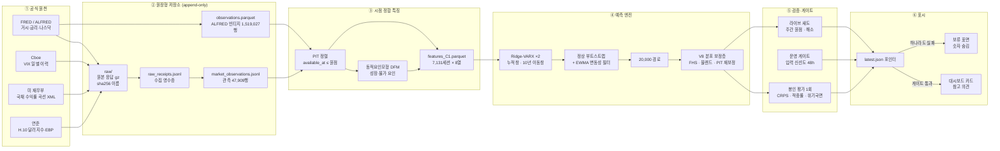
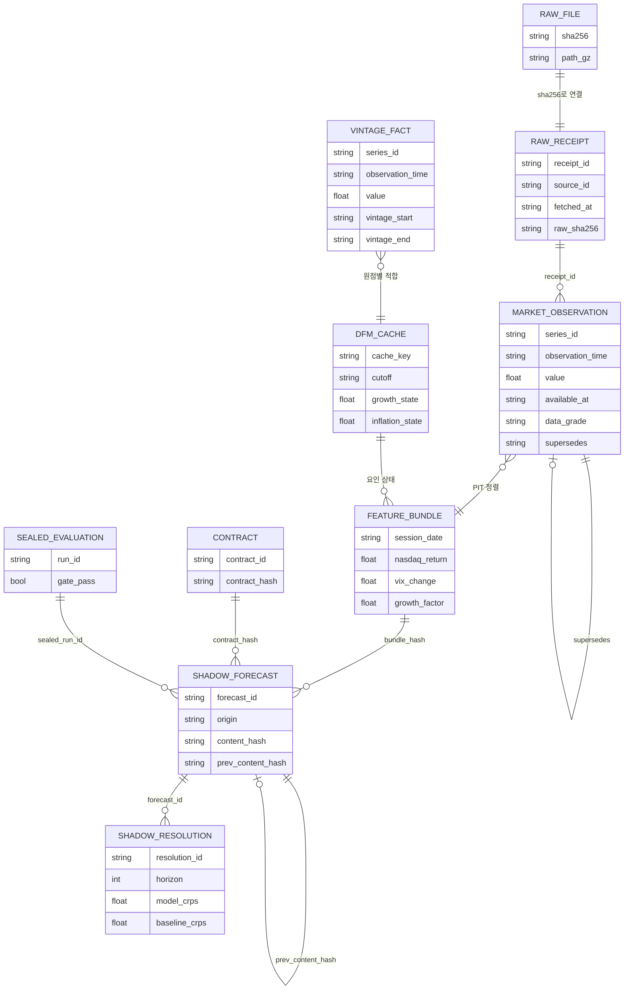
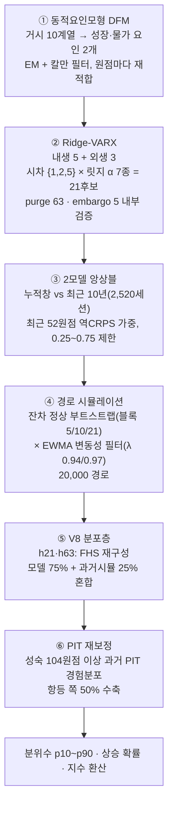
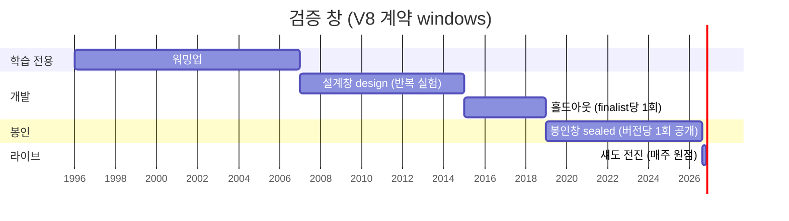
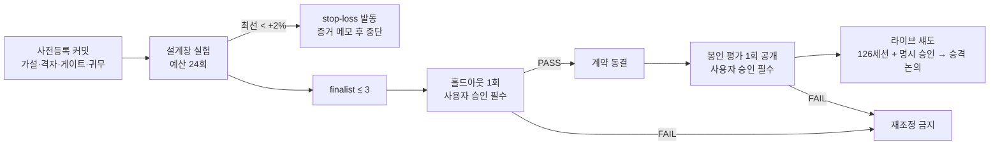
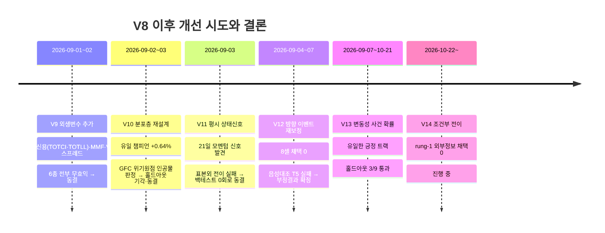
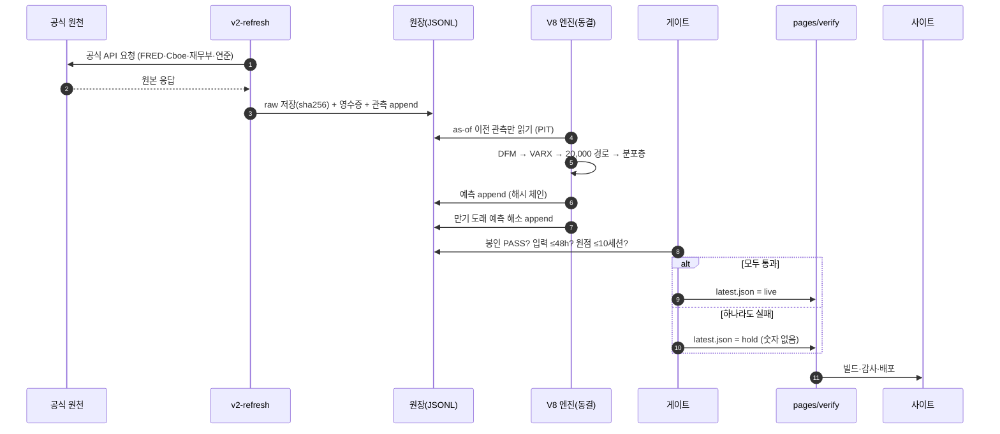

# NASDAQ 다변량 시계열 예측 시스템 — 구조·원리·데이터·기법·검증 해설서

> **문서 목적**: 이 MD는 사람이 읽는 해설서이면서, **GPT가 전문적인 단일 HTML 페이지로 변환하기 위한 원고**다.
> 0장에 HTML 제작 지시서(라이브러리·디자인·컴포넌트 매핑)가 있고, 본문의 ` ```mermaid ` 블록은 다이어그램,
> ` ```json chart ` 블록은 차트 데이터, `$$ … $$` 는 수식, `> [!NOTE]` 류는 콜아웃 박스로 렌더링한다.
>
> **기준 시점**: 2026-10-26 (KST). 수치 출처는 저장소 `origin/main` @ `91f1c12f`의 원장·계약 파일이며,
> 문서 안의 모든 수치는 해당 파일에서 직접 다시 계산해 확인했다(부록 A에 경로).
>
> **지위**: 이 시스템의 모든 출력은 **참고 의견**이며 매매 신호가 아니다. 공식 LLM 예측·시나리오와 산술 결합하지 않는다.

---

## 0. HTML 제작 지시서 (GPT용 — 페이지에는 노출하지 않음)

### 0.1 산출물 형태

- **단일 HTML 파일** (CSS·JS 인라인, 외부는 아래 CDN만). 오프라인 인쇄 가능해야 한다.
- 언어 `lang="ko"`. 기술 용어는 한글(영문) 병기 — 예: "연속 순위 확률 점수(CRPS)".
- 레이아웃: **좌측 고정 목차(sticky TOC)** + 본문 최대 폭 960px. 모바일(<768px)에서는 목차를 상단 접이식으로.
- 섹션마다 **"쉽게 말하면" 박스**(비유)를 먼저, **"전문가용 상세"** 는 `<details>` 접힘으로.

### 0.2 외부 라이브러리 (버전 고정)

| 용도 | 라이브러리 | CDN |
|---|---|---|
| 다이어그램 | Mermaid 10.9.1 | `https://cdn.jsdelivr.net/npm/mermaid@10.9.1/dist/mermaid.min.js` |
| 차트 | Apache ECharts 5.5.0 | `https://cdn.jsdelivr.net/npm/echarts@5.5.0/dist/echarts.min.js` |
| 수식 | KaTeX 0.16.9 (+auto-render) | `https://cdn.jsdelivr.net/npm/katex@0.16.9/dist/katex.min.js` · `…/contrib/auto-render.min.js` · `…/katex.min.css` |
| 본문 글꼴 | Pretendard 1.3.9 | `https://cdn.jsdelivr.net/gh/orioncactus/pretendard@v1.3.9/dist/web/static/pretendard.min.css` |
| 코드 글꼴 | JetBrains Mono | Google Fonts |

- Mermaid 블록은 `<pre class="mermaid">` 로 그대로 넣고 `mermaid.initialize({startOnLoad:true, theme:'base', themeVariables:{...}})` 로 아래 팔레트를 적용한다.
- ` ```json chart ` 블록은 `id`·`type`·`title`·`data` 를 읽어 ECharts 옵션으로 변환한다. `annotations` 는 markLine/markArea로 그린다.
- 차트 컨테이너에는 `min-width:0` 을 주고, **SVG/캔버스 안에 설명 문장을 넣지 않는다**(설명은 차트 아래 HTML 캡션으로).

### 0.3 디자인 토큰

```json
{
  "color": {
    "primary": "#0B1F3A", "primary-2": "#1E3A8A", "accent": "#0EA5A4",
    "pass": "#16A34A", "fail": "#DC2626", "hold": "#D97706", "neutral": "#64748B",
    "bg": "#F8FAFC", "card": "#FFFFFF", "border": "#E2E8F0", "text": "#0F172A", "muted": "#475569",
    "series": ["#1E3A8A", "#0EA5A4", "#D97706", "#7C3AED", "#DB2777", "#64748B"]
  },
  "dark": { "bg": "#0B1220", "card": "#111A2E", "border": "#1F2A44", "text": "#E2E8F0", "muted": "#94A3B8" },
  "radius": "14px", "shadow": "0 1px 2px rgba(15,23,42,.06), 0 8px 24px rgba(15,23,42,.06)",
  "font": { "body": "Pretendard, system-ui, sans-serif", "mono": "JetBrains Mono, ui-monospace, monospace" }
}
```

- `prefers-color-scheme: dark` 대응, `body` 배경색 명시.
- 상태 배지: **PASS**(초록) · **FAIL**(빨강) · **HOLD/보류**(주황) · **동결**(회색) · **진행 중**(청록).
- 콜아웃: `[!NOTE]` 파랑 · `[!TIP]` 청록("쉽게 말하면") · `[!WARNING]` 주황(한계) · `[!IMPORTANT]` 남색(원칙).

### 0.4 섹션 → 컴포넌트 매핑

| 섹션 | 핵심 컴포넌트 |
|---|---|
| 1. 한 장 요약 | 히어로 + KPI 카드 6개 + 상태 배지 |
| 2. 무엇을 예측하나 | 표적 카드 4장(가로 스크롤) + 비유 박스 |
| 3. 전체 구조 | Mermaid 흐름도(대형, 가로) |
| 4. 데이터·DB | Mermaid ER 다이어그램 + 계열 표 + 데이터 등급 배지 |
| 5. 모델 엔진 | 단계 스테퍼(1→6) + 수식 카드 + Mermaid |
| 6. 기법 총람 | 비교 표 + "쓰지 않는 것" 박스 |
| 7. 검증 방법 | Mermaid 간트(검증 창) + 게이트 체크리스트 |
| 8. 검증 결과 | ECharts 막대·레이더·히트맵·히스토그램 + 결과 표 |
| 9. 운영 자동화 | Mermaid 시퀀스 + 크론 표(KST) |
| 10. 정직성 장치 | 아이콘 그리드 카드 |
| 11. 한계 | WARNING 콜아웃 목록 |
| 12. 로드맵 | 진행 바(P0~P7) |
| 13. 용어집 | 2열 정의 목록(검색 가능하면 좋음) |

### 0.5 반드시 지킬 표기 규칙

- 확률은 **1% 단위**로 표시하고 80% 구간을 병기한다. 날짜는 YYYY-MM-DD, 시각은 KST.
- "확률"·"모의 경로 비율"·"기준율"을 섞어 부르지 않는다. 서로 다른 확률 공간의 수치를 한 차트에서 평균 내지 않는다.
- 페이지 하단 고정 문구: **"참고 의견 · 매매 신호 아님 · 실전 자금 결정의 단독 근거로 쓰지 않습니다."**
- 이 문서에 **없는 지표를 지어내지 않는다**(방향 적중률·MASE·first-touch 점수는 공개 범위 밖이라 의도적으로 뺐다).

---

## 1. 한 장 요약

> [!TIP]
> **쉽게 말하면** — 이 시스템은 "내일 나스닥이 몇 포인트일까?"를 맞히지 않는다. 대신 **일기예보처럼**
> "앞으로 1주·1달·3달 동안 나스닥이 이 범위 안에 있을 가능성이 80%" 같은 **분포**와,
> "한 달 안에 VIX가 25를 넘을 확률" 같은 **사건 확률**을 만든다. 그리고 그 예보가 과거에 정말 맞았는지를
> **한 번만 열 수 있는 봉인 시험**으로 채점해, 통과한 것만 화면에 올린다.

### 1.1 KPI 카드

| 카드 | 값 | 부가 설명 | 배지 |
|---|---|---|---|
| 대표 모델 | **V8** `shadow.mf_dfm_varx_calibrated_v8` | DFM + Ridge-VARX + 보정 분포층 | 봉인 PASS |
| 봉인 평가 | **1,011 원점 · 사유 0건** | 2007~2026 주간 원점, 1회 공개 | PASS |
| 장기 예측 개선 | **+4.1%** (21·63일 평균) | 최강 기준선(과거 시뮬레이션) 대비 CRPS | 2019+ 봉인창 +4.2% |
| 80% 구간 적중 | **79.0~81.3%** | 4개 지평 모두 허용대역 76~84% 안 | 정상 |
| 100점 환산 | **70점 · B(보통)** | 현 산식에서 가능한 범위 61~76점 | 표시 전용 |
| 변동성 사건 확률(V13) | **홀드아웃 3/9 셀 통과** | 단기 RV 지속·1개월 VIX25 | 부분 통과 |

### 1.2 현재 상태 한 줄씩 (2026-10-26)

- **V8 가격 분포**: 봉인 시험 통과 → 사이트에 "연구 참고" 카드로 공개 중. 라이브 섀도 표본 **49/126 세션**(126 도달 예정 2027-02-16). 승격은 사람이 결정.
- **V9~V12**: 외생변수 추가·분포층 재설계·평시 상태신호·방향 이벤트 — **모두 개선 없음(측정된 영)으로 동결**.
- **V13 변동성 사건 확률**: 9셀 중 3셀 홀드아웃 통과, 라이브 카드 운영. 설계창 개발 예산 8/8 소진.
- **V14 조건부 전이(평온→급등)**: 2026-10-22 개시, rung-1 외부 정보 채택 0. 라이브 포인터 없음.
- **daily6m 6개월 일별 전망**: 독립 연구 프리뷰, 예측력 검증 전(`predictive_validation: not_established`).

---

## 2. 무엇을 예측하나

> [!IMPORTANT]
> 프로젝트 헌법(CLAUDE.md)의 1차 목표는 **"주가 맞히기가 아니라 이벤트 확률화"** 다. 그래서 시계열 트랙도
> 점 하나(내일 종가)가 아니라 **분포**와 **기한·임계값이 있는 사건 확률**을 산출한다.

### 2.1 표적 4종

| 트랙 | 표적 | 지평 | 출력 | 확률 공간 |
|---|---|---|---|---|
| **V8** | NASDAQ Composite(NASDAQCOM) 로그수익률의 분포 | 1·5·21·63 거래일 | 분위수 p10·p25·p50·p75·p90, 상승 확률, 지수 환산 범위 | `research_timeseries_v8_conditional` |
| **V13** | ① VIX 종가 ≥ K(25·30) 터치 ② 21일 실현변동성 RV21 > θ(0.1694) | 5·21·63 영업일 | 9셀 사건 확률 + 80% 계수 불확실성 대역 | `event_probability.volatility_v13` |
| **V14** | 평온 상태에서 출발했을 때의 돌파: P(VIX≥25 \| VIX<20), P(RV21>θ \| RV21≤θ) | 5·21·63 | 6셀 조건부 확률 (연구 단계) | 표시 없음(t0) |
| **daily6m** | 향후 6개월 매 거래일의 지수 범위·전일 대비 상승 확률 | 약 126 거래일 | 20,000 결합 경로의 일별 p10~p90 | `research_timeseries_daily6m_conditional` |

> [!TIP]
> **왜 지평이 1·5·21·63일인가?** — 각각 하루·한 주·한 달·한 분기(거래일 기준)다.
> 포트폴리오 EXIT 규칙(예: VIX 25 이상, 드로다운 한도)이 보는 시간 단위와 맞춘 것이다.

### 2.2 "분포"가 무엇인지 그림으로

- 예측은 **20,000개의 가능한 미래 경로**를 만든 뒤, 각 지평에서 경로 끝값을 줄 세워 분위수를 읽는다.
- 예: 봉인창(2019~2026) 평균 **80% 구간 폭**(로그수익률) — 1일 3.5% · 5일 7.5% · 21일 14.3% · 63일 24.1%.
  즉 "3개월 뒤 지수는 대략 지금 ±12% 범위 안에 있을 가능성이 80%" 라는 형태의 예보다.

```json chart
{
  "id": "band-width",
  "type": "bar",
  "title": "봉인창(2019-01-01~2026-08-14, 385원점) 평균 예측 구간 폭",
  "xAxis": ["1일", "5일", "21일", "63일"],
  "series": [
    {"name": "80% 구간 폭 (p10~p90)", "data": [3.47, 7.53, 14.33, 24.05], "unit": "%p 로그수익률"},
    {"name": "50% 구간 폭 (p25~p75)", "data": [1.56, 3.83, 7.13, 11.26], "unit": "%p 로그수익률"}
  ],
  "caption": "지평이 길수록 불확실성이 넓어진다 — 대략 √시간에 비례."
}
```

---

## 3. 전체 구조 (아키텍처)

> [!TIP]
> **쉽게 말하면** — 공장 라인이다. ① 공식 기관에서 원자료를 받아 **영수증과 함께 금고에 넣고**(원장),
> ② "그 날짜에 실제로 알 수 있었던 정보만" 골라 재료를 만들고(PIT 정렬), ③ 거시경제 요약 지표와 시장 변수를
> 함께 보는 통계 모델로 **수만 개의 미래 경로**를 그린 다음, ④ 그 경로 묶음을 과거 성적으로 **보정**하고,
> ⑤ 시험을 통과했을 때만 화면에 내보낸다. 어느 단계든 조건을 못 맞추면 **숫자를 숨기고 '보류'로 닫는다**.



### 3.1 계층별 책임

| 계층 | 하는 일 | 핵심 원칙 |
|---|---|---|
| ① 원천 | 공식 기관 API/파일만 사용 (FRED는 공식 API, 그래프 엔드포인트 스크랩 금지) | 라이선스·약관 준수, 키 없는 영수증 |
| ② 저장소 | 원본 바이트를 sha256 이름으로 보존, 관측은 JSONL에 **추가만** | 행 수정·삭제 금지, 정정은 `supersedes` 새 행 |
| ③ 특징 | 원점(as-of) 시각까지 **공개된 값만** 사용, 거시는 발표 시각 이후에만 반영 | 미래 데이터·빈티지 누수 0 |
| ④ 엔진 | 결정론 수치 모델 (난수 시드도 모델버전+원점의 sha256) | 같은 입력 → 비트 단위 같은 출력 |
| ⑤ 게이트 | 사전등록된 임계로만 판정, 결과 본 뒤 임계 변경 금지 | 봉인창 공개는 모델 버전당 1회 |
| ⑥ 표시 | 게이트 하나라도 실패하면 숫자를 내리고 '검증 대기'로 닫는다(fail-closed) | 마지막 값 캐시로 버티지 않음 |

---

## 4. 데이터 레이어 — 어떤 DB를 쓰나

> [!TIP]
> **쉽게 말하면** — 일반적인 "고쳐 쓰는 데이터베이스"가 아니라 **회계 장부**다. 한 번 적은 줄은 지우지 않고,
> 틀렸으면 "앞 줄을 대체함"이라고 새 줄을 적는다. 그래서 "그날 그 시각에 시스템이 무엇을 알고 있었는지"를
> 언제든 정확히 되돌려 볼 수 있다. 이것이 과거 시험(백테스트)을 정직하게 만드는 바탕이다.

### 4.1 저장 방식 — 파일 기반 원장형(이벤트 소싱) DB

| 층 | 형식 | 예시 경로 | 성격 |
|---|---|---|---|
| 원본(raw) | gzip, **sha256 콘텐츠 주소** 파일명 | `data/timeseries_v2/raw/…`, `data/timeseries_daily6m/raw/cboe_vix_archive/*.gz` | 불변 원본 |
| 영수증·관측 원장 | **JSONL (append-only)** | `data/timeseries_v2/ledgers/market_raw_receipts.jsonl`, `market_observations.jsonl` | 정본(canonical) |
| 빈티지 사실 | **Parquet** (컬럼형) | `data/timeseries/facts/observations.parquet` | ALFRED 개정 이력 포함 |
| 특징 번들 | Parquet + manifest(JSON, 해시) | `data/timeseries_v2/parquet/features_C1.parquet` | 원장에서 재생성 가능 |
| 요인 캐시 | 원점별 JSON (키 = 계약해시·컷오프·입력해시) | `data/timeseries_v2/dfm_cache/` (11,192개) | 재사용 캐시 |
| 실험·평가 원장 | JSONL | `data/timeseries_v8/ledgers/{development_experiments,holdout_scorings,sealed_evaluations}.jsonl` | 1회성 기록 |
| 라이브 원장 | JSONL **해시 체인**(`prev_content_hash`) | `shadow_forecasts.jsonl`, `shadow_resolutions.jsonl`, `daily_display_forecasts.jsonl` | 전진 검증 |
| 표시 포인터 | JSON | `data/timeseries_v8/multivariate_v8_latest.json`, `daily_display_latest.json` | 화면이 읽는 유일한 입구 |
| 계약(사전등록) | YAML | `data/contracts/multivariate_timeseries_v8.yaml` | 모델·게이트 좌표 동결 |

- 이 트랙은 **SQLite를 쓰지 않는다.** (저장소의 `db/` SQLite는 LLM 예측·채점 원장의 파생 인덱스용이며 `sync --rebuild` 로 재구축되는 캐시다.)
- 사람이 검토할 때는 8시트 엑셀 워크북(`workbooks/`)을 내보내지만, **정본은 언제나 JSONL**이다.

### 4.2 관측 한 줄의 생김새 (필수 필드)

```json
{
  "series_id": "NASDAQCOM",
  "observation_time": "2026-10-23",
  "value": 25955.34,
  "unit": "index",
  "available_at": "2026-10-24T05:06:32Z",
  "vintage_start": "2026-10-24T05:06:32Z",
  "vintage_end": null,
  "data_grade": "captured_forward",
  "source_id": "fred_api_nasdaqcom_archive",
  "raw_sha256": "00f0161e…",
  "receipt_id": "market-receipt-1d2258aa…",
  "revision_seq": 1,
  "supersedes": null
}
```

| 필드 | 의미 | 왜 중요한가 |
|---|---|---|
| `observation_time` | 그 값이 **가리키는** 날짜 | "10월 23일 종가" |
| `available_at` | 그 값을 **실제로 알 수 있게 된** 시각 | 예측 원점보다 늦으면 사용 금지 → 미래 누수 차단 |
| `vintage_start/end` | 그 값이 유효했던 발표 판본의 기간 | 거시지표는 나중에 수정된다 — 당시 판을 써야 한다 |
| `raw_sha256` · `receipt_id` | 원본 바이트·수집 영수증 연결 | 숫자 하나를 원본 파일까지 역추적 (연결률 1.0이 게이트 조건) |
| `supersedes` | 대체하는 앞 행 | 정정도 덮어쓰기가 아니라 새 행 |

### 4.3 데이터 등급

| 등급 | 뜻 | 쓰임 |
|---|---|---|
| `native_pit` | 원천이 빈티지를 직접 제공(ALFRED) — 당시 공개값을 정확히 재현 | 거시 계열 필수 등급 |
| `reconstructed_market_archive` | 시장 일별 이력을 공식 아카이브에서 재구성 (시장 가격은 대개 개정되지 않음) | 시장 계열 — **native PIT로 표기하지 않음** |
| `captured_forward` | 저장소가 실제로 수집한 시각부터만 유효 | 개정 이력이 없는 원천(예: 연준 EBP 전체 재작성 파일) |

### 4.4 사용하는 계열과 실제 보유량

**시장 아카이브** (`data/timeseries_v2/ledgers/market_observations.jsonl`, 총 47,909행)

| 계열 | 내용 | 원천 | 변환 | 행 수 | 기간 |
|---|---|---|---|---|---|
| NASDAQCOM | 나스닥 종합지수 (표적) | FRED 공식 API | 로그 변화 | 8,007 | 1995-01-03 ~ 2026-10-23 |
| VIX | 변동성 지수 | Cboe 이력 CSV | 로그 변화 | 9,301 | 1990-01-02 ~ 2026-10-23 |
| DGS2 | 2년 국채 | 미 재무부 XML | 1차 차분(bp) | 9,209 | 1990-01-02 ~ 2026-10-23 |
| DGS10 | 10년 국채 (곡선 계산용) | 미 재무부 XML | 10Y−2Y 후 차분(bp) | 9,209 | 1990-01-02 ~ 2026-10-23 |
| DTWEXB | 구 달러지수 | 연준 H.10 | 로그 변화 | 6,328 | 1995-01-04 ~ 2019-12-31 |
| DTWEXBGS | 광의 달러지수 (주간 발행) | 연준 H.10 | 로그 변화 | 5,212 | 2006-01-02 ~ 2026-10-16 |
| FED_EBP | 초과 채권 프리미엄(월간) | 연준 | — (선택) | 643 | 1973-01 ~ 2026-07 |

**거시 빈티지 사실** (`data/timeseries/facts/observations.parquet`, ALFRED, 1,519,027행 · 26계열)

| 그룹 | 계열 | 쓰임 |
|---|---|---|
| 성장 | PAYEMS(고용) · UNRATE(실업률) · INDPRO(산업생산) · RSAFS(소매판매) · HOUST(주택착공) · GDPC1(실질GDP, 분기) | **성장 요인** |
| 물가 | CPIAUCSL · CPILFESL(근원CPI) · PCEPI · PCEPILFE(근원PCE) | **물가 요인** |
| 금융 | NFCI(금융여건, 929,536행 — 매주 전 이력 개정) · DFF(연방기금금리) | 후보 C2 |
| 유동성 | M2SL · WALCL(연준 자산) · WTREGEN(재무부 계좌) · RRPONTSYD(역레포) | 후보 C3, V9 실험 |
| 신용·MMF | TOTCI · TOTLL · WRMFNS | V9 실험(무효익 확인) |

> [!NOTE]
> **빈티지가 실제 오류를 잡은 사례** — VXN 지수의 2014년 판 값 21.30이 현재 판에서는 전일 값 17.81로 덮여 있었다
> (같은 날 VIX +5.34 급등). 현재 판으로 시험했다면 사건일 하나가 지워진 채 검정됐을 것이다.

### 4.5 원장 구조 (ER 다이어그램)



### 4.6 V8이 실제로 먹는 입력 (특징 번들 C1)

`features_C1.parquet` — 7,131 거래일(1997-02-19~) × 8열

| 열 | 역할 | 설명 |
|---|---|---|
| `nasdaq_return` | 내생(표적) | 나스닥 일간 로그수익률 |
| `vix_change` | 내생 | VIX 로그 변화 |
| `dgs2_change_bps` | 내생 | 2년 금리 일간 변화(bp) |
| `curve_change_bps` | 내생 | 10Y−2Y 곡선 기울기 변화(bp) |
| `dollar_change` | 내생 | 달러지수 로그 변화 (2019-01-02 DTWEXB→DTWEXBGS 전환) |
| `growth_factor` | 외생 | DFM 성장 요인 상태 (발표 시각 이후에만 갱신) |
| `inflation_factor` | 외생 | DFM 물가 요인 상태 |
| `dfm_age_since_release` | 외생 | 마지막 거시 발표 후 경과 — "정보가 얼마나 낡았나" |

---

## 5. 모델 엔진 — 어떤 원리로 예측하나

> [!TIP]
> **쉽게 말하면** — 6단계 요리법이다.
> ① 흩어진 거시지표 10개를 "경기 온도계·물가 온도계" 두 개로 요약하고(DFM),
> ② 나스닥·VIX·금리·곡선·달러 다섯 변수가 서로를 어떻게 끌고 다니는지 회귀로 배우되 과적합을 막는 브레이크(릿지)를 걸고(Ridge-VARX),
> ③ 장기 기억형·최근 10년형 두 모델을 최근 성적 비율로 섞고(앙상블),
> ④ 과거의 "예상 밖 충격"을 덩어리째 다시 뽑아 오늘의 변동성 크기로 맞춘 뒤 20,000번 미래를 굴리고(부트스트랩 시뮬레이션),
> ⑤ 긴 지평(21·63일)은 과거 같은 길이 구간의 실제 움직임으로 다시 그리고(FHS), 단순 과거분포와 75:25로 섞고(블렌드),
> ⑥ "과거에 예보가 한쪽으로 치우쳤던 정도"만큼 분위수를 살짝 바로잡는다(PIT 재보정).



### 5.1 ① 동적요인모형 (Dynamic Factor Model, DFM)

- 월간·분기 혼합 빈도 거시지표에서 **공통으로 움직이는 숨은 요인 하나**를 뽑는다 (성장 그룹·물가 그룹 각각).
- 구현: `statsmodels` `DynamicFactorMQ` (요인 1개, 요인 AR(1), 개별 오차 AR(1), 표준화), **EM 알고리즘** 적합(허용오차 1e-5, 최대 300회), 수렴 판정은 로그우도 감소 금지·유한성 검사까지 통과해야 인정.
- **원점마다 그 시점 빈티지로 재적합** (`parameter_pit: origin_specific_refit_required`) → 미래 개정치가 섞이지 않는다. 결과는 계약해시·컷오프·입력해시 키로 캐시.

$$
x_{i,t} = \lambda_i f_t + e_{i,t},\qquad f_t = \phi f_{t-1} + \eta_t,\qquad e_{i,t} = \rho_i e_{i,t-1} + \varepsilon_{i,t}
$$

### 5.2 ② Ridge-VARX (릿지 정규화 벡터자기회귀 + 외생변수)

$$
y_t = c + \sum_{l=1}^{L} A_l\, y_{t-l} + B\, x_{t-1} + u_t,\qquad
\hat\beta = \arg\min_\beta \lVert Y - Z\beta \rVert^2 + \alpha \lVert \beta_{-0} \rVert^2
$$

- $y_t$ = 내생 5변수, $x_{t-1}$ = 전일까지 알려진 외생 3변수(요인·요인 나이). 외생변수의 미래 실제값은 절대 쓰지 않는다.
- **표준화**: 학습창의 중앙값·IQR(robust scaling). 이상치 잘라내기(clipping) 금지.
- **하이퍼파라미터 선택**: 시차 L ∈ {1, 2, 5} × α ∈ {1e-4, 1e-3, 1e-2, 0.1, 1, 10, 100} = 21조합을 **시계열 내부 교차검증**(최근 52개 내부 원점, 각 원점 앞 63세션 purge·5세션 embargo)으로 나스닥 1일 예측 제곱오차가 가장 작은 조합을 고른다.
- 7개 α를 한 번의 설계행렬로 **일괄 풀이**(batched solve)해 V1 대비 계산을 줄였다(결과는 동일).

### 5.3 ③ 두 모델 앙상블

$$
w_{\text{exp}} = \operatorname{clip}\!\left(\frac{1/\overline{\mathrm{CRPS}}_{\text{exp}}}{1/\overline{\mathrm{CRPS}}_{\text{exp}} + 1/\overline{\mathrm{CRPS}}_{\text{roll}}},\ 0.25,\ 0.75\right),\qquad w_{\text{roll}} = 1 - w_{\text{exp}}
$$

- 누적창(1996~ 전체) 모델과 최근 10년(2,520세션) 이동창 모델. 최근 52개 원점의 21일 CRPS 평균의 역수 비율. 이력이 52개 미만이면 0.5:0.5.
- **학습형 가중치가 아니라 고정 규칙**이다(헌법의 ML 게이트: 가중 학습 결합은 해소 200+ 뒤).

### 5.4 ④ 경로 시뮬레이션 — 정상 부트스트랩 + EWMA 필터

$$
\sigma^2_t = \lambda\,\sigma^2_{t-1} + (1-\lambda)\,u_{t-1}^2,\qquad
u^{*}_{s} = u_s \cdot \frac{\sigma_{T}}{\sigma_{s}}
$$

- 다변량 잔차 $u_s$ 를 **행 단위로**(5변수 동시) 뽑아 변수 간 동시 상관을 보존한다.
- **정상 부트스트랩(Politis–Romano)**: 평균 블록 길이 $b$ ∈ {5, 10, 21}, 매 스텝 확률 $1/b$ 로 새 블록 시작 → 변동성 군집을 보존.
- 뽑힌 잔차는 그 시점 변동성 대비 **오늘 변동성 크기로 재척도**(필터링). λ ∈ {0.94, 0.97}. 블록·λ는 원점마다 21일 CRPS로 선택(봉인 평가 1,011원점에서 블록 21이 398회·λ 0.97이 612회 선택됨).
- 경로 수: 개발 2,000 / 봉인·운영 **20,000**. 난수 시드 = sha256(모델버전, 원점) → 재현 가능.

### 5.5 ⑤⑥ V8 분포 보정층 (B1~B5 사전등록 격자)

V2 엔진은 그대로 두고(**읽기 전용, 봉인 코드 해시 고정**) 그 위에 분포만 다듬는 층을 얹었다. 모든 커널은 중립값에서 **V2와 비트 단위로 동일**(E0 항등 테스트로 강제).

| 블록 | 아이디어 | 격자 | 최종 채택 |
|---|---|---|---|
| B1 변동성 기간구조 | 변동성이 장기평균으로 회귀하도록 스텝별 축소 | φ ∈ {항등, .94, .97, .99, AR(1)} | ✗ (기각 — 장기 악화) |
| B2 위치 앵커 | 시뮬 평균을 PIT 무조건 드리프트 쪽으로 유계 이동 | ω, σ 상한 | ✗ |
| B3 볼록 블렌드 | 모델 분포와 과거 시뮬레이션 분포 혼합 | w ∈ {1, .75, .5} | ✓ **w = 0.75** (h21·h63) |
| B4 PIT 재보정 | 과거 PIT 경험분포의 역함수로 분위수 수준 보정 | 수축 s ∈ {.25, .5}, 성숙 104원점+ | ✓ **s = 0.5** |
| B5 FHS 장기 재구성 | h21·h63 분포를 반복 VARX 외삽 대신 과거 창 직접 재구성 | 변동성 투영·틸트 | ✓ **FHS, 틸트 0** |

**B5 — 필터드 역사 시뮬레이션(FHS)**

$$
z_j = \frac{S_j^{(h)} - \hat\mu\,h}{\sigma_{\text{start}(j)}\sqrt{h}},\qquad
R^{(h)}_j = \hat\mu\,h + z_j\,\sigma_{\text{now}}\sqrt{h}
$$

과거의 모든 h일 누적수익 $S_j$ 를 그 구간 시작 시점 변동성으로 표준화했다가 **오늘 변동성**으로 되돌린다. 난수도 반복 외삽도 없는 결정론 재구성이라, 반복 VARX가 장기에서 위치를 잘못 끌고 가던 결함(2009년 손실 집중)을 우회한다.

**B3 — 블렌드**: $F = 0.75\,F_{\text{model}} + 0.25\,F_{\text{HS}}$ (과거 시뮬레이션 = 가장 강한 단순 기준선)

**B4 — PIT 재보정**

$$
u^{*}(q) = (1-s)\,G^{-1}(q) + s\,q,\qquad s = 0.5
$$

$G$ = 이미 만기가 끝난 과거 예측들의 PIT(실현값이 예측분포의 몇 분위였나) 경험분포. 과거 예보가 완벽히 보정돼 있었다면 $G^{-1}(q)=q$ 라 변화가 없고, 치우쳐 있었다면 그만큼(절반만) 되돌린다.

> [!NOTE]
> **동결 승자 E10** = `fhs_horizons [21,63]` + `blend 0.75` + `pit_recalibration_shrinkage 0.5`
> (설계 실험 `tsv8-exp-4b1f6ff27e1b8decfa65`, 홀드아웃 `tsv8-exp-96a2c2b81657cfab8f91`). 2026-08-30 사용자 승인(R8-D2)으로 계약 동결.

### 5.6 V13 — 변동성 사건 확률 (로지스틱 회귀)

$$
p = \sigma(\beta_0 + \beta_1 z_t),\qquad z_t = \frac{x_t - \mu}{s},\qquad \sigma(a) = \frac{1}{1+e^{-a}}
$$

- $x_t$ = 오늘의 VIX(VIX 셀) 또는 오늘의 RV21(RV 셀) **한 개**. 이것이 챔피언 `persistence_pb`("당일 변동성 수준의 지속")다.
- 사다리(복잡도 순): 기후(무조건 빈도) → **EWMA-로짓**(수준 + 21일 평활) → **HAR-로지스틱**(1·5·22일 RV, Corsi 2009) → GARCH(1,1)-t 시뮬레이션(미실행 — HAR 증분 0이라 불필요).
- 결과: 더 복잡한 모형이 **당일 수준 1개짜리 모형을 한 셀도 이기지 못했다** → 계약 규칙 "우월-아니면-단순-아니면-HOLD"에 따라 9셀 전부 단순 모형이 챔피언.
- 적합: 뉴턴법 200회, L2 1e-3, 설계창(2007-2014) 전체 1회 적합 후 **계수 동결**(sha256 `1a857850…`). 80% 대역은 **델타법 계수 불확실성**이지 보정 구간이 아니다.
- h63 셀은 교차적합 isotonic 보정을 시험했으나 사전등록 fallback이 발동해 원값(raw) 사용.

### 5.7 V14 — 조건부 전이 (평온 → 돌파)

- 표적: "지금 평온(VIX<20 또는 RV21≤θ)일 때 h일 안에 VIX 25 / θ를 돌파할 확률" — 하드룰(VIX 25)의 **조기경보**에 직접 대응.
- 모형: 조건부 PB(평온 상태에서의 당일 수준 로짓) vs 조건부 기후. 외부 블록(FOMC 달력·CFTC VIX 선물 포지셔닝)을 증분으로 검정.

### 5.8 daily6m — 6개월 일별 결합 경로

- V2 커널을 **불변으로 재사용**한 Ridge-VARX 결합 경로 20,000개, 앙상블 0.5:0.5 고정, 외생은 "마지막 알려진 값 유지", **지평별 보정 없음**.
- 일별 p10~p90 띠는 **각 날짜별(pointwise)** 구간이지 경로 전체를 동시에 덮는 구간이 아니다. 화면의 예시 경로는 종점 순위 10·25·50·75·90 백분위에 가장 가까운 실제 시뮬레이션 경로(모양의 현실성 유지).
- FHS는 독립 비교 기준선으로만 계산.

---

## 6. 사용하는 머신러닝·통계 기법 총람

> [!IMPORTANT]
> 이 트랙은 **딥러닝으로 가격을 학습하지 않는다**(헌법 §02: 검증된 능력은 이벤트 확률화). 쓰는 것은 해석 가능하고
> 재현 가능한 **통계적 학습·계량경제 기법**이며, 하이퍼파라미터는 전부 결과 전에 격자로 사전등록했다.

| 기법 | 분류 | 어디에 | 왜 이 기법인가 |
|---|---|---|---|
| 동적요인모형(DFM) + EM + 칼만 필터 | 상태공간 잠재요인 | 거시 10계열 → 요인 2개 | 혼합 빈도·결측·발표 지연을 한 틀에서 처리, 차원 축소 |
| 릿지 회귀 (L2 정규화) | 정규화 선형모형 | VARX 계수 | 다변량·다시차에서 과적합·공선성 억제 |
| VARX | 다변량 시계열 | 5변수 동시 동학 | 변수 간 파급(금리→주식 등)을 경로에 반영 |
| Robust scaling (중앙값/IQR) | 전처리 | 설계행렬 | 위기 구간 극단값에 덜 민감 |
| Purged · embargoed 시계열 CV | 모형 선택 | 시차·α 선택 | 지평 겹침에 의한 정보 누수 차단 (63세션 purge) |
| 역CRPS 가중 앙상블 (고정 규칙) | 앙상블 | 누적창 vs 10년창 | 국면 변화 적응, 학습형 가중 아님 |
| 정상 부트스트랩 (Politis–Romano) | 재표집 | 잔차 경로, 신뢰구간 | 자기상관·변동성 군집 보존 |
| EWMA 변동성 필터링 | 변동성 모형 | 잔차 재척도, FHS | RiskMetrics식 — 단순·안정 |
| 몬테카를로 경로 시뮬레이션 | 확률 시뮬레이션 | 20,000 경로 | 분위수·경로 의존 지표 산출 |
| 필터드 역사 시뮬레이션(FHS) | 비모수 분포 | h21·h63 | 장기 외삽 결함 회피, 결정론 |
| 볼록 분포 혼합(블렌드) | 예측 결합 | 모델 + 과거시뮬 | 꼬리 안정화, CRPS 개선 |
| PIT 경험분포 재보정(+수축) | 확률 보정 | 분위수 수준 | 과거 치우침 교정, 과보정 방지 |
| 로지스틱 회귀 (뉴턴, L2) | 분류 확률 | V13·V14 사건 확률 | 해석 가능, 잘 보정됨 |
| HAR-RV | 변동성 계량 | V13 사다리 | 장단기 변동성 기억 (증분 0 확인) |
| Isotonic 회귀 (교차적합) | 단조 보정 | V13 h63 시험 | 사전등록 fallback으로 미배치 |
| 델타법 | 불확실성 전파 | V13 80% 대역 | 계수 공분산 → 확률 대역 |

### 6.1 평가·검정 기법

| 기법 | 쓰임 |
|---|---|
| **CRPS** (연속 순위 확률 점수) | 분포 예측 전체를 한 숫자로 채점 — 낮을수록 좋음 |
| **Brier 점수 / BSS** | 사건 확률 채점 / 기준선 대비 개선율 |
| **커버리지(적중률)** | 80%·50% 구간에 실현값이 들어간 비율 |
| **Diebold–Mariano 검정** (HAC) | 두 예측의 손실 차이가 우연인지 |
| **블록 부트스트랩 CI90** | 손실 차이의 90% 신뢰구간 (V13: 블록 13, 2,000회, 시드 20260907) |
| **y-블록 순열 귀무(음성 대조)** | 사건 라벨을 블록째 섞어도 "스킬"이 나오면 그 스킬은 가짜 — 통과율 ≤ 0.10 요구 |
| **가족별 다중검정 P** | 여러 셀 중 k개 통과가 우연일 확률 |
| **Murphy 분해** (신뢰도·해상도·불확실성) | 확률이 "맞게 자신 있는지" 보고 |
| **Cramér 거리 감사** | 블렌드 전후 분포가 얼마나 변했는지 |

$$
\mathrm{CRPS}(F, y) = \int_{-\infty}^{\infty}\big(F(x) - \mathbb{1}\{x \ge y\}\big)^2 dx
= \mathbb{E}|X - y| - \tfrac{1}{2}\mathbb{E}|X - X'|
$$

$$
\text{개선율} = 1 - \frac{\mathrm{CRPS}_{\text{model}}}{\mathrm{CRPS}_{\text{best baseline}}},\qquad
\mathrm{BS} = \frac{1}{N}\sum_{i}(p_i - o_i)^2,\qquad
\mathrm{BSS} = 1 - \frac{\mathrm{BS}}{\mathrm{BS}_{\text{clim}}}
$$

> [!TIP]
> **CRPS를 쉽게** — 예보가 "내일 기온 20~25도"라고 넓게 말하면 틀릴 일은 적지만 쓸모가 없고, "22도"라고 좁게 말하면
> 쓸모는 있지만 틀리기 쉽다. CRPS는 **넓이와 정확도를 한꺼번에** 벌점 매기는 점수라, 둘 사이의 균형을 정직하게 잰다.

### 6.2 쓰지 않는 것 (의도적 배제)

| 배제 | 이유 |
|---|---|
| LSTM·Transformer 등 딥러닝 가격 학습 | 헌법 금지 — 검증된 능력은 이벤트 확률화, 과적합·재현성 문제 |
| 지수 수준 직접 학습, 종점 강제 | 계약 `prohibitions` (비정상 시계열, 사후 맞춤 위험) |
| 미래 실제 외생값 사용 | 정보 누수 |
| 결과 확인 후 임계·기준선·귀무 변경 | 사전등록 위반 — 캠페인 전체 무효 사유 |
| 학습형 앙상블 가중치 | 해소 200+ 게이트 전 금지 |

> [!NOTE]
> 저장소에는 별도로 **오픈웨이트 시계열 파운데이션 모델 참조층**(`src/ai_fc/ml` — Chronos-Bolt·Chronos-2·Chronos-T5, FinBERT)이 있다.
> 이것은 **추론 전용**(학습·가중치 갱신 금지)이며 base rate 참조값을 만드는 **별도 계층**으로, 이 문서의 다변량 시계열 트랙과 결합하지 않는다.

---

## 7. 검증 방법 — 어떻게 "맞았다"를 증명하나

> [!TIP]
> **쉽게 말하면** — 수능 대비와 같다. ① **모의고사(설계창 2007~2014)** 로만 공부법을 바꿔 보고,
> ② 마음에 드는 공부법이 정해지면 **예비 시험(홀드아웃 2015~2018)** 을 딱 한 번 치고,
> ③ 통과하면 **본시험(봉인창 2019~)** 을 모델 버전당 **딱 한 번** 공개 채점한다. 떨어져도 재시험(재조정)은 없다.
> ④ 그 뒤에는 **실전(라이브 섀도)** 에서 매주 새로 예보하고 만기 때 채점한다.

### 7.1 검증 창 타임라인



- **원점(origin)**: 매주 마지막 완결 거래일. 그 시점까지 공개된 정보만으로 예측을 만든다(워크포워드).
- **purge 63 / embargo 5**: 63일 예측 구간이 다음 학습과 겹치지 않도록 간격을 둔다.
- 개발 중에는 2019-04-30 이후 데이터를 **날짜로 절단**해 봉인창을 구조적으로 못 보게 했다(2019-blind).
- **최소 250원점**, 필수 위기 국면 3개(2008 금융위기·2020 팬데믹·2022 긴축)를 반드시 포함해야 판정 가능.

> [!WARNING]
> **"백테스트 금지" 원칙과의 관계** — 헌법은 LLM 예측의 과거 시험을 금지한다(LLM은 결과를 학습에 내포).
> 이 트랙은 **결정론 수치 모델**이라 명문화된 예외(dualdb §8)에 해당한다. 단, 산출물은 base rate 참조이지 LLM
> 캘리브레이션 표본이 아니며, 탐색 경계·기간 선택이 사후 지식을 간접 내포할 수 있다는 caveat를 유지한다.
> 또 2019+ 구간은 V2가 이미 공개 채점했으므로 V8에게 **완전 청정한 봉인이 아닌 '준청정'** 이다 — 진짜 청정 검증은 라이브 섀도뿐이다.

### 7.2 비교 대상 — 6개 기준선

| 기준선 | 설명 |
|---|---|
| random_walk | 변화 없음 + 과거 변동성 |
| drift_random_walk | 평균 상승률 포함 랜덤워크 |
| ar1 | 1차 자기회귀 |
| gbm | 기하 브라운 운동 |
| **historical_simulation** | 과거 수익률 분포 그대로 — 대부분 지평에서 **가장 강한 기준선** |
| block_bootstrap | 과거 수익률 블록 재표집 |

모델 점수는 항상 **그 지평에서 가장 잘한 기준선**과 비교한다(약한 상대를 골라 이기는 것 방지).

### 7.3 공개 게이트 (V2에서 수치 그대로 승계, 완화 없음)

| 항목 | 기준 |
|---|---|
| PIT 누수 | 0건 |
| 영수증 연결률 | 1.0 |
| 단기(1·5일) CRPS | 최강 기준선보다 2% 넘게 나쁘면 안 됨 |
| **장기(21·63일) 평균 CRPS 개선** | **≥ +2%** |
| 장기 손실차 부트스트랩 CI90 상단 | **< 0** (우연이 아님) |
| 80% 구간 적중률 | 76~84% |
| 50% 구간 적중률 | 45~55% |
| 위기 국면별 80% 적중 | ≥ 70% |
| 실패 시 표면 | 숫자 없이 "검증 대기" |

### 7.4 운영 게이트 (매일 화면에 낼 자격)

- 필수 시장 입력 나이 ≤ 48시간 (NASDAQCOM·VIX·DGS2·DGS10), 달러지수만 주간 발행이라 216시간.
- 원점 나이: 1거래일 경과 시 경고 병기, **10거래일 경과 시 숫자 숨김**(2단 임계, 2026-09-07 사용자 결정).
- 최근 26원점 CRPS가 기준선보다 5% 넘게 나쁘면 숨김.

### 7.5 실험 규율



---

## 8. 검증 결과

### 8.1 V2 → V8: 봉인 시험 실패에서 통과로

V2(`shadow.mf_dfm_ridge_varx_v2`, 2026-08)는 같은 엔진으로 봉인 평가를 1회 치러 **FAIL**했다. 장기(63일) 예측이 기준선보다 크게 나빴다. V8은 엔진을 건드리지 않고 **분포층만** 고쳐 같은 시험을 통과했다.

```json chart
{
  "id": "v2-vs-v8-sealed",
  "type": "bar",
  "title": "봉인창 2019+ (385원점): 최강 기준선 대비 CRPS 개선율",
  "xAxis": ["1일", "5일", "21일", "63일"],
  "series": [
    {"name": "V2 (FAIL)", "data": [0.81, 1.21, -1.98, -7.64], "color": "#DC2626"},
    {"name": "V8 (PASS)", "data": [1.17, 1.69, 3.47, 4.87], "color": "#16A34A"}
  ],
  "unit": "%",
  "annotations": [
    {"type": "line", "y": 2.0, "label": "장기 게이트 +2% (21·63일 평균 기준)"},
    {"type": "line", "y": 0, "label": "기준선과 동급"}
  ],
  "caption": "양수 = 기준선보다 좋음. V2는 63일에서 −7.6%로 탈락, V8은 +4.9%."
}
```

| 구분 | V2 (run `tsv2-backtest-f995c40e…`) | V8 (run `tsv8-sealed-64345a81…`) |
|---|---|---|
| 전체창 2007+ (1,011원점) 1·5·21·63일 | +3.49 · +3.17 · −1.19 · **−10.73** % | +3.50 · +3.48 · +3.96 · **+4.21** % |
| 전체창 장기 평균 | −5.96% | **+4.08%** |
| 전체창 장기 손실차 CI90 | 상단 > 0 | **[−0.00264, −0.00086]** |
| 전체창 2008 금융위기 80% 적중 | 70% 미만 | **78.2%** (78원점) |
| 판정 | **FAIL** (사유 5건) | **PASS** (사유 0건) |

### 8.2 V8 개발 실험 E0~E11 (설계창 2007~2014, 417원점)

```json chart
{
  "id": "v8-dev-experiments",
  "type": "bar-horizontal",
  "title": "V8 설계창 실험: 장기(21·63일) 평균 CRPS 개선율",
  "yAxis": ["E0 V2 항등", "E1 B1 φ=.97", "E1 B1 AR(1)", "E2b B2 앵커", "E4 B1~B3 조합", "E5 +B4 재보정", "E6 FHS 단독", "E7 FHS+틸트", "E8 FHS+블렌드", "E9 FHS+블렌드+강B4", "E10 FHS+블렌드+B4(s=.5)", "E11 +기간구조 vol"],
  "series": [{"name": "장기 평균 개선율(%)", "data": [-8.50, -10.17, -8.52, -3.49, 0.73, 1.48, 2.60, 2.57, 3.21, 2.33, 2.86, 2.38]}],
  "highlight": {"index": 10, "label": "동결 승자 (커버리지 전부 밴드 안)"},
  "annotations": [{"type": "line", "x": 2.5, "label": "개정 proxy 기준 +2.5%"}],
  "caption": "E0~E5(B1~B4 가족)는 +2% 미달로 stop-loss 발동 → B5(FHS) 활성화 후 E6~E11. E8이 점수 최고(+3.21%)였으나 63일 80% 적중 87.1%로 밴드(76~84%) 이탈 → 게이트 정합 최고점 E10 채택. 예산 12/24 사용."
}
```

| 실험 | 21일 | 63일 | 63일 80% 적중 | 2008 위기 80% 적중 | 판정 |
|---|---|---|---|---|---|
| E0 (V2 항등) | −2.64% | −14.37% | 79.1% | 62.8% | 기준 |
| E5 (B1~B4 최선) | +2.81% | +0.15% | 85.4% | 66.7% | stop-loss |
| E6 FHS 단독 | +2.38% | +2.82% | 82.0% | 82.1% | 후보 |
| E8 FHS+블렌드 | +3.04% | +3.38% | **87.1% (이탈)** | 82.1% | 기각 |
| **E10 FHS+블렌드+B4 s=.5** | **+3.02%** | **+2.71%** | **83.7%** | **78.2%** | **챔피언** |

> [!NOTE]
> **패인 진단이 해법을 낳았다** — E0~E5 손실의 77%가 2009년 한 해에 몰려 있었다(중앙값−실현 −17.1%p).
> 반복 VARX가 장기 위치를 잘못 끌고 가는 구조 결함이었고, 반복 외삽 자체를 없앤 FHS가 이를 우위로 뒤집었다.

> [!WARNING]
> 개발 proxy 기준은 도중에 한 번 개정됐다(R8-D1, 2026-08-28 사용자 승인: 설계창 +4% → +2.5%, CI 기준을 노이즈 상한+전체창 투영으로 교체).
> 개정 근거·원값은 계약 `revision_history`에 보존돼 있고, **최종 공개 게이트(+2%·CI<0·적중 밴드)는 V2와 수치 동일, 완화 없음**.

### 8.3 홀드아웃 (2015~2018, 1회 소모)

| 항목 | 값 |
|---|---|
| 홀드아웃 원점 | 209 (2015~2018 주간) |
| 장기(21·63일) 평균 개선 — 게이트 판정값 | **+7.34%** (기준 ≥ +2%) |
| 장기 손실차 CI90 | **[−0.00327, −0.00106]** (상단 < 0) |
| 같은 실행의 2007~2018 전체(626원점) 지평별 | 1일 +5.06 · 5일 +4.68 · 21일 +4.31 · 63일 +3.77 % (장기 평균 +4.04%) |
| 판정 | **PASS** |

> [!NOTE]
> 계약서 주석은 "holdout +4.04%"라고 적고 있으나, 원장(`holdout_scorings.jsonl`)을 다시 계산하면 그 값은 **2007~2018 전체 626원점** 요약이고,
> 홀드아웃 2015~2018만으로 다시 집계한 게이트 판정값은 **+7.34%** 다. 두 값 모두 기준을 넘으므로 판정은 같다. 원장은 불변이라 고치지 않는다.

### 8.4 봉인 평가 상세 (run `tsv8-sealed-64345a816b4857171915d5b8`, 2026-08-30, 20,000경로)

**(a) 전체창 2007+ — 게이트 판정 창 (1,011원점, 2007-01 ~ 2026-08-14)**

| 지평 | 모델 CRPS | 최강 기준선 | 기준선 CRPS | 개선율 | 80% 적중 | 50% 적중 | DM p |
|---|---|---|---|---|---|---|---|
| 1일 | 0.00708 | 과거시뮬 | 0.00734 | **+3.50%** | 80.3% | 51.7% | <0.001 |
| 5일 | 0.01487 | 과거시뮬 | 0.01540 | **+3.48%** | 79.0% | 49.7% | <0.001 |
| 21일 | 0.02949 | 과거시뮬 | 0.03071 | **+3.96%** | 81.3% | 51.3% | <0.001 |
| 63일 | 0.05024 | 과거시뮬 | 0.05245 | **+4.21%** | 80.8% | 52.0% | 0.011 |

**(b) 봉인창 2019+ — 진짜 표본 외 (385원점, 2019-01 ~ 2026-08-14)**

| 지평 | 모델 CRPS | 최강 기준선 | 기준선 CRPS | 개선율 | 80% 적중 | 50% 적중 | DM p |
|---|---|---|---|---|---|---|---|
| 1일 | 0.007654 | 과거시뮬 | 0.007745 | +1.17% | 81.8% | 51.2% | 0.288 |
| 5일 | 0.016317 | 블록부트 | 0.016598 | +1.69% | 77.1% | 48.8% | 0.128 |
| 21일 | 0.032238 | 과거시뮬 | 0.033399 | **+3.47%** | 79.2% | 47.0% | **0.026** |
| 63일 | 0.052038 | 과거시뮬 | 0.054701 | **+4.87%** | 78.2% | 50.4% | 0.135 |

- 봉인창 장기 평균 **+4.17%**, 장기 손실차 CI90 **[−0.00379, −0.00026]** (상단 < 0).
- 봉인창 자체 판정은 **hold** — 사유 원문: "필수 위기 국면 누락: great_financial_crisis_2008"(2019+에는 2008 원점이 0개). 게이트 판정은 계약대로 전체창 기준이며, 이 사실은 화면에도 그대로 공시한다(R8-D4).
- 4개 지평 중 DM 검정 5% 유의는 **21일 1개** — 개선 방향은 일관되나 지평별 통계적 확신은 아직 약하다.

```json chart
{
  "id": "coverage-band",
  "type": "dot-range",
  "title": "80% 구간 적중률 — 허용대역 76~84% 안에 있는가",
  "xAxis": ["1일", "5일", "21일", "63일"],
  "series": [
    {"name": "전체창 2007+", "data": [80.3, 79.0, 81.3, 80.8]},
    {"name": "봉인창 2019+", "data": [81.8, 77.1, 79.2, 78.2]}
  ],
  "unit": "%",
  "annotations": [
    {"type": "area", "y": [76, 84], "label": "허용대역"},
    {"type": "line", "y": 80, "label": "공칭 80%"}
  ]
}
```

**(c) 위기 국면별 80% 적중률**

```json chart
{
  "id": "regime-coverage",
  "type": "bar",
  "title": "위기 국면 80% 구간 적중률 (전체창 기준)",
  "xAxis": ["2008 금융위기 (78원점)", "2020 팬데믹 (48원점)", "2022 긴축 (52원점)"],
  "series": [{"name": "80% 적중률", "data": [78.2, 91.7, 75.0]}],
  "unit": "%",
  "annotations": [{"type": "line", "y": 70, "label": "국면 하한 70%"}, {"type": "line", "y": 80, "label": "공칭 80%"}],
  "caption": "2020은 넓게 담음(보수적), 2022는 좁게 담음(과신). 봉인창에는 2008 원점이 없다."
}
```

**(d) 실현값이 예측분포의 어디에 떨어졌나 (봉인창 PIT 6칸 히스토그램)**

칸 경계 = p10·p25·p50·p75·p90. 완벽히 보정됐다면 기대 개수는 385 × (0.10, 0.15, 0.25, 0.25, 0.15, 0.10) = 38.5 · 57.8 · 96.3 · 96.3 · 57.8 · 38.5.

```json chart
{
  "id": "pit-rank-bins",
  "type": "bar-grouped",
  "title": "봉인창(385원점) 실현값 위치 분포 vs 이상적 분포",
  "xAxis": ["p10 미만", "p10~25", "p25~50", "p50~75", "p75~90", "p90 초과"],
  "series": [
    {"name": "이상적", "data": [38.5, 57.8, 96.3, 96.3, 57.8, 38.5], "style": "outline"},
    {"name": "1일", "data": [36, 47, 88, 109, 71, 34]},
    {"name": "5일", "data": [34, 60, 96, 92, 49, 54]},
    {"name": "21일", "data": [37, 54, 93, 88, 70, 43]},
    {"name": "63일", "data": [39, 55, 88, 106, 52, 45]}
  ],
  "caption": "막대가 이상적 윤곽과 비슷할수록 '말한 만큼 맞는' 예보. 5일 지평은 상단 꼬리(p90 초과 54건)가 다소 두껍다."
}
```

### 8.5 100점 환산 점수판 (표시 전용 · 게이트 아님)

고정 규칙 `display_only_fixed_rule_v1`(학습 아님). 근거: 기상 검증 CRPSS, M4 대회 OWA, 구간 예측 공칭 적중률, 다요인 등급 합산.

| 축 | 가중 | 축 점수 | 환산 | 산출 근거 |
|---|---|---|---|---|
| 정확도 | 30 | 64.0 | 19.2 | 봉인창 4지평 평균 개선 +2.80% (0%=50점, +10%=100점) |
| 확실성 | 10 | 62.5 | 6.2 | 장기 CI90 상단<0 ✓(50점) + DM 유의 1/4(12.5점) |
| 약속 지킴(보정) | 30 | 90.7 | 27.2 | 80%·50% 적중률 8개 점검 |
| 위기 대응 | 15 | 57.6 | 8.6 | 2020 85.4 · 2022 87.5 · **2008 미검증 0점** |
| 실전 | 15 | 59.9 | 9.0 | 섀도 19행, 기준선보다 좋음 12, 80% 적중 17 (가상 10행으로 중립 수축) |
| **총점** | 100 | — | **70점 · B(보통)** | 등급 A≥80 · B≥60 · C≥40 · D |

- 봉인 4축(61.3점)은 1회 봉인 평가 값이라 **불변**, 실전 축만 라이브 표본에 따라 0~15점 사이에서 움직인다 → **가능 범위 61~76점, 등급은 B로 고정**.

```json chart
{
  "id": "score100-radar",
  "type": "radar",
  "title": "V8 100점 환산 — 축별 점수",
  "indicators": [
    {"name": "정확도", "max": 100}, {"name": "확실성", "max": 100}, {"name": "약속 지킴", "max": 100},
    {"name": "위기 대응", "max": 100}, {"name": "실전", "max": 100}
  ],
  "series": [{"name": "V8 (2026-10-26)", "data": [64.0, 62.5, 90.7, 57.6, 59.9]}],
  "caption": "총점 70 · B. 위기 대응이 낮은 이유는 봉인창에 2008 원점이 없어 '검증 안 됨 = 0점'으로 계산하기 때문."
}
```

### 8.6 라이브 섀도 (진짜 청정 검증)

| 항목 | 값 (2026-10-26) |
|---|---|
| 주간 섀도 예측 | 9회 (원점 2026-08-14 ~ 2026-10-16) |
| 해소(채점) 행 | 19 (1일 8 · 5일 7 · 21일 4 · 63일 0) |
| 기준선(과거시뮬)보다 CRPS 좋음 | 12 / 19 |
| 80% 구간 적중 | 17 / 19 |
| 승격 표본 진행 | **49 / 126 세션** (첫 원점 다음 NYSE 세션부터) |
| 126세션 도달 예정 | 2027-02-16 |
| 첫 63일 만기 | 2026-11-12 |

| 지평 | 행 | 모델 평균 CRPS | 기준선 평균 CRPS | 개선율 | 80% 적중 |
|---|---|---|---|---|---|
| 1일 | 8 | 0.00584 | 0.00556 | −5.1% | 6/8 |
| 5일 | 7 | 0.00817 | 0.00866 | +5.6% | 7/7 |
| 21일 | 4 | 0.01675 | 0.01803 | +7.1% | 4/4 |

> [!WARNING]
> 19행은 **판정 표본이 아니다**. 같은 원점의 지평들은 서로 독립이 아니고, 승격 논의는 계약상 126세션 + 사용자 명시 승인 뒤에만 가능하다
> (`automatic_champion: false`). 2026-10-26 빌드 시점 화면 상태는 `shadow_operational_hold` — 주말을 지나 입력 나이가 49.5시간으로
> 48시간 한도를 넘었기 때문이며, 다음 거래일 데이터가 들어오면 자동으로 풀리는 정상 동작이다.

### 8.7 V9~V12 — "개선 없음"을 정직하게 확정한 트랙들



| 트랙 | 시도 | 핵심 수치 | 결론 |
|---|---|---|---|
| **V9** | V8 위에 거시·신용·유동성·VXN 열 추가 (ablation) | M2SL 장기 쌍대 +0.000014(무효익) · TOTCI **유의 악화** · VXN 스프레드 단기 −1.65% 악화 | exog 경로 소진, 예산 7/24에서 동결 |
| **V10** | 국면 조건부 재표집·혼합·상태의존 블렌드·재보정 고도화 | 챔피언 W3 +0.64% → 2008 위기 78원점이 이득의 83.8% 견인, 제거 시 +0.13%, 상위 5% 원점 제거 시 **부호 반전** | 6렌즈 적대 검증 후 동결, 홀드아웃 슬롯 3/3 보존 |
| **V11** | 평시에도 정보 있는 상태신호(9 후보) 값싼 직교 진단 | 21일 모멘텀→PIT Δ=−0.12 유의, 그러나 표본외 CRPS **+0.97% 악화**, 순열 귀무 P(≥4 통과)=0.25~0.32 | 백테스트 0회로 동결 |
| **V12** | V8 first-touch(경로 터치) 확률 재보정 | 사전등록 T1~T4 × {21,63일} 8셀 **채택 0/8**, 음성대조 T5 실패(귀무 25.4% > 10%) | 부정 결과 계약으로 확정 |

> [!IMPORTANT]
> **캠페인 총결론** — 일간 NASDAQ 평시 분포에서는 V8이 못 잡는 "안정적이고 표본 밖으로 옮겨 가는" 조건부 구조가 발견되지 않았다
> (효율적 시장 가설과 부합). 그래서 방향을 **가격 분포 → 변동성 사건 확률**(헌법 1차 목표)로 돌린 것이 V13이다.

### 8.8 V13 변동성 사건 확률

**(a) 모형 사다리 — 무엇이 이기고 무엇이 졌나 (설계창 2007~2014)**

| rung | 후보 | 검정 수 | 채택 | 의미 |
|---|---|---|---|---|
| 1 | EWMA-로짓 vs 기후 | 9 | **9** | 기후(평균 빈도)보다는 확실히 낫다 — 단, 지속 계열이라 예상된 결과 |
| 2 | HAR vs EWMA | 9 | 0 | 더 풍부한 변동성 기억은 증분 없음 |
| 3 | EWMA vs 당일 수준 1개(PB) | 9 | 0 | **당일 수준만으로 충분** → 챔피언 = PB |
| 4 | 매크로 블록(2·10년 금리·달러·EBP) | 27 | 0 | 측정된 영 |
| 5 | 형상 블록(부호점프·반분산비·VRP) | 27 | 0 | 측정된 영 |
| 6 | VXN PIT 스프레드 | 9 | 1 | family P 0.37 — 우연 범위, 발견 아님 |
| 7 | FOMC 달력·CFTC VIX 포지셔닝·국면 기억 | 24 | 0 | 측정된 영 |
| 8 | 발표일·NQ 포지셔닝·국면 기억 2 | 23 | 3 | 전부 국면 얇음, family P 0.105 — 발견 아님 |
| **누계 (rung 2~8)** | | **128** | **비퇴화 채택 0** | 개발 예산 8/8 소진(2026-10-21) |

```json chart
{
  "id": "v13-ladder-funnel",
  "type": "bar-stacked",
  "title": "V13 증분 검정 128개 — 채택 vs 기각",
  "xAxis": ["rung-2 HAR", "rung-3 EWMA", "rung-4 매크로", "rung-5 형상", "rung-6 VXN", "rung-7 공개1", "rung-8 공개2"],
  "series": [
    {"name": "기각", "data": [9, 9, 27, 27, 8, 24, 20], "color": "#94A3B8"},
    {"name": "채택(퇴화·우연 범위)", "data": [0, 0, 0, 0, 1, 0, 3], "color": "#D97706"}
  ],
  "caption": "외부 정보가 '오늘의 변동성 수준'에 이미 흡수돼 있다는 패턴이 반복 재현됐다."
}
```

**(b) 홀드아웃 2015~2018 (2026-09-09, 슬롯 1/3 소모) — 9셀 중 3셀 통과**

통과 조건 = G1(기후 대비 Brier 개선 CI90 하한>0) ∧ G2(PB 대비 열위 아님) ∧ **G4(라벨을 블록째 섞었을 때 G1 통과율 ≤ 0.10)**.

| 셀 | 원점 | 사건/비사건 | 국면 | BSS(기후 대비) | G1 CI90 | G4 귀무 통과율 | 판정 |
|---|---|---|---|---|---|---|---|
| **rv_h5** | 1001 | 285/716 | 7 | +0.828 | [+0.2051, +0.2495] | 0.000 | **PASS** |
| **rv_h21** | 985 | 354/631 | 5 | +0.600 | [+0.1490, +0.2422] | 0.015 | **PASS** |
| **vix25_h21** | 985 | 169/816 | 6 | +0.446 | [+0.0551, +0.1237] | 0.080 | **PASS** |
| vix25_h5 | 1001 | 74/927 | 8 | +0.640 | [+0.0683, +0.0880] | 0.125 | FAIL(G4) |
| rv_h63 | 943 | 492/451 | 4 | +0.275 | [+0.0651, +0.1419] | 0.805 | FAIL(G4) |
| vix30_h21 | 985 | 57/928 | 3 | +0.373 | [+0.0164, +0.0499] | 0.965 | FAIL(G4) |
| vix30_h5 | 1001 | 25/976 | 3 | +0.615 | [+0.0259, +0.0326] | 1.000 | FAIL(G4) |
| vix25_h63 | 943 | 353/590 | 5 | +0.145 | [−0.0390, +0.1182] | 0.000 | FAIL(G1) |
| vix30_h63 | 943 | 141/802 | 3 | +0.162 | [−0.0239, +0.0813] | 0.485 | FAIL(G1·G4) |

- 다중검정: family P(k≥3 | n=9, p=0.05) = **0.0084** (셀 간 상관을 반영한 가우시안 코퓰러 재계산 시 0.0415 — 여전히 < 0.05).

```json chart
{
  "id": "v13-holdout-heatmap",
  "type": "heatmap",
  "title": "V13 홀드아웃: 셀별 BSS와 귀무 통과율",
  "rows": ["VIX ≥ 25", "VIX ≥ 30", "RV21 > θ"],
  "cols": ["5일", "21일", "63일"],
  "values_bss": [[0.640, 0.446, 0.145], [0.615, 0.373, 0.162], [0.828, 0.600, 0.275]],
  "values_null_pass": [[0.125, 0.080, 0.000], [1.000, 0.965, 0.485], [0.000, 0.015, 0.805]],
  "verdict": [["FAIL", "PASS", "FAIL"], ["FAIL", "FAIL", "FAIL"], ["PASS", "PASS", "FAIL"]],
  "caption": "칸 색 = 판정(PASS 초록/FAIL 빨강), 칸 안 큰 숫자 = BSS, 작은 숫자 = 귀무 통과율. VIX30 행은 BSS가 높아 보여도 귀무에서 무너진다."
}
```

> [!TIP]
> **"가짜 실력"을 걸러낸 장면** — `vix30_h5`는 기후 대비 BSS +0.615로 압도적으로 보였다. 그런데 사건 라벨을 마구 섞어도 같은 결과가
> **100%** 재현됐다. 사건이 1,001번 중 25번뿐이라, 아무 매끄러운 확률이든 고정 평균값보다 Brier가 작게 나오는 착시였다.
> 설계창에서 "국면(연속 사건 덩어리)이 너무 적다"고 미리 경고한 셀들이 정확히 이 셀들이었다.

**(c) 지금 화면에 나가는 값 — 홀드아웃 통과 3셀 (원점 2026-10-23 종가 기준, 참고 의견)**

| 셀 | 확률 | 80% 대역(계수 불확실성) | 기후 기저율 | 해석 |
|---|---|---|---|---|
| 1개월(21영업일) 내 VIX 종가 ≥ 25 | **32%** | 25% ~ 38% | 42% | 평균보다 낮음 |
| 1주(5영업일) 내 RV21 > 16.94% | **65%** | 60% ~ 69% | 55% | 평균보다 높음 |
| 1개월 내 RV21 > 16.94% | **76%** | 72% ~ 80% | 67% | 평균보다 높음 |

나머지 6셀은 홀드아웃 실패로 **숫자를 내리고 "—"로 표시**한다.

**(d) 라이브 전진 축적 (2026-09-04 ~)**

| 셀 지평 | distinct 성숙 원점 | 실제 사건 |
|---|---|---|
| 5일 셀 (3종) | 27 (09-04 ~ 10-15) | rv_h5 1건, VIX 셀 0건 |
| 21일 셀 (3종) | 12 (09-04 ~ 09-22) | 0건 |
| 63일 셀 | 0 | — |

> [!WARNING]
> 사건이 0~1건인 상태의 라이브 Brier/BSS는 의미가 없다(무사건 기간엔 낮은 확률이 자동으로 고득점). 그래서 계약(V13-D13)이
> 사건 < 20 또는 국면 < 5인 셀에 **"판정불가(제한)"** 라벨을 붙여 긍정 주장·배선을 막는다 — 현재 9셀 전부 해당. 판정은 셀당 성숙 원점 60 이후.

**(e) 배선(EXIT 질문 연결)은 왜 아직 안 열렸나** — 레지스트리에서 9셀로 채점 가능한 질문은 `vix-25-90d`(≈63영업일) 하나인데
대응 셀 `vix25_h63`이 홀드아웃에서 실패했다. 검증된 것(단기 RV 지속)과 쓰임이 있는 것(90일 VIX 터치)이 겹치지 않았다 — **실패가 아니라 측정 결과**다.

### 8.9 V14 조건부 전이 (2026-10-22 개시)

| 항목 | 값 |
|---|---|
| 표적 | cvix25_h{5,21,63} = P(VIX≥25 \| VIX<20), crv_h{5,21,63} = P(RV21>θ \| RV21≤θ) |
| rung-1 (2026-10-23, 사전등록 `a93801cf`) | 외부 블록(FOMC 달력·VIX 선물 포지셔닝) 6검정 **채택 0** (측정된 영) |
| 부수 발견 | 조건부 PB가 조건부 기후를 양방향으로 이김 — **crv_h5 BSS +0.318 / +0.260**, cvix25_h21(국면 얇음) |
| 하드룰 셀 cvix25_h5 | 설계창 반창 사건 6·5건 → **검정 불가**, 라이브 전진에서만 판정 |
| 예산·상태 | 개발 1/4, 게이트 미무장(armed false), 표시 없음(t0), 결정 V14-D10·D11 대기 |

### 8.10 daily6m 6개월 일별 전망 (독립 연구 프리뷰)

| 항목 | 값 (2026-10-23까지) |
|---|---|
| 발행 | 6행 (원점 10-14·10-19·10-20~10-23, 그중 4행은 앞 발행을 대체 `supersedes`) |
| 해소 | 17행 (5개 발행, 해소일 7개: 10-15 ~ 10-23) |
| 일별 상승 확률 평균 Brier | **0.271** (동전 던지기 0.25보다 나쁨) |
| 80% 일별 구간 적중 | 14 / 17 |
| 실제 상승일 | 5 / 17 |

> [!WARNING]
> 같은 발행의 일별 행은 서로 독립이 아니므로 **판정이 아니다**. 계약상 `predictive_validation: not_established`, 승격은 별도 사전등록 계약과 소유자 결정이 필요하다.

---

## 9. 운영 자동화 — 매일 무엇이 도나

### 9.1 GitHub Actions 예약 (UTC → KST)

| 워크플로 | 예약 (UTC) | KST | 하는 일 |
|---|---|---|---|
| `timeseries-v2-refresh` | 화~토 08:20 | 화~토 17:20 | 공식 원천 수집 → 시장 아카이브 append, DFM 준비 |
| `timeseries-v8-shadow` | 화~토 03:10 | 화~토 12:10 | 주간 섀도 예측 발행·만기 해소·검증 |
| `timeseries-v8-daily` | 매일 23:40·09:40 + 화~토 00~10시 매시 37분 | 08:40·18:40 + 09:37~19:37 매시 | 마지막 마감 세션 기준 **일일 표시** 갱신(채점 제외) |
| `timeseries-v13-vol-live` | 화~토 03:40 + 00~10시 매시 43분 | 12:40 + 09:43~19:43 | V13 9셀 확률 산출·해소·검증 |
| `timeseries-daily6m` | 화~토 09:20 + 매시 37분 | 18:20 + 매시 | 6개월 일별 전망 발행·해소 |
| `daily6m-sources-refresh` | 5분마다 | 5분마다 | 나스닥·VIX·국채 원천 캡처 |
| `timeseries-inputs-refresh` | 매시 17·47분 | 매시 17·47분 | 입력 계열 캡처 |
| `pages` / `verify` | 데이터 커밋 후 `workflow_run` | — | 대시보드 빌드·원장 감사·배포 |
| `ops-failure-alert` | 데이터 라이터 실패 시 | — | 조용한 정지 감시 |

### 9.2 하루 흐름 (시퀀스)



---

## 10. 정직성·무결성 장치

| 장치 | 무엇을 막나 | 구현 |
|---|---|---|
| **append-only 원장 + supersedes** | 사후 수정으로 성적 꾸미기 | 행 수정·삭제 금지, `audit-ledgers --check` CI |
| **해시 체인** | 중간 행 바꿔치기 | `prev_content_hash` → `content_hash` 연쇄 |
| **봉인 코드 해시** | 시험 후 모델 몰래 수정 | V2 봉인 파일 목록 + V8 패키지의 `model_code_hash`, 드리프트 시 CI fail-closed |
| **계약 사전등록** | 결과 보고 기준 바꾸기 | YAML 계약을 결과 전 커밋, `frozen_coordinates` |
| **봉인 1회 공개** | 될 때까지 다시 시험 | `maximum_disclosures_per_model_version: 1`, `retune_after_failure: prohibited` |
| **실험 예산 + stop-loss** | 무한 탐색(데이터 채굴) | V8 24회·V13 8회·V14 4회, 미달 시 증거 메모 후 중단 |
| **사용자 승인 영수증** | 자율 세션의 비가역 행동 | `approvals.jsonl` — 승인 원문·시각, 홀드아웃 verb는 영수증 없이 데이터 읽기 전 거부 |
| **E0 항등 테스트** | 새 층이 기존 엔진을 몰래 바꿈 | 중립 설정 = V2 비트 동일 |
| **2019-blind 날짜 절단** | 개발 중 봉인창 엿보기 | `development_truncation_after: 2019-04-30` |
| **y-블록 순열 귀무** | 희소 사건의 가짜 스킬 | 통과율 ≤ 0.10 |
| **국면(에피소드) 가드** | 한 덩어리 사건에 기댄 판정 | 연속 국면 수 < 5 → 배선 불가 라벨 (게이트 완화엔 절대 사용 금지) |
| **fail-closed 표시** | 낡은 숫자로 버티기 | 게이트 실패 시 숫자 숨김, 마지막 값 캐시 없음 |
| **보호 매니페스트 비교** | 평가가 다른 원장을 건드림 | `forecasts/`·`calibration/` 등 10개 루트 sha256 전후 동일 확인 |

---

## 11. 한계와 주의

> [!WARNING]
> 1. **참고 의견 지위**: 프로젝트 P3 게이트(LLM 원장 해소 50문항+ & Brier<0.18) 전에는 어떤 출력도 실전 자금 결정의 단독 근거가 아니다. 이 트랙이 아무리 좋아도 그 게이트를 진전시키지 않는다(별개 원장).
> 2. **준청정 봉인**: 2019+ 점수는 V2 시절 이미 공개돼 V8 설계 전에 알려져 있었다. 청정 검증은 라이브 섀도뿐(현재 49/126 세션).
> 3. **봉인창에 2008급 위기가 없다**: 봉인창 자체 판정은 hold이고, 점수판의 위기 대응 축은 그만큼 낮게 계산된다.
> 4. **지평별 통계적 확신이 약하다**: 봉인창 DM 검정 5% 유의는 21일 1개뿐.
> 5. **하이퍼파라미터 caveat**: 탐색 격자·기간 선택이 과거 정점 지식을 간접 내포할 수 있다.
> 6. **V13의 스킬은 "지속성"**: 시장 엣지가 아니라 "오늘 변동성이 높으면 내일도 높다"는 성질이며, 가치는 EXIT 트리거 base rate 공급이다.
> 7. **V13 80% 대역은 계수 불확실성**이지 보정된 예측 구간이 아니다.
> 8. **데이터 지연**: 달러지수(DTWEXBGS)는 주간 발행이라 원점이 필수 계열 공통 마지막 날짜로 묶이면 섀도가 정체될 수 있다(실측 사례 있음).
> 9. **daily6m 일별 띠는 pointwise**: 6개월 경로 전체를 동시에 덮는 구간이 아니다.
> 10. **사용자 하드룰은 확률과 무관하게 기계적으로 유지**된다. 이 시스템은 대체가 아니라 조기경보다.

---

## 12. 로드맵 (2026-10-26 기계 판독 상태)

`tools/roadmap_status.py` 가 원장·계약에서 파생한 상태:

| 단계 | 이름 | 상태 |
|---|---|---|
| P0 | 판정 기계 건전성·에피소드 가드 | ✅ 완료 |
| P1 | 라이브 전진 채점 | ✅ 완료 |
| P1b | V8 섀도 정지 진단 | ✅ 완료 |
| P2 | 홀드아웃 1회 소모 | ✅ 완료 (partial 3/9) |
| P3 | EXIT base rate 배선 | ⏸ 보류 (셀당 성숙 원점 60 후 재판단) |
| P4 | 봉인 아카이브 내 신규 피처블록 | ✅ 완료 (채택 0) |
| P5 | 외부 정보집합(옵션·일중) | ⏳ 진행 대기 — CBOE 라이선스 회신·적재 전 |
| P6 | 라이브 전진 축적 | ⏳ 성숙 원점 최소 0/60 (해상 123행) |
| P7 | 신규 버전 봉인 + P3 게이트 | ⏳ 미착수 |

```json chart
{
  "id": "roadmap-progress",
  "type": "progress",
  "title": "MTS 프로그램 진행",
  "items": [
    {"name": "P0", "value": 100}, {"name": "P1", "value": 100}, {"name": "P1b", "value": 100},
    {"name": "P2", "value": 100}, {"name": "P3", "value": 0, "state": "hold"}, {"name": "P4", "value": 100},
    {"name": "P5", "value": 10}, {"name": "P6", "value": 0}, {"name": "P7", "value": 0}
  ],
  "resources": {
    "V13 개발 예산": "8/8 소진", "V13 홀드아웃 슬롯": "1/3 사용", "V8 봉인 공개": "1/1 사용",
    "V8 섀도 세션": "49/126", "V14 개발 예산": "1/4"
  }
}
```

**다음 이정표**: 2026-11-12 V8 첫 63일 만기 → 2027-02-16 섀도 126세션 도달(승격 논의 자격, 자동 승격 없음) → V13 셀당 60 성숙 원점 후 배선 재판단.

---

## 13. 용어집

| 용어 | 쉬운 설명 |
|---|---|
| 다변량 시계열 | 여러 변수(주가·VIX·금리·달러)를 시간 순서로 함께 다루는 데이터 |
| 원점(origin) | 예측을 만드는 기준 날짜 — 그날까지 알려진 정보만 쓴다 |
| 지평(horizon) | 얼마나 먼 미래인가 (1·5·21·63 거래일) |
| PIT (point-in-time) | "그 시점에 실제로 알 수 있었던" 정보만 쓰는 원칙 |
| 빈티지(vintage) | 같은 지표의 발표 판본 — 고용지표는 나중에 수정된다 |
| ALFRED | 세인트루이스 연준의 빈티지 보관 데이터베이스 |
| DFM | 여러 거시지표 뒤의 공통 흐름(요인)을 뽑는 통계 모델 |
| VARX | 여러 변수가 서로의 과거와 외부 변수로 설명되는 회귀 |
| 릿지(Ridge) | 계수가 너무 커지지 않게 거는 브레이크 — 과적합 방지 |
| 부트스트랩 | 과거 자료를 다시 뽑아 가능한 미래를 여러 번 만드는 방법 |
| EWMA | 최근 값에 더 큰 가중을 주는 평균 — 오늘의 변동성 추정 |
| FHS | 과거 실제 움직임을 오늘 변동성 크기로 맞춰 다시 쓰는 시뮬레이션 |
| 분위수 p10/p90 | 아래에서 10%/90% 지점 — 둘 사이가 80% 구간 |
| CRPS | 분포 예보 전체를 채점하는 점수, 낮을수록 좋음 |
| Brier / BSS | 사건 확률 채점 / 기준 대비 개선율 |
| 커버리지(적중률) | 구간 안에 실제가 들어온 비율 — 80% 구간이면 80% 근처가 정상 |
| PIT 재보정 | 과거 예보가 위·아래로 치우친 만큼 분위수를 바로잡는 것 |
| 홀드아웃 | 개발 중 손대지 않고 남겨 둔 예비 시험 구간 (1회) |
| 봉인 평가 | 모델 버전당 한 번만 공개 채점하는 본시험 |
| 섀도(shadow) | 화면엔 참고로만 내고 실전 성적을 쌓는 단계 |
| 사전등록 | 결과를 보기 전에 가설·기준·규칙을 먼저 커밋하는 것 |
| 측정된 영 | "효과 없음"을 충분한 검정력으로 확인한 결과 — 실패가 아니라 정보 |
| 음성 대조(귀무) | 답을 섞어도 점수가 나오는지 확인 — 나오면 가짜 실력 |
| 국면(에피소드) | 사건이 연속으로 이어진 덩어리 — 덩어리 수가 적으면 판정이 불안정 |
| fail-closed | 조건을 못 맞추면 숫자를 숨기는 쪽으로 닫힘 |
| 기후(climatology) | 조건 없이 본 평균 빈도 — 가장 기본 기준선 |
| 지속 기준선(PB) | "오늘 수준"만 보는 가장 단순한 모형 |

---

## 부록 A. 파일 지도 (수치 출처)

| 내용 | 경로 |
|---|---|
| V8 계약(동결) | `data/contracts/multivariate_timeseries_v8.yaml` |
| V2 계약 | `data/contracts/multivariate_timeseries_v2.yaml` |
| V13 계약 | `data/contracts/multivariate_timeseries_v13_vol.yaml` |
| V14 계약 | `data/contracts/multivariate_timeseries_v14_conditional.yaml` |
| daily6m 계약 | `data/contracts/timeseries_daily6m_v1.yaml` |
| V2 엔진 커널 | `src/ai_fc/timeseries_v2/{model,dfm_cache,features,market_archive}.py` |
| V8 분포층 | `src/ai_fc/timeseries_v8/{model,backtest,pipeline}.py` |
| V8 표시·점수판 | `src/ai_fc/timeseries_v8_display.py` (`score100`, `shadow_progress`) |
| V8 개발 실험 원장 | `data/timeseries_v8/ledgers/development_experiments.jsonl` (12행) |
| V8 홀드아웃 원장 | `data/timeseries_v8/ledgers/holdout_scorings.jsonl` (1행) |
| V8 봉인 평가 원장 | `data/timeseries_v8/ledgers/sealed_evaluations.jsonl` (1행, 점수 4,044행 내장) |
| V8 섀도 원장 | `data/timeseries_v8/ledgers/shadow_{forecasts,resolutions}.jsonl` (9·19행) |
| V2 봉인 평가 | `data/timeseries_v2/ledgers/sealed_evaluations.jsonl` (유효 run `tsv2-backtest-f995c40e…`) |
| 시장 아카이브 | `data/timeseries_v2/ledgers/market_observations.jsonl` (47,909행) |
| ALFRED 빈티지 | `data/timeseries/facts/observations.parquet` (1,519,027행) |
| 특징 번들 | `data/timeseries_v2/parquet/features_C1.parquet` |
| V13 동결 계수 | `data/timeseries_v13/vol/champion_coefficients.json` |
| V13 최신값 | `data/timeseries_v13/vol/vol_latest.json` |
| V13 홀드아웃 판정서 | `docs/review/V13_HOLDOUT_VERDICT_20260909.md` |
| V13 라이브 원장 | `data/timeseries_v13/ledgers/vol_live{,_resolutions}.jsonl` |
| daily6m 원장 | `data/timeseries_daily6m/ledgers/{forecasts,resolutions}.jsonl` |
| 통치 설계도 | `docs/design/mts_program_blueprint_v1_260909.md` |
| 모델 레지스트리 | `docs/MODEL_REGISTRY.md` |
| 로드맵 상태 도구 | `tools/roadmap_status.py` |

## 부록 B. 계보 한눈에 (V1 → V14)

| 버전 | model_id | 성격 | 결과 |
|---|---|---|---|
| V1 | `shadow.mf_dfm_ridge_varx_v1` | 혼합빈도 DFM + Ridge-VARX 원형 | V2로 승계 |
| V2 | `shadow.mf_dfm_ridge_varx_v2` | V1 커널 최적화·시장 아카이브 | 봉인 **FAIL** (63일 −7.6%) |
| V3 | `shadow.nasdaq_direct_regime_distribution_v3` | 국면 직접 분포 | 섀도 보류 |
| V4 | `shadow.nasdaq_pit_market_event_distribution_v4` | 시장 이벤트 분포 | 섀도 보류 |
| V5 | `shadow.nasdaq_pit_hybrid_distribution_v5` | 하이브리드 분포 | 섀도 보류 |
| V6·V7 | `shadow.nasdaq_pit_hierarchical_distribution_v6/v7` | 계층 분포 | 게이트 보류 |
| **V8** | `shadow.mf_dfm_varx_calibrated_v8` | V2 엔진 + 보정 분포층 | **봉인 PASS · 공개** |
| V9 | `shadow.mf_dfm_varx_liquidity_v9` | 유동성·신용 외생 | 동결(무효익) |
| V10 | `shadow.mf_dfm_varx_regime_width_v10` | 국면 폭 아키텍처 | 동결(GFC 인공물) |
| V11 | (진단 트랙) | 평시 직교 상태신호 | 동결(표본외 실패) |
| V12 | (draft 계약) | first-touch 재보정 | 부정 결과 |
| **V13** | `event_probability.volatility_v13` | 변동성 사건 확률 | **홀드아웃 3/9 · 라이브 카드** |
| V14 | (조건부 계약) | 평온→돌파 조건부 | 연구 진행 |
| daily6m | `research.nasdaq_daily6m_varx_v1` | 6개월 일별 결합 경로 | 연구 프리뷰 |

---

*참고 의견 · 매매 신호 아님 · 실전 자금 결정의 단독 근거로 쓰지 않습니다. 미국 시장·미국 공식 거시자료 기준.*
