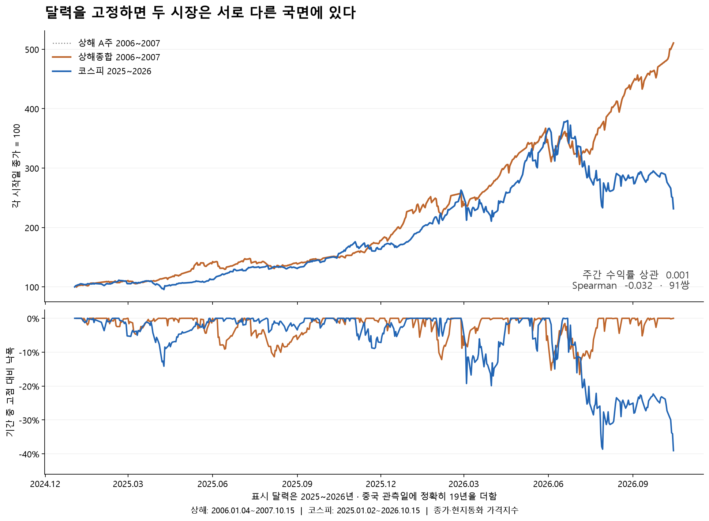
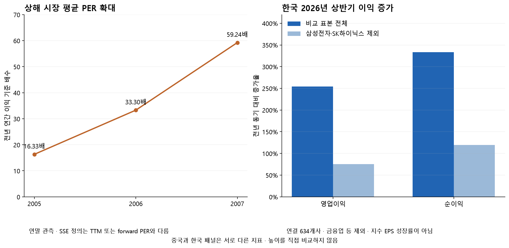
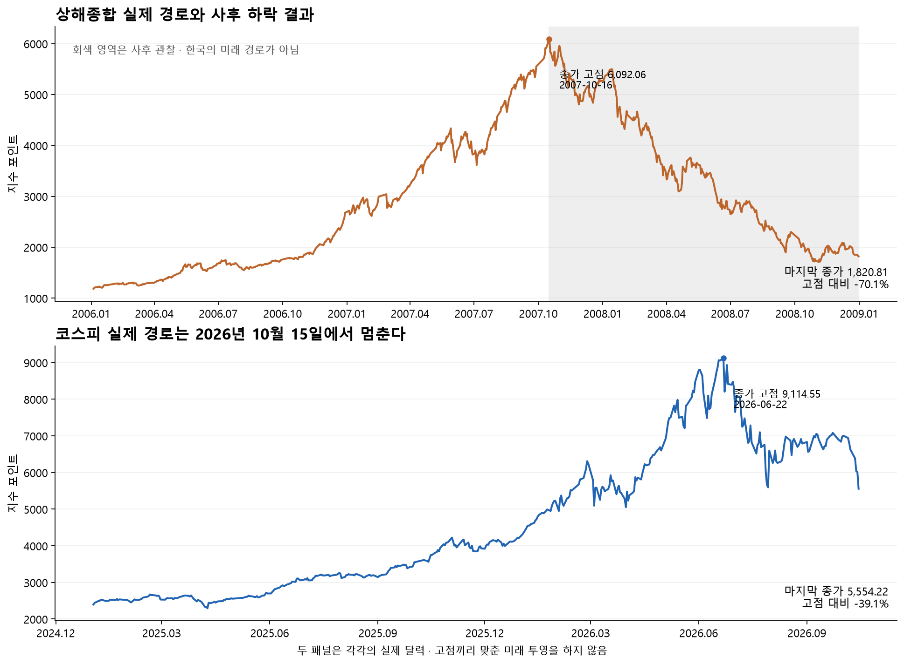
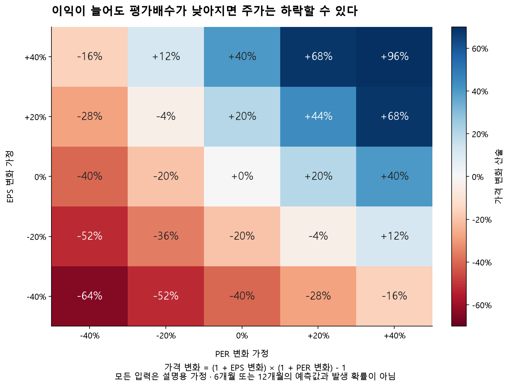

# 2007년 상해와 2026년 코스피의 상승 구조와 하락 위험

기준 시점은 **2026년 10월 16일 오전 9시 KST**, 한국 가격 기준은 **10월 15일 확정 종가**다. 향후 위험 지평은 126거래일을 주된 기준으로, 252거래일을 보조 기준으로 삼는다.

**두 상승장은 실제 이익 증가에 국가 성장 서사와 개인 참여가 더해졌다는 점에서 부분적으로 유사하다. 그러나 같은 가격 경로가 반복된다는 증거는 약하다.** 날짜를 19년 차이로 고정한 주간 수익률 상관은 0.00089이며, 코스피는 이미 6월 종가 고점에서 39.06% 하락했다. 지금의 판단 대상은 최초 고점의 도래보다, 이익 전망과 자금조달 여건이 이 조정을 회복으로 바꿀 수 있는지다.

2007년 상해는 실적 증가와 함께 평가배수 확대가 두드러졌고, 2026년 한국은 AI 메모리의 큰 이익과 소수 종목 집중에 민감하다. 정부의 시장 육성 정책은 양국 모두 존재하며, 중앙은행의 긴축·당국의 과열 억제도 병행됐다. **‘메가트렌드 수혜와 개인 열풍’은 유용한 관찰 틀이다. 다만 현재 근거로 정부 정책의 순효과나 상해와 같은 폭락 경로의 반복을 확정할 수는 없다.**

## 가설별 판정

| 가설 | 판정 | 판단 근거와 적용 범위 |
| --- | --- | --- |
| 중국 수출·산업이익과 한국 AI 메모리 실적이 크게 증가했다 | 확인 | 실적 증가가 각각 관측된다. 메가트렌드의 독립적인 인과효과까지 수치화한 것은 아니다. |
| 두 나라가 해당 메가트렌드의 세계 최대 수혜국이다 | 부분 확인 | 강한 수혜는 확인되지만, 전체 국가·산업의 이익 귀속을 같은 기준으로 순위화하지 못했다. |
| 중국과 한국의 해당 연도 이익성장률이 글로벌 1위다 | 미확인 | 한국의 당시 기관 자료에는 세계 최고라는 표현이 있으나, 두 시점의 동일 국가군·동일 정의 원자료로 재현한 순위는 없다. |
| 개인 참여와 레버리지가 상승·변동성을 증폭했다 | 부분 확인 | 중국 개인 거래·신규계좌와 한국 개인 ETF 매수·대출 확대가 확인된다. 정부 정책의 독립적인 인과효과는 측정하지 못했다. |
| 정부의 투자 유도 정책이 개인 열풍의 주원인이다 | 미확인 | 시장 육성과 국내투자 유도는 확인되지만 순효과는 미산출이다. 금융긴축·투자자 보호도 병행됐다. |
| 비슷한 차트가 앞으로 같은 폭락 경로를 예고한다 | 미확인 | 사전에 고정한 수익률 비교에서 뚜렷한 동조성이 없고, 독립 사례도 두 개뿐이다. |

정책의 존재와 투자 행동의 원인 귀속은 별도의 판단이다. 중앙은행의 긴축이 정부의 국내투자 유도 정책 자체를 부정하지도 않는다.

## 가격을 같은 기준으로 비교한 결과

| 측정 항목 | 상해종합 | 코스피 |
| --- | --- | --- |
| 관측 기간 | 2006-01-04 ~ 2007-10-15 | 2025-01-02 ~ 2026-10-15 |
| 첫 종가 → 마지막 종가 | 1,180.96 → 6,030.09 | 2,398.94 → 5,554.22 |
| 현지통화 가격 상승률 | +410.61% | +131.53% |
| 기간 내 최대낙폭 | -16.59% | -39.06% |
| 마지막 종가의 기간 고점 대비 낙폭 | +0.00% | -39.06% |
| 일별 로그수익률 연율 변동성 | +28.53% | +43.69% |
| 실제 종가 관측 수 | 429 | 433 |

첫 거래일과 통화 단위가 서로 다르므로 원래 지수 포인트의 크기는 비교하지 않는다. 차트는 첫 종가를 각각 100으로 놓고 중국 날짜에 정확히 19년을 더했다. 두 시장의 휴장일은 그대로 두며 보간·시간축 최적화를 하지 않았다.

### 수익률의 리듬은 비슷한가

| 고정한 비교 방법 | 수익률 쌍 | Pearson | Spearman |
| --- | --- | --- | --- |
| 주간 · 달력 19년 고정 | 91 | 0.00089 | -0.03227 |
| 직전 252거래일 · 거래일 나이 고정 | 252 | -0.04850 | -0.01448 |
| 직전 504거래일 · 거래일 나이 고정 | 504 | -0.04050 | 0.01563 |
| 월간 · 중국 시작 2005-10-01 | 23 | -0.03294 | 0.04447 |
| 월간 · 중국 시작 2006-01-01 | 20 | -0.06977 | 0.02556 |
| 월간 · 중국 시작 2006-04-01 | 17 | -0.11231 | -0.08578 |

이 표의 범위에서는 뚜렷한 양의 수익률 동조성이 확인되지 않는다. 이는 두 나라의 경제 구조가 무관하다는 뜻이나 가능한 모든 시차의 유사성을 부정하는 검정은 아니다. 다만 첨부 차트에서 선택한 박스와 굴곡을 근거로 향후 날짜·가격을 옮겨 붙이는 방법을 지지하지는 않는다. 비교창과 지수를 바꿔도 결과가 대체로 0 부근에 머문다. 상해 A주지수로 바꾼 보조 결과도 계산 자료에 함께 보존했다.

주간 표는 주별 마지막 실제 종가로 계산하며 동일 달력 종료점의 마지막 불완전 주를 포함한다. 월간 표는 미완료인 2026년 10월을 제외한다. 252·504거래일 표는 각각 253·505개 실제 종가를 확보한 뒤 거래일 나이로 짝지었다. 거래일 수가 많아도 독립적인 버블 사례가 많아지는 것은 아니므로 유의확률이나 붕괴 확률을 붙이지 않았다.

### 첨부 차트의 고점을 구분해야 한다

상해거래소가 기록한 2007년 10월 16일 **장중 고점**은 상해종합 6,124.04, 상해 A주 6,429.68이다. **종가 고점**은 각각 6,092.06과 6,395.76이다. 첨부의 약 6,429 표시는 A주 장중 지수와 정합적이지만, 화면의 공급자 기호까지 인증한 것은 아니다. 한국 첨부의 장중 고점도 실제 일별 종가 고점 9,114.55와 구분한다. 이번 낙폭은 일관되게 종가끼리 계산했다. [상해거래소 원표](https://www.sse.com.cn/aboutus/publication/yearly/documents/c/10061086/files/c6db3f91030b4533ad5bd85cb421b18e.pdf)

| 기간 | 현지통화 가격수익률 | USD 환산 가격수익률 |
| --- | --- | --- |
| 중국 2006.01.04 ~ 2007.10.15 | +410.61% | +448.11% |
| 한국 2025.01.02 ~ 2026.10.15 | +131.53% | +154.72% |

USD 환산은 같은 날짜의 현지통화 지수와 달러당 현지통화 환율을 사용했다. 환율의 종가 시각은 제공되지 않아 아시아 주식 종가와 동시 가격임을 확인할 수 없다. 따라서 일중 동시 가격이나 과거 시점의 실행 가능한 신호로 해석하지 않는다. 배당은 포함하지 않았다.

MSCI World는 동일 날짜의 공개 조회본이 서로 다른 종가를 보여 상대수익률 산출에서 제외했다. 원문·충돌 값·제외 사유를 보존했고, 세계지수 대비 숫자는 `null`로 남겼다. 따라서 위 표는 국가 간 세계 순위를 증명하지 않는다.

## 이익 성장과 지수 노출의 공통점과 차이

### 중국은 세계 공장 성장과 주식시장 개혁이 겹쳤다

중국의 2007년 수출은 25.7% 증가했고, 일정 규모 이상 산업기업의 1~11월 이익은 36.7% 늘었다. 이 수치는 2008년 발표된 사후 실적이다. 세계 공장화는 2007년에 갑자기 시작한 사건보다 WTO 가입 이후 누적된 수출·투자 확대 과정으로 보는 편이 정확하다. 당시 중국은 상품수출 세계 2위였으며, 수출 순위와 상장기업 이익성장률 순위는 다른 지표다. [중국 국가통계국 당시 발표](https://www.stats.gov.cn/english/NewsEvents/200802/t20080228_25995.html), [WTO 무역 검토](https://www.wto.org/english/news_e/pres08_e/pr520_e.htm)

SSE의 2007년 상장사 실적 증가율 47.5%는 2008년 6월 2일 발표된 요약이다. 새 회계기준, 대형 신규상장과 표본 변화를 확인해야 하며, 이를 2007년 고점 직전에 알려져 있던 예상 EPS로 대체할 수 없다. [SSE 실적 요약](https://www.sse.com.cn/aboutus/mediacenter/hotandd/c/c_20150912_3988204.shtml)

또한 2007년 말 상위 10개사의 시가총액 비중은 51.87%였고, 대형 금융·에너지 국유기업이 중심이었다. ‘중국 제조수출 호황’과 ‘상해지수 이익의 직접 수혜’는 부분적으로만 겹친다. 연말 비중은 고점 당시 비중이나 실제 상승 기여도가 아니다. [SSE 연감 상위 종목 표](https://www.sse.com.cn/aboutus/publication/yearly/documents/c/10061086/files/c6db3f91030b4533ad5bd85cb421b18e.pdf)

시장 평균 PER는 2005년 말 16.33배, 2006년 말 33.30배, 2007년 말 59.24배로 높아졌다. SSE의 이 분모는 **전년 연간 이익**이며 TTM이나 예상 PER가 아니다. 평가배수 확대의 방향은 관찰되지만, 이를 다른 정의의 한국 예상 PER와 단순히 나눠 상대 과열도를 계산하지 않았다. 동일 지수의 일관된 EPS·PER 양 끝점 시계열이 없어 정확한 이익 대 배수 기여 분해는 미산출했다. [SSE 연감 지표 정의와 시장개황](https://www.sse.com.cn/aboutus/publication/yearly/documents/c/10061086/files/c6db3f91030b4533ad5bd85cb421b18e.pdf)

### 한국은 메모리 이익이 중심이지만 다른 기업도 성장했다

KRX가 발표하고 한국금융연구원이 보관한 2026년 상반기 요약에서, 비교 가능한 비금융 연결 634개사의 영업이익은 254.15%, 순이익은 333.30% 증가했다. 삼성전자·SK하이닉스를 제외해도 각각 75.61%, 119.68% 증가했다. 따라서 이익 확대 전체를 두 회사만의 착시라고 볼 수는 없다. 다만 두 회사 제외가 반도체 지주회사·공급망 전체를 제거한 산업 중립 표본은 아니다. [KRX 실적 요약 보관본](https://www.kif.re.kr/KIF/Publication/OthersDetail.aspx?ControlNo=366316&NodeID=402)

기업 공시와 보도된 총액을 조합하면 두 회사는 비교 표본 영업이익의 약 63.1%, 이익 증가분의 약 77.9%를 차지하는 것으로 계산된다. **시장 총액의 공식 PDF를 확보하지 못해 이 비중은 2차 총액을 포함한 조건부 참고치**다. 공식 성장률과 기업 공시를 사용한 역산값은 비슷하지만 원문 총액 인증을 대신하지 않는다. 회사별 금액과 식은 `korea/evidence.json`에 남겼고, 지수 수익 기여도라고 부르지 않는다.

SK하이닉스는 2분기 실적 발표에서 AI 인프라와 고부가 메모리 수요를 실적 요인으로 설명했다. 이익의 직접 연결은 강하지만, AI 산업 전체의 이익을 한국이 가장 많이 가져간다는 순위와는 구분해야 한다. 미국의 플랫폼·GPU와 대만의 파운드리도 별도 수혜 경로를 가진다. [SK하이닉스 실적 발표](https://news.skhynix.com/en/q2-2026-business-results/)

MSCI 한국 지수의 9월 말 비중은 삼성전자 보통주 35.31%, SK하이닉스 27.58%, 삼성전자 우선주 4.40%였다. 보통주 두 회사만 합쳐 **62.89%**, 우선주까지 포함하면 **67.29%**다. 상위 10개 비중은 78.77%다. 이는 KOSPI와 다른 74종목 지수의 집중도이며 가격 상승 기여도는 아니다. 한국이 AI 수혜를 크게 받는 동시에 메모리 전망 변화에 민감한 이유를 보여준다. [MSCI 공식 팩트시트](https://www.msci.com/documents/10199/255599/msci-korea-index.pdf)

같은 자료의 예상 PER는 4.95배, 후행 PER는 10.25배다. 예상 이익이 크게 늘어 분모가 높아지면 예상 PER는 낮아진다. 낮은 예상 PER가 기업이익의 지속성을 보장하지는 않으며, 반대로 실적의 지속성이 확인되면 상해의 고배수 확장과 다른 회복 경로도 가능하다. 중국의 전년 이익 PER와 직접 비교하는 과열 점수는 만들지 않았다.

### 세계 이익성장률 1위는 어디까지 확인되는가

2026년 1월 Eastspring은 LSEG·IBES 자료를 토대로 한국의 12개월 선행 이익성장률 41%를 세계 최고 수준으로 설명했다. 5월 Goldman Sachs는 한국의 연간 이익 증가를 300%로 전망하며 아시아에서 이례적인 수준으로 평가했다. 이들은 **해당 시점 기관의 전망**이며 서로 기간·정의·작성 시점이 다르다. 5월의 코스피 목표치도 이번 연구의 현재 목표가로 채택하지 않았다. [Eastspring 1월 자료](https://www.eastspring.com/docs/librariesprovider6/cio-views-documents/weekly/2026/cio-views-january-week-2.pdf), [Goldman Sachs 5월 원문](https://www.goldmansachs.com/insights/articles/koreas-stock-market-is-forecast-to-set-fresh-highs)

9월 MSCI ACWI의 비교 목표 범위는 선진 23개국과 신흥 24개국, 총 47개국이다. 그러나 두 시점의 전체 국가별 동일 정의 EPS 성장률 원자료와 2007년 당시 국가 구성은 확보하지 못했다. 한국의 강한 성장과 당시 ‘세계 최고’라는 평가까지는 확인되지만, **2007년 중국과 2026년 한국이 모두 같은 기준으로 글로벌 1위였다는 명제는 미확인**이다. 2026년 연간 확정 실적도 아직 없다. [ACWI 국가 범위](https://www.msci.com/documents/10199/255599/msci-acwi.pdf)

## 정부 정책과 개인 열풍은 어떻게 연결됐는가

### 중국은 개인 거래 확대와 과열 억제가 동시에 나타났다

2007년 SSE 자연인의 거래 비중은 86.01%, 연간 순매수는 2,854.45억 위안이었다. 자연인 신규 A주 계좌는 2006년 150.5만에서 2007년 1,867.4만으로 늘었다. 개인의 강한 참여는 확인되지만 계좌 수를 고유 인원이나 전국민 참여율로 해석해서는 안 된다. 당시 계좌 정비와 통계 범위도 함께 봐야 한다. [SSE 투자자 상세 표](https://www.sse.com.cn/aboutus/publication/yearly/documents/c/10061086/files/c6db3f91030b4533ad5bd85cb421b18e.pdf)

비유통주 개혁은 주주 권리와 주식 공급의 불확실성을 바꾸는 구조개혁이었다. 이후 유통물량 증가와 자금조달 확대는 수급의 반대편에도 작용했다. SSE A주 자금조달액은 2006년 1,713.51억 위안에서 2007년 6,701.33억 위안으로 늘었다. 이 전체를 IPO 금액이라고 부를 수는 없다. [SSE 시장개황](https://www.sse.com.cn/aboutus/publication/yearly/documents/c/10061086/files/c6db3f91030b4533ad5bd85cb421b18e.pdf)

중국 당국은 2007년 중 금리를 6차례, 지급준비율을 10차례 인상했고, 5월 30일에는 주식 거래 인지세를 거래 양측 각각 3‰로 올렸다. 고점 직후인 10월 18일 CSRC는 신규·소액 투자자의 위험 인식을 강조했다. 시장 육성과 모든 시점의 매수 독려는 같은 정책이 아니다. [PBOC 2007년 4분기 보고서](https://www.pbc.gov.cn/eportal/fileDir/history_file/files/att_20306_1.pdf), [거래세 공고](https://www.mofcom.gov.cn/zcfb/zgdwjjmywg/art/2007/art_99829a5529ff4223a7bf6ca48ffc4b24.html), [CSRC 위험교육 공문](https://www.csrc.gov.cn/csrc/c100028/c1002860/content.shtml)

### 한국은 ETF 참여가 컸고 조정 과정에서 차입도 줄었다

한국은행 보고서상 상반기 개인의 국내주식형 ETF 순매수는 42.8조원이었다. 개인의 증권사 주식 관련 대출은 2025년 말 52.3조원에서 2026년 6월 말 63.2조원으로 늘었다가 7월 말 56.0조원으로 줄었다. 8월 말 신용융자는 33.3조원으로 6월 말보다 10.9% 감소했다. **상승기에 차입 참여가 늘고 하락기에 일부 축소된 과정**이 확인된다. 주식 관련 대출과 신용융자는 포함 범위가 다르므로 한 시계열처럼 이어 붙이지 않았다. [한국은행 보고서 PDF 58~60쪽](https://www.bok.or.kr/fileSrc/portal/3d42a054e8ac48a4a7cc9f47d9b2342c/1/53fb38ced4a840c4a78ac1fe46b6bdb0.pdf)

10월 14일로 표시된 KOFIA 공개 통계 카드의 예탁금은 약 97.43조원, 신용융자는 약 33.71조원이다. 카드에 연도가 없어 현재 조회 맥락에서 2026년으로 조건부 귀속했고, 이 값으로 과거 순유입이나 정책 효과를 계산하지 않았다. 예탁금은 미래 매수 예정액이 아니며, 개인 ETF 매수와 ETF의 현물 매수를 신규자금으로 이중 합산하지 않았다. [금융투자협회 공개 통계](https://freesis.kofia.or.kr/index.jsp)

정부는 국내투자 유도 세제 방안과 국민참여성장펀드를 추진했다. 1차 펀드는 5월 29일 집계 기준 6,000억원을 모집해 30,258명이 가입했다. 이는 해당 상품의 참여 열기를 보여주지만 전체 국민의 코스피 순매수를 뜻하지 않는다. 150조원은 국민성장펀드의 5년 계획 규모이며 1차 개인 모집액과 다르다. 펀드의 ‘주목적 투자로 인정되는 코스피 투자 10% 이내’ 조건도 자유투자 부분을 포함한 총 보유 한도와 혼동하지 않는다. [금융위 설계](https://www.fsc.go.kr/no010101/86834?curPage=2), [판매 결과](https://www.fsc.go.kr/po010101/87009)

10월 15일 금융위 설명자료는 2차 펀드의 판매가 차분하게 진행되고 있으며, 가입 대상과 우선 배정 조건이 달라 1차와 단순 비교하기 어렵다고 밝혔다. 금융위가 빠른 판매를 지시했다는 보도도 부인했다. 당국 설명만으로 국민 전체의 투자 심리를 판정할 수는 없지만, **5월의 참여 열기가 10월까지 같은 강도로 지속됐다는 가정은 약해진다.** [금융위 10월 15일 설명자료](https://www.fsc.go.kr/no010102/87936)

한국은행은 7월과 8월 기준금리를 각각 2.75%, 3.00%로 올렸다. 주식시장 제도 개선과 금융 여건 완화를 하나로 묶을 수 없다는 뜻이다. [한국은행 금리 이력](https://www.bok.or.kr/portal/singl/baseRate/progress.do?dataSeCd=01&menuNo=200643)

### 정책 전후 가격을 보면 선반영과 동시 사건이 중요하다

| 사건일과 내용 | 분류 | 전 20거래일 | 후 20거래일 |
| --- | --- | --- | --- |
| 2007-05-30 증권거래 인지세 인상 시행 | 과열 억제 | +16.51% | -8.34% |
| 2026-01-20 RIA 국내투자 세제지원 추진 발표 | 국내투자 유도 추진안 | +20.91% | +15.75% |
| 2026-05-06 국민참여성장펀드 설계 발표 | 산업자금 및 참여 유도 | +29.01% | +24.54% |
| 2026-05-29 1차 국민참여성장펀드 판매 결과 발표 | 참여 결과 공표 | +23.74% | +2.76% |
| 2026-07-16 한국은행 기준금리 인상 | 통화 긴축 | -17.82% | -6.47% |
| 2026-08-27 한국은행 기준금리 인상 | 통화 긴축 | +13.02% | +4.01% |

전 20거래일은 사건 직전 종가까지의 20개 수익률, 후 20거래일은 직전 종가부터 사건일을 포함한 20개 수익률이다. 발표 시각은 확정하지 못해 날짜 기준의 기술적 비교로 한정했다. 원자료에서 정확한 시작·끝 날짜를 확인할 수 있다.

국내투자 유도·펀드 발표 전에도 이미 큰 상승이 진행됐다. 금리 인상 이후에도 가격이 같은 방향으로 움직이지 않았다. 이 관찰은 정책이 무효였다는 뜻이 아니라, 실적·전쟁·환율·외국인 수급이 겹친 상태에서 단일 정책 효과를 가격 변화 전체로 설명할 수 없다는 뜻이다. 일별 개인 수급의 비교 가능한 원자료와 신뢰할 수 있는 세계지수 통제를 확보하지 못해 정책의 순효과는 미산출했다.

## 고점과 하락 전환은 같은 과정인가

중국의 비교 종료일인 2007년 10월 15일은 종가 고점 하루 전이었다. 반면 한국의 2026년 10월 15일은 이미 종가 고점 이후 약 4개월이 지난 시점이다. 같은 연도 위치가 같은 시장 국면을 뜻하지 않는다. ‘고점 전 상해’와 ‘고점 후 코스피’를 같은 출발 상태로 놓으면 남은 하락 폭을 왜곡하기 쉽다.

2007~2008년 중국의 관측 최대낙폭은 종가 기준 71.98%였으며, 고점은 2007-10-16, 저점은 2008-11-04다. 이는 금융긴축·증권 공급·세계 금융위기가 겹친 **사후 결과**다. 메가트렌드와 개인 열기 두 요소만으로 이 낙폭을 설명할 수 없다. [SSE 2009 연감](https://www.sse.com.cn/aboutus/publication/yearly/documents/c/10061085/files/10093621bdad44b2aaf7fc39c85c9256.pdf), [BIS 당시 금융위기 전개 설명](https://www.bis.org/publications/78th-annual-report-200708-overview)

현재 한국의 낙폭 문턱을 처음 하회한 중국 날짜를 사후 진단용으로만 확인하면 2008-03-18다. 중국 낙폭은 직전 거래일 -37.29%에서 당일 -39.78%로 내려갔다. 정확히 같은 낙폭으로 맞춘 것이 아니다. 그 종가 3,668.90 이후 126거래일 수익률은 -47.42%였다. **이미 크게 하락해도 추가 손실이 가능했다는 한 사례**이지, 한국의 향후 6개월 수익률이나 발생 확률이 아니다. 이 진단은 현재 한국의 관측 낙폭을 보고 고른 조건부 비교이고, 글로벌 금융위기 충격도 포함한다. 중국 자료가 2008년 말에서 끝나 252거래일 후 결과는 관측 196일로 부족하며 `null`로 처리했다.

반대로 한국에는 상해와 다른 경로를 지지하는 근거도 있다. 실제 이익이 두 회사 밖에서도 증가했고, 낮은 예상 배수는 이익이 유지될 경우 회복의 여지를 제공한다. 차입 일부가 이미 축소돼 상승기와 같은 포지션이 그대로 남아 있는 것도 아니다. 이 근거들은 회복의 보장이 아니라, 중국의 과거 하락을 기계적으로 복제하지 않아야 하는 이유다.

## 향후 6개월과 12개월의 판단 조건

현재 근거만으로 세 경로의 확률이나 기대수익률을 정할 수는 없다. 다만 **집중 위험이 큰 조정 국면이며, 다음 판단의 핵심은 메모리 이익 전망의 지속성과 차입·외국인 수급의 안정**이라는 해석은 가능하다. 한국은행도 업황 기대 변화가 가장 큰 요인이며 레버리지는 변동성을 증폭했다고 설명했다. [공식 설명회](https://www.bok.or.kr/portal/bbs/B0000170/view.do?menuNo=201297&nttId=11064638)

| 경로 | 현재 지지 근거 | 126거래일에 확인할 조건 | 252거래일에 확인할 조건 | 이 해석을 약화하는 관측 |
| --- | --- | --- | --- | --- |
| 회복과 재상승 | 실제 이익 증가, 두 회사 제외 실적 성장, 예상 저배수, 일부 차입 축소 | 메모리 가격·출하·이익 추정치 유지, 외국인 매도 완화, 상승 업종 확산 | AI 지출이 실제 매출·현금흐름으로 이어지고 공급 증가에도 이익률 유지 | 이익 전망의 연속 하향, 반등이 두 종목에만 집중, 신용 청산 재확대 |
| 횡보와 평가배수 조정 | 이익 증가와 가격 하락의 공존 가능성, 업종 집중 | EPS 상향이 둔화하더라도 확정 실적이 이를 지지하고 자금조달 악화가 제한 | 예상 이익을 실제 이익이 따라가며 PER 축소 압력이 안정 | 이익이 광범위하게 재상향되거나 반대로 수요·마진이 급격히 악화 |
| 추가 급락 | 큰 낙폭·고변동성, 메모리 민감도, 잔존 차입과 외부 충격 노출 | EPS 하향과 PER 축소·외국인 매도·차입 청산의 동반 발생 | AI 투자 수익화 약화, 공급 확대로 이익 정상화, 높은 자금조달 부담 지속 | 주문·계약·현금흐름이 전망을 지지하고 시장 폭·수급이 함께 개선 |

이익 추정치의 증가율만 보지 말고 **추정치 수준이 계속 올라가는지**와 **실제 이익이 그 수준을 따라가는지**를 함께 확인해야 한다. 성장률 둔화는 높은 기저 때문에 생길 수 있고, 높은 성장률이 남아 있어도 추정치 하향이 주가를 압박할 수 있다. 한국 기업 실적·MSCI 추정치·KRX 실적 표본의 정의를 유지한 상태에서 각각 비교해야 한다.

### 추가 20% 하락은 무엇을 뜻하는가

10월 15일 종가 5,554.22에서 추가 20% 하락하는 기준선은 **4,443.38**다. 이는 목표가가 아니라 요청한 손실 사건의 산술 기준이다. 이 경우 기존 종가 고점 대비 낙폭은 51.25%가 된다. 현재에서 종가 고점을 회복하려면 64.10% 상승해야 한다.

기간 내 최대낙폭은 기준일 이후 새로 형성된 고점도 포함한다. 예를 들어 100에서 150으로 오른 뒤 100으로 돌아오면 기준일 대비 손실은 0%지만 최대낙폭은 33.3%다. 두 사건을 같은 확률이나 손실률로 취급하지 않는다.

동일 정의의 양의 EPS와 PER에서 가격 변화는 `(1+EPS 변화)×(1+PER 변화)-1`이다. EPS가 20% 늘고 PER가 30% 낮아지면 가격은 16% 하락한다. 두 변화를 단순히 더하면 안 된다.

| EPS 변화 가정 | 현재 대비 20% 하락에 해당하는 PER 변화 |
| --- | --- |
| -20% | +0.00% |
| -10% | -11.11% |
| +0% | -20.00% |
| +10% | -27.27% |
| +20% | -33.33% |
| +40% | -42.86% |

위 표와 그림의 입력은 설명용 가정이다. 각 칸은 6개월·12개월의 예상치, 관측 빈도, 신뢰구간이나 확률이 아니다. 실제로 어느 칸에 가까워질지는 이익과 할인율의 새 정보에 달려 있다.

## 데이터 범위와 검증

중국은 공식 SSE 연감에서 2005~2008년 두 지수의 종가 1,942행을 추출했다. Yahoo 보조 자료와 전수 비교한 최대 차이는 0.01포인트로, 원자료의 반올림을 고려한 0.011포인트 허용차를 넘은 행은 없었다. 한국은 보존한 일별 과거가격 표를 사용하고, 하루 늦은 Yahoo 관측에 없는 10월 15일 종가는 날짜가 있는 보도·역사 표와 KOFIA 자료로 대조해 별도 출처로 추가했다. 당일 장중 값을 종가에 섞지 않았다.

주요 미산출 항목은 전체 국가군의 같은 시점 EPS 순위, 동일 정의 EPS·PER의 정확한 상승 기여 분해, 일별 구성종목에 기반한 업종 수익 기여도, 정책의 개인 순매수 인과효과, 세계지수 대비 수익률이다. 집중도·총이익·가격 변화로 이 항목들을 대신 채우지 않았다.

2008년 연감과 사후 확정 실적은 당시의 결과를 설명하는 자료다. 2007년 당시 이미 공개된 정보처럼 사용하지 않았다. 현재 내려받은 문서도 원래 게시 시각과 수정 빈티지를 모두 인증한 것은 아니므로, 이 결과는 과거 시점의 실행 가능한 예측모델 검증이 아니다. 원문이 막혔거나 일부만 보존된 경우도 출처 기록에 남겼다.

### 재현과 감사 파일

- `prices/prices.csv`, `prices/analytics.json`, `prices/chart_ready.csv`: 정본 가격과 고정 정렬 계산.
- `china/evidence.json`, `korea/evidence.json`, `context/evidence.json`: 주장·원단위·변환·발표일·빈티지 한계.
- 각 하위 폴더의 `source_manifest.json`: 원문 URL·수집 시각·SHA256·접근 실패와 교차검증.
- `supporting_analysis.json`, `policy_windows.csv`, `valuation_sensitivity.csv`: 정책창·조건부 역사 진단·가정 산술.
- `validation.json`, `independent_review.json`: 계산·원문·원본 보호와 독립 검토 결과.

재현 명령은 이 연구 폴더에서 `python -X utf8 prices/consolidate.py --offline`, `python -X utf8 prices/analytics.py`, `python -X utf8 build_supporting_analysis.py`, `python -X utf8 render_charts.py`, `python -X utf8 build_report.py` 순서다. `python -X utf8 -m unittest discover -p 'test_*.py' -v`로 연구 검증을 실행한다. 의존성 추가·업그레이드가 필요하지 않은 기존 환경에서 작성했다.

연구 산출물은 이 폴더 안에만 저장했다. 공식 전망·확률·원장·기존 모델·공개 API에는 연결하지 않았다. 연구가 제공하는 것은 현재 가설의 근거와 반증 조건이며, 붕괴 확률이나 매매 신호가 아니다.
